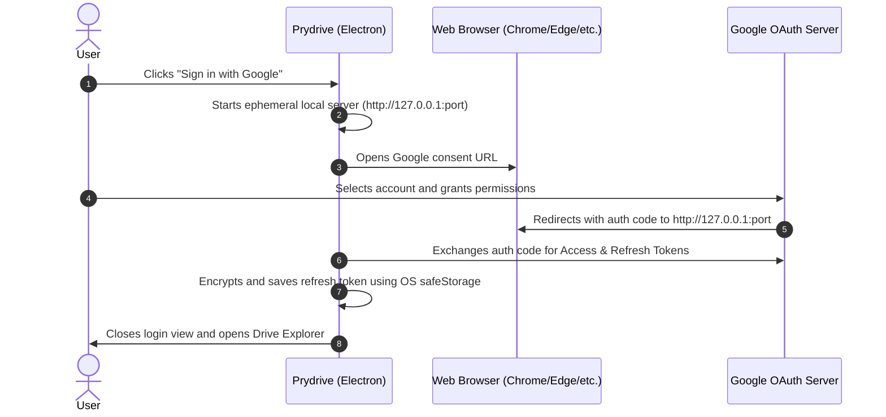

# AGENTS.md - Prydrive

Reference documentation, architecture, rules, and standards for AI agents and human developers operating within the **Prydrive** project.

---

## 1. Project Description

**Prydrive** is a modern, fast, and visual desktop application for comprehensive file and folder management on **Google Drive**. It allows users to explore cloud folders, list contents, upload files via native drag & drop, download files using efficient streams, edit metadata, and manage assets through an intuitive graphical user interface (GUI), eliminating the daily need to interact with a web browser.

### Key Objectives
- **Fluid Desktop Experience**: Modern graphical user interface (GUI) featuring grid and list views, file thumbnails, breadcrumb navigation, and native Drag & Drop support.
- **Direct 1-Click Access with Google**: Authentication exclusively via **"Sign in with Google" (OAuth 2.0 Desktop)** with zero requirement to type passwords inside the app or manage JSON credential files.
- **High Performance & Streaming**: Bulk uploads and downloads using native Node.js streams, real-time progress indicators, and minimal memory (RAM) footprint.
- **Electron Security**: Strict process isolation (`contextIsolation: true`, `nodeIntegration: false`), on-disk token encryption via the OS keychain (`safeStorage` / DPAPI / Keychain), and a strongly typed IPC layer exposed via `preload`.
- **Spec-Driven Development (SDD)**: Rigorous development workflow governed by agent skills and cross-session context persistence in `MEMORY.md`.

---

## 2. Authentication and Connection (OAuth 2.0 Desktop)

The application relies **exclusively on official Google Sign-In** implementing the **OAuth 2.0 for Desktop Applications standard (RFC 8252 / Loopback IP flow)**.



### Access Flow Characteristics
1. **Single initial click**: The user clicks the official button: **`"Sign in with Google"`**.
2. **Native browser launch**: The app delegates the sign-in flow to the user's secure default system browser (Google strictly forbids embedded WebViews for OAuth).
3. **Silent persistence**: The `refresh_token` is stored securely and encrypted on the user's machine (`safeStorage`). In all subsequent application launches, the app silently renews the session in the background without user interaction.
4. **Secure sign-out**: Dedicated interface option to revoke tokens with Google and wipe local credentials.

### Costs and Scalability
- **100% Free ($0 Cost)**: Google Drive API and OAuth 2.0 are free. Neither authentication nor file operations incur costs for the developer or users.
- **Storage Provided by User**: Each user utilizes the free 15 GB or Google One / Workspace storage of their own account. The app does not store any user files on intermediary servers.
- **API Quotas**:
  - Global project limit: **12,000 queries per minute (QPM)**.
  - Per-user limit: **2,400 queries per minute per user**.
  - If the user base grows significantly, project quota increases can be requested for free in Google Cloud Console.
- **Google Verification (OAuth Consent Screen)**:
  - In *Testing Mode*, supports up to 100 designated test users.
  - For public production distribution without the *"Unverified app"* warning banner, a public privacy policy page must be published, followed by submitting a free verification request for the `drive` scope to Google.

---

## 3. Technology Stack and Project Structure

### Tech Stack
- **Desktop Framework**: [Electron](https://www.electronjs.org/) (v30+).
- **Language**: [TypeScript](https://www.typescriptlang.org/) in strict mode (Main, Preload, and Renderer).
- **Bundler & Tooling**: [Vite](https://vitejs.dev/) + [electron-vite](https://electron-vite.org/) for fast Hot Module Replacement (HMR).
- **Frontend / Renderer**:
  - [React](https://react.dev/) (v18+) with Functional Components and Hooks.
  - [Tailwind CSS](https://tailwindcss.com/) for modern styling and light/dark theme support.
  - [Lucide Icons](https://lucide.dev/) for file explorer iconography.
  - [Radix UI](https://www.radix-ui.com/) for accessible dialogs, modals, and context menus.
- **Google Drive Client**: `googleapis` (`@googleapis/drive` v3) executed strictly within the *Main Process*.
- **Secure Storage**: `electron.safeStorage` for native OS-level token encryption.
- **Validation**: `zod` for validating schemas, environment variables, and API responses.

### Directory Structure

```text
Prydrive/
├── .agents/                      # Agent system skills and workflows
│   └── skills/                   # Available agent skills (SDD flow)
├── .env.example                  # Environment variables template (Client ID / Secret)
├── .gitignore                    # Strict rules to ignore secrets and build artifacts
├── AGENTS.md                     # This architecture and guidelines document
├── MEMORY.md                     # Persistent cross-session memory (~50 lines)
├── docs/                         # Governance and architectural documentation
│   └── constitution.md           # Non-negotiable project principles (SDD)
├── specs/                        # Feature specifications
│   └── NNN-feature-name/         # Per-feature directory (spec.md, plan.md, tasks.md)
├── package.json                  # Project dependencies and lifecycle scripts
├── tsconfig.json                 # Base TypeScript configuration
├── tsconfig.node.json            # TS configuration for Main and Preload processes
├── tsconfig.web.json             # TS configuration for Renderer process
├── electron.vite.config.ts       # Vite + Electron bundler configuration
├── src/
│   ├── main/                     # Electron Main Process (Node.js runtime)
│   │   ├── index.ts              # Window lifecycle management and Electron bootstrap
│   │   ├── ipc/                  # IPC event controllers (Main <-> Renderer communication)
│   │   │   ├── auth-ipc.ts       # Google login, logout, and session checks
│   │   │   ├── drive-ipc.ts      # List, upload, download, edit, and delete operations
│   │   │   └── dialogs-ipc.ts    # Native OS dialogs (open file, save as)
│   │   ├── core/
│   │   │   ├── oauth.ts          # Ephemeral local loopback server & token exchange
│   │   │   ├── token-storage.ts  # Token encryption and persistence with safeStorage
│   │   │   ├── drive-client.ts   # Authenticated Drive client singleton instance
│   │   │   └── mime-types.ts     # Workspace format to binary export mappings
│   │   └── operations/
│   │       ├── list.ts           # Paginated and cached folder listings
│   │       ├── upload.ts         # Multipart and Resumable streaming uploads with progress
│   │       ├── download.ts       # Streaming downloads directly to local disk
│   │       ├── edit.ts           # Rename, move, and update file metadata
│   │       └── delete.ts         # Move to trash or permanent deletion
│   ├── preload/                  # Security bridge between Main and Renderer
│   │   ├── index.ts              # Exposes window.api via contextBridge
│   │   └── index.d.ts            # Type definitions for window.api
│   ├── renderer/                 # Graphical User Interface (React + Tailwind)
│   │   ├── index.html            # Application window HTML template
│   │   ├── src/
│   │   │   ├── App.tsx           # Main application shell and view router (Auth / Explorer)
│   │   │   ├── main.tsx          # React application mount point
│   │   │   ├── components/
│   │   │   │   ├── auth/         # Welcome screen with "Sign in with Google" button
│   │   │   │   ├── layout/       # Sidebar, Header with user avatar, Breadcrumbs
│   │   │   │   ├── explorer/     # FileGrid, FileList, FileCard, ContextMenu
│   │   │   │   ├── transfer/     # Floating transfer drawer (uploads/downloads)
│   │   │   │   ├── modals/       # Confirmation, rename, and file detail modals
│   │   │   │   └── ui/           # Buttons, inputs, badges, progress bars
│   │   │   ├── hooks/            # useDrive, useAuth, useTransfers
│   │   │   └── store/            # Global application state management (Zustand)
│   └── shared/                   # Shared types and contracts (Main <-> Renderer)
│       ├── types.ts              # DriveItem, FileTransfer, UserProfile, AuthState
│       └── ipc-channels.ts       # Strongly typed IPC channel constants
└── out/ / dist/                  # Transpiled code and packaged application binaries
```

---

## 4. Coding Conventions and Architecture

1. **Strict Electron Security**:
   - `nodeIntegration: false` and `contextIsolation: true` across all `BrowserWindow` instances.
   - Prohibited to execute direct Google Drive API calls or local filesystem access from the *Renderer*.
   - All operations must communicate via `ipcRenderer.invoke` exposed through `window.api` in `preload/index.ts`.

2. **Credential Encryption**:
   - Authentication tokens must never be written in plain text to `localStorage` or unencrypted JSON files.
   - Use `electron.safeStorage` in the *Main Process* to encrypt tokens using operating system credentials.

3. **Strict IPC Contracts**:
   - Every IPC channel must have a typed entry in `src/shared/ipc-channels.ts` and explicit input/output interfaces in `src/shared/types.ts`.
   - Zero tolerance for `any` in IPC parameters and return types.

4. **Asynchronous Stream Management**:
   - **Downloads**: The *Main* process streams download data directly to disk (`fs.createWriteStream`) and reports transfer progress to the *Renderer* via events (`drive:download-progress`).
   - **Uploads**: Files larger than 5 MB must use *Resumable Uploads* with read streams (`fs.createReadStream`), emitting real-time progress events.

5. **Code Language (English Only)**:
   - **100% English in codebase**: All variable names, functions, classes, interfaces, types, filenames, constants, git branches, and commit messages must be in English.
   - **Comments exclusively in English**: All inline comments (`//`, `/* */`), JSDoc, and TSDoc annotations must be written in English.
   - The user-facing graphical interface (UI labels and texts) will follow the language specified in the feature spec (Spanish or multi-language/i18n).

---

## 5. Data, State, and Persistence

- **User Session**:
  - Upon authentication, user identity is retrieved (email, display name, avatar) to render in the header next to the sign-out action.
- **Navigation and Breadcrumbs**:
  - Navigation history is tracked in a stack (`FolderStack: Array<{ id: string, name: string }>`), enabling forward, back, and direct breadcrumb jumping.
  - Default root directory corresponds to `'root'`.
- **Persistent Local Settings**:
  - Saved within the app's `userData` directory:
    - Default download folder (defaults to the operating system's Downloads folder).
    - View preference (grid vs. list).
- **Product Backlog & Future Capabilities**:
  - **Settings Menu & Theme Management (Light/Dark Mode)**: A dedicated settings modal/drawer allowing users to customize preferences, including toggling between Light and Dark themes and persistent language preferences (deferred from Spec 001 to a dedicated future spec).
- **Google Workspace Files**:
  - Automatic detection of Google Docs, Sheets, and Slides by MIME type with conversion on download (Docs -> `.pdf`/`.docx`; Sheets -> `.xlsx`/`.csv`).

---

## 6. Way of Working and Methodology (SDD)

### Spec-Driven Development (SDD) Workflow
The project adopts **SDD** as its formal engineering methodology. Every new feature or architectural modification follows the pipeline:

$$\text{Constitution} \rightarrow \text{Spec} \rightarrow \text{Clarification} \rightarrow \text{Plan} \rightarrow \text{Tasks} \rightarrow \text{Implementation} \rightarrow \text{Validation} \rightarrow \text{Change}$$

1. **The Spec is the single source of truth**: No code is written unless specified in `specs/NNN-feature-name/spec.md`.
2. **Strict Implementation Cycle**: Test first (failing/red) $\rightarrow$ minimal code $\rightarrow$ suite passing (green) $\rightarrow$ mark task as completed in `tasks.md` and enumerate 1 or more test scenarios for that particular task. Each task delivers the complete vertical slice of exactly one User Story (`US-x`), respecting declared task dependencies.
3. **Change Control (`sdd-change`)**: Any new requirement updates the spec first, then the plan and tasks, and finally the codebase.

### Available Agent Skills (`.agents/skills/`)
| Skill | Typical Invocation | Purpose |
| :--- | :--- | :--- |
| `sdd` | `/sdd` | Main entry point for the Spec-Driven Development workflow. |
| `sdd-constitution` | `/sdd-constitution` | Proposes or updates non-negotiable principles in `docs/constitution.md`. |
| `sdd-spec` | `/sdd-spec NNN-name idea` | Interviews user and drafts functional specification with EARS requirements. |
| `sdd-clarify` | `/sdd-clarify NNN-name` | Reviews specification as a QA engineer to uncover ambiguities and edge cases. |
| `sdd-plan` | `/sdd-plan NNN-name` | Designs technical solution, interfaces, and architecture (`plan.md`). |
| `sdd-tasks` | `/sdd-tasks NNN-name` | Breaks down technical plan into tasks with 1-to-1 correspondence to User Stories and explicit dependencies (`tasks.md`). |
| `sdd-implement` | `/sdd-implement NNN-name Tn` | Implements a single task using strict TDD (test first), marking it complete and enumerating test scenarios. |
| `sdd-validate` | `/sdd-validate NNN-name` | Validates all functional requirements (FRs) via automated tests. |
| `sdd-change` | `/sdd-change NNN-name detail` | Applies requirement changes following the disciplined SDD lifecycle. |
| `sdd-status` | `/sdd-status NNN-name` | Reports current development phase and next action for a spec. |
| `git-commit-msg` | `/git-commit-msg [hints]` | Generates a Conventional Commit message based on current git status and diff. |
| `git-pr-msg` | `/git-pr-msg [base-branch]` | Generates a structured Pull Request title and description based on branch diff. |

### Application User Workflow
1. **Startup**: If no active session exists, displays the welcome screen with the official **`"Sign in with Google"`** button.
2. **Browser Login**: User clicks the button, the default system browser opens, user grants access, and returns to `Prydrive` authenticated.
3. **Visual Explorer**: Grid or list view, breadcrumb path bar, and native Drag & Drop support to upload files.
4. **Contextual Actions (Right Click)**: Download, Rename, Move, Delete, and View details.
5. **Transfers Drawer**: Collapsible bottom bar displaying active streaming uploads/downloads with live progress.

---

## 7. Memory and Context Persistence

The project operates with two clearly defined memory layers:

### A. Agent Operating Memory (`MEMORY.md`)
- **Purpose**: Key context persistence between development sessions for AI agents and human developers.
- **Length Constraint**: **Maximum ~50 lines**. Obsolete information must be pruned or summarized continuously.
- **Strict Structure**:
  - `## Current Status`: Concise summary of active phase, completed milestones, and immediate goals.
  - `## Decisions (and why)`: Log of critical technical or architectural choices and their rationale.
  - `## Learnings and errors to avoid`: Discovered pitfalls, workarounds for complex bugs, or library incompatibilities.
- **Mandatory Update**: Must be updated upon concluding every spec phase or when wrapping up a work session.

### B. Application Runtime Memory (App Cache)
- **Folder Cache with TTL**: The *Main* process caches Google Drive directory listings in memory for 60 seconds for instant navigation.
- **Reactive Invalidation**: Mutation operations (`upload`, `delete`, `edit`) immediately invalidate the affected folder cache.
- **Intelligent Pagination**: Folders with more than 100 items utilize `pageToken` for on-demand pagination.
- **Stream Cleanup**: Forced closure and release of file descriptors upon transfer cancellation or error.

---

## 8. Limits and Constraints

1. **Google Drive API Quotas**:
   - Respect the 12,000 queries per minute limit per project. Code must avoid aggressive polling loops.
2. **Secrets Security**:
   - **NEVER** log or commit OAuth tokens or `.env` files.
   - Tokens are stored exclusively in the OS encrypted storage (`safeStorage`).
3. **Permissions and Scopes**:
   - Use the official `https://www.googleapis.com/auth/drive` scope for complete read and write access to the user's Drive.

---

## 9. Verification and Testing

- **Connection Verification Command**:
  - `npm run verify:auth`: Auxiliary CLI script that checks stored refresh token validity, refreshes token against Google API, and prints authenticated identity and available quota.
- **Automated Tests**:
  - `npm test`: Runs unit tests (size formatting, MIME type mappings, file utilities).
  - Integration tests for IPC handlers using Google Drive API mocks.
- **Dry-Run Mode**:
  - Environment flag to simulate file transfers and deletions without modifying real data in Google Drive.

---

## 10. Project Commands

| Command | Description |
| :--- | :--- |
| `npm install` | Installs project dependencies. |
| `npm run dev` | Starts Electron and Vite with Hot Reload for both Main and Renderer. |
| `npm run build` | Compiles TypeScript and bundles the frontend with Vite. |
| `npm run build:win` | Generates Windows executable installer (`.exe`) via electron-builder. |
| `npm run verify:auth` | Validates stored token and tests Google Drive API connection without launching GUI. |
| `npm run typecheck` | Runs the TypeScript compiler without emitting files (`tsc --noEmit`). |
| `npm run lint` | Runs ESLint to verify code quality across Main and Renderer. |

---

## 11. Rules for AI Agents

Any AI agent modifying or extending this repository must strictly adhere to the following non-negotiable rules:

1. **Keep `MEMORY.md` updated**: Upon completing any task or milestone, update `MEMORY.md` respecting the ~50 line limit.
2. **Follow the SDD workflow**: Do not skip stages (Constitution $\rightarrow$ Spec $\rightarrow$ Plan $\rightarrow$ Tasks $\rightarrow$ Implementation). The spec rules: if something is not in the spec, it is not implemented. When in doubt, clarify first.
3. **Do not break Electron isolation**: Never enable `nodeIntegration: true` or import Node.js modules (`fs`, `child_process`, `googleapis`) directly from React components (`src/renderer`). All communication must go through the typed IPC bridge in `src/preload/`.
4. **Mandatory Token Encryption**: OAuth tokens must strictly be encrypted via `safeStorage` in the *Main* process. Never store them in plain text.
5. **Strict Modularity**: When adding new functionality, place core logic in `src/main/operations/`, expose its channel in `src/main/ipc/drive-ipc.ts`, and update the UI in `src/renderer/`.
6. **Strict Typing**: Every new IPC channel and data structure must be typed in `src/shared/`. Do not use `@ts-ignore` without explicit documented justification.
7. **English-only code and comments**: Variable, function, class, and type names, as well as commit messages and code comments, must always be written in English.
8. **Preserve documentation**: Keep `AGENTS.md` and `docs/constitution.md` updated when architecture or governance rules change.
