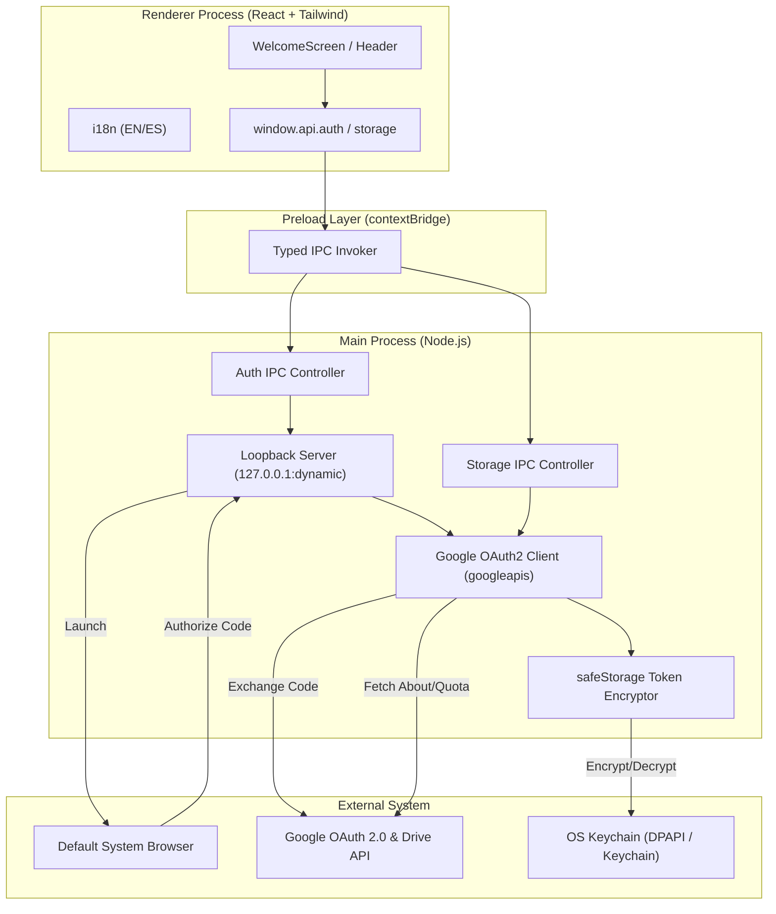
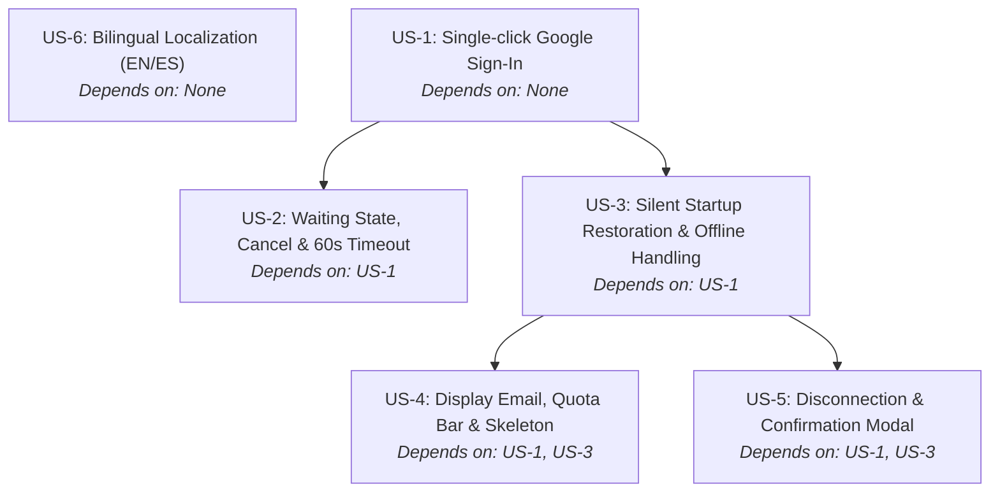

# Technical Plan: Spec 001 — Google Authentication Flow

## Architecture and Overview
This document specifies the technical design for the desktop Google authentication flow in Prydrive. The architecture strictly enforces Electron process isolation: the Main process handles OAuth 2.0 loopback server lifecycle, token encryption via `electron.safeStorage`, Google API interactions (`googleapis`), and persistent storage, while the Renderer process (React + Tailwind CSS) displays the interface and communicates exclusively through strongly typed IPC channels exposed in `preload`.



---

## 1. Files and Responsibilities

### Build & Tooling Setup
- `package.json`: Project manifest defining runtime dependencies (`googleapis`, `lucide-react`, `@radix-ui/react-dialog`, `zod`), dev dependencies (`electron`, `electron-vite`, `vite`, `vitest`, `typescript`, `tailwindcss`, `@types/react`), and npm scripts (`dev`, `build`, `test`, `typecheck`).
- `electron.vite.config.ts`: Configuration for `electron-vite` bundling Main, Preload, and Renderer.
- `tsconfig.json`, `tsconfig.node.json`, `tsconfig.web.json`: TypeScript configurations with `strict: true`.
- `vitest.config.ts`: Test runner configuration with jsdom for UI and node for Main.

### Shared Contracts (`src/shared/`)
- `src/shared/types.ts`: Strongly typed domain models: `AuthState`, `UserProfile`, `StorageQuota`, `AuthError`, `LanguageCode` ('en' | 'es'), and `IpcResult<T>`.
- `src/shared/ipc-channels.ts`: String constants for all IPC channels (`AUTH_LOGIN_INITIATE`, `AUTH_LOGIN_CANCEL`, `AUTH_GET_STATE`, `AUTH_RESTORE_SESSION`, `AUTH_DISCONNECT`, `STORAGE_GET_QUOTA`, `APP_SET_LANGUAGE`).

### Preload Bridge (`src/preload/`)
- `src/preload/index.ts`: Exposes `window.api` using `contextBridge.exposeInMainWorld` with strict typing.
- `src/preload/index.d.ts`: Global type definitions extending the `Window` interface.

### Main Process (`src/main/`)
- `src/main/index.ts`: Application lifecycle entry point, browser window creation (`contextIsolation: true`, `nodeIntegration: false`), safeStorage readiness check, and IPC handler registration.
- `src/main/core/token-storage.ts`: Handles encryption and persistence of OAuth refresh tokens using `electron.safeStorage` and atomic file write in `app.getPath('userData')/auth_session.enc`.
- `src/main/core/oauth-server.ts`: Ephemeral local HTTP loopback server (binds to `127.0.0.1` on dynamic ports with up to 3 retries), manages 60-second abort timer, and captures authorization code.
- `src/main/core/google-client.ts`: Wraps `googleapis.google.auth.OAuth2` client, manages token exchange, token refresh, and Drive v3 `about.get` quota calls.
- `src/main/ipc/auth-ipc.ts`: IPC handlers for initiating login, canceling waiting state, restoring background session, and disconnecting.
- `src/main/ipc/storage-ipc.ts`: IPC handler for retrieving user email and storage quota metrics.

### Renderer Process (`src/renderer/`)
- `src/renderer/index.html`: Base HTML template with UTF-8 encoding and viewport configuration.
- `src/renderer/src/main.tsx`: React DOM mount point.
- `src/renderer/src/App.tsx`: Root view orchestrator managing `authState`, current user, and error notifications.
- `src/renderer/src/i18n/translations.ts`: Pure dictionary mapping for English (default) and Spanish strings.
- `src/renderer/src/components/auth/WelcomeScreen.tsx`: Initial welcome screen rendering the "Sign in with Google" button (with debounce protection) and language toggle.
- `src/renderer/src/components/auth/AwaitingAuthModal.tsx`: Modal overlay indicating browser authorization in progress with animated loader, explanatory message, and "Cancel" button.
- `src/renderer/src/components/auth/DisconnectModal.tsx`: Confirmation dialog preventing accidental account disconnections.
- `src/renderer/src/components/layout/Header.tsx`: Minimalist header displaying active email, storage quota bar, language switch, and disconnect action.
- `src/renderer/src/components/storage/QuotaBar.tsx`: Graphical quota progress bar with skeleton loader while loading, percentage fill, and fallback error state with retry.

### Test Suites (`tests/`)
- `tests/unit/quota-formatter.test.ts`: Pure unit tests for byte conversion, percentage clamping, unmetered display, and negative/zero boundaries.
- `tests/unit/error-evaluator.test.ts`: Pure unit tests categorizing errors into offline vs revoked credentials.
- `tests/unit/translations.test.ts`: Integrity tests ensuring dictionary symmetry between EN and ES.
- `tests/unit/oauth-server.test.ts`: Unit tests verifying loopback server timeout, cancellation, and port retry handling.
- `tests/unit/token-storage.test.ts`: Unit tests validating encryption/decryption flows with mocked safeStorage.
- `tests/integration/auth-ipc.test.ts`: Integration test verifying full IPC communication cycle for login, restoration, and sign-out.

---

## 2. Business Logic and Decoupled Functions

All pure logic is isolated in standalone, deterministic functions free of UI or Node.js runtime bindings:

### 2.1 Storage Quota Formatter
```typescript
// Pure formatting and calculation
export interface FormattedQuota {
  usedBytes: number;
  totalBytes: number | null;
  formattedUsed: string;
  formattedTotal: string;
  percentage: number;
  isUnmetered: boolean;
}

export function formatStorageQuota(
  usedBytes: number,
  totalBytes?: number | null
): FormattedQuota {
  // Pure conversion logic (1024 base)
}

export function calculateQuotaPercentage(
  usedBytes: number,
  totalBytes?: number | null
): number {
  // Returns clamped value between 0 and 100, or 0 if unmetered
}
```

### 2.2 Auth Error Evaluator
```typescript
export type AuthFailureCategory = 'TOKEN_REVOKED' | 'NETWORK_OFFLINE' | 'TIMEOUT' | 'UNKNOWN';

export function evaluateAuthError(error: unknown): {
  category: AuthFailureCategory;
  shouldPurgeCredentials: boolean;
  messageKey: string;
} {
  // Evaluates HTTP status code, error code ('ENOTFOUND', 'ETIMEDOUT', 'invalid_grant')
  // Guarantees credentials are NEVER purged on network failures
}
```

### 2.3 Ephemeral Port Selector
```typescript
export function selectAlternatePort(attempt: number, basePort = 0): number {
  // When basePort is 0, OS assigns dynamic available port
  // Handles retry sequence deterministically
}
```

---

## 3. Algorithm in Pseudocode

### 3.1 Login Initiation & Loopback Server Flow (`US-1`, `US-2`)
```text
FUNCTION initiateGoogleLogin():
  IF loginInProgress IS true THEN:
    RETURN error("Login already in progress")
  SET loginInProgress = true

  SET retryCount = 0
  SET serverBound = false

  WHILE retryCount < 3 AND serverBound IS false:
    TRY:
      START localServer on 127.0.0.1:0 (ephemeral port)
      SET serverBound = true
    CATCH PortBindingError:
      SET retryCount = retryCount + 1

  IF serverBound IS false THEN:
    SET loginInProgress = false
    RETURN error("Unable to bind local listener: check firewall")

  SET assignedPort = localServer.address().port
  SET redirectUri = "http://127.0.0.1:" + assignedPort

  GENERATE googleAuthUrl WITH clientId, redirectUri, scopes=["https://www.googleapis.com/auth/drive.metadata.readonly", "https://www.googleapis.com/auth/userinfo.email"]

  START timer FOR 60 SECONDS:
    ON timeout:
      CLOSE localServer
      SET loginInProgress = false
      EMIT "AUTH_TIMEOUT"

  OPEN googleAuthUrl IN externalBrowser

  ON incomingHttpRequest(request):
    PARSE url query params
    IF query CONTAINS "code":
      RESPOND http "200 OK: Authentication successful. You may close this tab."
      CANCEL timer
      CLOSE localServer
      EXCHANGE code FOR tokens WITH Google OAuth endpoint
      ENCRYPT refreshToken VIA safeStorage
      SAVE encryptedToken TO disk
      FETCH user email AND quota
      SET loginInProgress = false
      TRANSITION TO "authenticated" state
    ELSE IF query CONTAINS "error":
      CANCEL timer
      CLOSE localServer
      SET loginInProgress = false
      EMIT "AUTH_CANCELLED_BY_USER"
```

### 3.2 Startup Session Silent Restoration (`US-3`)
```text
FUNCTION restoreSessionOnStartup():
  CHECK IF "auth_session.enc" EXISTS ON disk
  IF NOT exists THEN:
    RETURN state("unauthenticated")

  READ encryptedToken FROM disk
  TRY:
    SET decryptedRefreshToken = safeStorage.decrypt(encryptedToken)
  CATCH DecryptionError:
    DELETE "auth_session.enc"
    RETURN state("unauthenticated", error="Credentials corrupted")

  TRY:
    INITIALIZE GoogleClient WITH decryptedRefreshToken
    FETCH user profile AND storage quota
    RETURN state("authenticated", user, quota)
  CATCH Error AS err:
    SET evaluation = evaluateAuthError(err)
    IF evaluation.shouldPurgeCredentials IS true THEN:
      DELETE "auth_session.enc"
      RETURN state("unauthenticated", alert=evaluation.messageKey)
    ELSE:
      // Transient network failure
      PRESERVE "auth_session.enc"
      RETURN state("offline", alert="Offline: check internet connection")
```

### 3.3 Storage Quota Retrieval & Fallback (`US-4`)
```text
FUNCTION getStorageQuota():
  TRY:
    CALL drive.about.get(fields="storageQuota,user")
    SET used = response.storageQuota.usage
    SET total = response.storageQuota.limit
    RETURN success(formatStorageQuota(used, total))
  CATCH Error AS err:
    RETURN fallback("Storage details unavailable", canRetry=true)
```

---

## 4. Interface Design and API Contracts

### 4.1 Strongly Typed IPC Channels (`src/shared/ipc-channels.ts`)
```typescript
export const IPC_CHANNELS = {
  AUTH_INITIATE: 'auth:initiate',
  AUTH_CANCEL: 'auth:cancel',
  AUTH_RESTORE_SESSION: 'auth:restore-session',
  AUTH_DISCONNECT: 'auth:disconnect',
  STORAGE_GET_QUOTA: 'storage:get-quota',
  APP_SET_LANGUAGE: 'app:set-language',
} as const;
```

### 4.2 Data Models (`src/shared/types.ts`)
```typescript
export type AuthState =
  | 'unauthenticated'
  | 'awaiting_authorization'
  | 'restoring_session'
  | 'authenticated'
  | 'offline';

export type LanguageCode = 'en' | 'es';

export interface UserProfile {
  email: string;
  displayName?: string;
  avatarUrl?: string;
}

export interface IpcResult<T> {
  success: boolean;
  data?: T;
  error?: {
    code: string;
    message: string;
  };
}
```

### 4.3 Component Hierarchy & Layout
```text
<App>
  ├── <Header> (Visible when state is 'authenticated')
  │     ├── <UserEmail email={profile.email} />
  │     ├── <QuotaBar quota={quota} isLoading={loadingQuota} />
  │     ├── <LanguageToggle currentLang={lang} onToggle={setLang} />
  │     └── <DisconnectButton onClick={openModal} />
  │
  ├── <WelcomeScreen> (Visible when state is 'unauthenticated' or 'offline')
  │     ├── <AppLogo />
  │     ├── <LanguageToggle /> (Top right)
  │     ├── <SignInWithGoogleButton disabled={isAwaiting} onClick={handleSignIn} />
  │     └── <OfflineAlert retry={handleRetry} /> (If offline)
  │
  ├── <AwaitingAuthModal isOpen={isAwaiting} onCancel={handleCancel} timeoutSec={60} />
  └── <DisconnectModal isOpen={isDisconnecting} onConfirm={confirmDisconnect} onCancel={closeModal} />
```

---

## 5. Justified Technical Decisions

| Decision | Alternative Discarded | Justification |
| :--- | :--- | :--- |
| **RFC 8252 Loopback Flow via System Browser** | Embedded Electron WebView | Google strictly blocks OAuth inside WebViews (`disallowed_useragent`). RFC 8252 is the official security standard for desktop applications. |
| **OS `safeStorage` Credential Encryption** | Plaintext JSON or `localStorage` | Plaintext tokens on disk expose user Drive access to local malware. `safeStorage` leverages DPAPI on Windows and Keychain on macOS, complying with Constitution Principle 5. |
| **Dynamic Ephemeral Port (`127.0.0.1:0`)** | Fixed port (e.g. `127.0.0.1:8080`) | Fixed ports cause collisions with local servers (Apache, WAMP, IIS, Vite dev servers). Dynamic ports with up to 3 retries ensure collision-free binding. |
| **Non-Destructive Offline Startup** | Immediate token wipe on startup error | Wiping tokens on network timeouts destroys valid sessions when users launch the app on flights, unstable Wi-Fi, or without connection. Differentiating `invalid_grant` preserves sessions. |
| **Vitest for Testing Suite** | Jest | Vitest integrates directly with Vite and ESM configurations with near-instant execution speed and built-in TypeScript support. |

---

## 6. Automated Testing Strategy (TDD)

All code follows strict TDD: unit tests are written first in red, minimal code is written second to turn tests green.

### 6.1 Unit Tests (`npm test`)
- **`tests/unit/quota-formatter.test.ts`**:
  - Test standard usage (e.g. 5 GB of 15 GB $\rightarrow$ 33.3%).
  - Test zero usage (0 B of 15 GB $\rightarrow$ 0%).
  - Test unmetered/unlimited storage accounts (`totalBytes = null` $\rightarrow$ percentage = 0, `isUnmetered = true`).
  - Test edge overflows (`used > total` $\rightarrow$ percentage clamped at 100%).
- **`tests/unit/error-evaluator.test.ts`**:
  - Test HTTP 400 / 401 / `invalid_grant` $\rightarrow$ `category = TOKEN_REVOKED`, `shouldPurgeCredentials = true`.
  - Test `ENOTFOUND` / `ETIMEDOUT` / network disconnect $\rightarrow$ `category = NETWORK_OFFLINE`, `shouldPurgeCredentials = false`.
- **`tests/unit/translations.test.ts`**:
  - Verify 100% key parity between English and Spanish dictionary objects.
- **`tests/unit/token-storage.test.ts`**:
  - Verify encryption and decryption using mocked `safeStorage`.
  - Verify handling of file corruption and missing files.

### 6.2 Integration Tests
- **`tests/integration/auth-flow.test.ts`**:
  - Simulate complete loopback server launch, incoming authorization code, token exchange, and credential persistence.
  - Test cancellation via cancel button and timeout abort after 60 seconds.

---

## 7. Traceability Matrix & Story Dependencies

### 7.1 Requirement to Component Traceability

| User Story | Requirements | Main Implementation | UI Components | Automated Tests |
| :--- | :--- | :--- | :--- | :--- |
| **US-1** | `FR-1`, `FR-5`, `NFR-1`, `NFR-2`, `NFR-3`, `EC-6` | `oauth-server.ts`, `google-client.ts`, `token-storage.ts`, `auth-ipc.ts` | `WelcomeScreen.tsx` | `tests/unit/oauth-server.test.ts`, `tests/unit/token-storage.test.ts` |
| **US-2** | `FR-2`, `FR-3`, `FR-4`, `EC-1`, `EC-4` | `oauth-server.ts`, `auth-ipc.ts` | `AwaitingAuthModal.tsx` | `tests/unit/oauth-server.test.ts` |
| **US-3** | `FR-6`, `FR-7`, `FR-8`, `EC-2`, `EC-5` | `token-storage.ts`, `auth-ipc.ts`, `error-evaluator.ts` | `WelcomeScreen.tsx` (offline banner) | `tests/unit/error-evaluator.test.ts`, `tests/integration/auth-flow.test.ts` |
| **US-4** | `FR-9`, `FR-10`, `FR-11`, `EC-3` | `storage-ipc.ts`, `google-client.ts`, `quota-formatter.ts` | `Header.tsx`, `QuotaBar.tsx` (skeleton & fallback) | `tests/unit/quota-formatter.test.ts` |
| **US-5** | `FR-12`, `FR-13`, `FR-14` | `token-storage.ts`, `auth-ipc.ts` | `DisconnectModal.tsx`, `Header.tsx` | `tests/integration/auth-flow.test.ts` |
| **US-6** | `FR-15` | `translations.ts` | `LanguageToggle.tsx`, All Views | `tests/unit/translations.test.ts` |

### 7.2 Inter-Story Dependencies
These dependencies directly govern the order of implementation in `tasks.md`:



- **US-1**: Foundation story. Implements base project tooling, IPC bridges, Google OAuth2 client, dynamic loopback receiver, and encrypted token storage.
- **US-2**: Depends on **US-1**. Builds on the loopback server to add explicit manual cancellation, 60-second abort timer, port retry resilience, and the waiting UI modal.
- **US-3**: Depends on **US-1**. Adds background startup check, distinguishing revoked credentials (purge) from temporary network failures (non-destructive offline state).
- **US-4**: Depends on **US-1** and **US-3**. Implements storage quota querying from Google Drive, quota formatting, skeleton loader, and fallback display.
- **US-5**: Depends on **US-1** and **US-3**. Implements confirmation modal, credential purging from disk, and session termination.
- **US-6**: Transversal story (independent). Implements translation dictionary (EN/ES) and language toggle switch across all views and modals.
