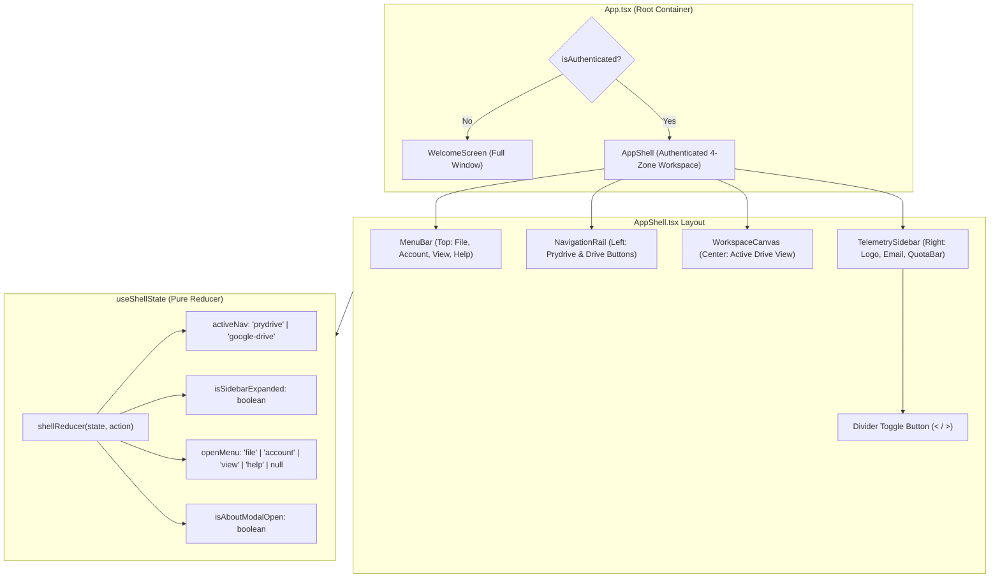

# Technical Plan: Spec 002 — Desktop Application Shell

## Architecture and Overview
This document specifies the technical architecture and implementation design for the four-zone desktop application shell in Prydrive, fulfilling [specs/002-app-shell/spec.md](file:///C:/wamp64/www/prydrive/specs/002-app-shell/spec.md) and adhering to the craftsmanship standards established in `.agents/skills/frontend-design/`.

The application shell establishes the permanent desktop workspace for authenticated users. It replaces the interim linear header with an orchestrated, four-zone layout:
1. **Top Menu Bar (`MenuBar`):** A classic desktop horizontal menu strip (*File*, *Account*, *View*, *Help*) managing window actions, session settings, language switching, and account disconnection.
2. **Left Navigation Rail (`NavigationRail`):** A compact vertical toolbar housing interactive brand and provider buttons with distinctive active surface highlights.
3. **Central Workspace Canvas (`WorkspaceCanvas`):** The primary content area designed to host cloud storage exploration (with an active Drive placeholder for this spec).
4. **Right Telemetry Sidebar (`TelemetrySidebar`):** A collapsible vertical sidebar presenting provider branding, user identity with tooltip truncation, storage quota progress metrics, and a circular divider toggle button.

When the user is unauthenticated, the full-window `WelcomeScreen` replaces the four-panel shell entirely.



---

## 1. Files and Responsibilities

### Renderer Shell Components (`src/renderer/src/components/shell/`)
- `AppShell.tsx`: Root shell layout container coordinating the 4 zones, handling minimum window constraints, and managing modal overlays (Disconnect and About modals).
- `MenuBar.tsx`: Classic desktop horizontal menu strip with accessible drop-down menus (*File*, *Account*, *View*, *Help*), outside-click detection, and Escape key dismissal.
- `NavigationRail.tsx`: Vertical left toolbar (64px width) rendering interactive Prydrive brand and Google Drive provider buttons with distinctive active background fill.
- `TelemetrySidebar.tsx`: Collapsible right panel (260px expanded, 0px collapsed) displaying Google Drive branding, truncated user email with tooltip, the existing `QuotaBar` component, and the circular border divider toggle button.
- `WorkspaceCanvas.tsx`: Central workspace area displaying the active provider status placeholder, smoothly flexing to fill available width.
- `AboutModal.tsx`: Lightweight modal dialog displaying Prydrive version (`v0.1.0`), description, and project credits when triggered from *Help $\rightarrow$ About Prydrive*.

### State & Hooks (`src/renderer/src/hooks/`)
- `useShellState.ts`: Pure state management hook encapsulating shell navigation, menu open/close status, click-outside dismissal, Escape key listeners, and sidebar expansion toggle.
- `useWindowSize.ts`: Lightweight hook tracking window dimensions to enforce responsiveness and auto-collapse the sidebar if width drops below 960px.

### Internationalization (`src/renderer/src/i18n/`)
- `translations.ts`: Extended with all bilingual strings required for the shell: menu titles and actions (*File, Account, View, Help, Close Window, Toggle Sidebar, About Prydrive, Version*), sidebar headings, tooltips, and canvas placeholder text.

### Root Application Wiring (`src/renderer/src/`)
- `App.tsx`: Updated to cleanly branch between `WelcomeScreen` (unauthenticated) and `AppShell` (authenticated), passing session credentials and quota data down to the shell.

### Automated Test Suites (`tests/unit/`)
- `tests/unit/shell-state.test.ts`: Comprehensive unit tests verifying pure state reducer transitions: active tab switching, sidebar toggle, menu open/close, click-outside dismissal, and Escape key handling.
- `tests/unit/translations.test.ts`: Extended tests verifying 100% parity between English and Spanish dictionaries for all shell keys.

---

## 2. Business Logic and Decoupled Functions

All shell state transitions are decoupled from React components into pure, deterministic functions:

```typescript
export type ActiveNavTab = 'prydrive' | 'google-drive';
export type ActiveMenu = 'file' | 'account' | 'view' | 'help' | null;

export interface ShellState {
  activeNav: ActiveNavTab;
  isSidebarExpanded: boolean;
  openMenu: ActiveMenu;
  isAboutModalOpen: boolean;
  isDisconnectModalOpen: boolean;
}

export type ShellAction =
  | { type: 'SET_ACTIVE_NAV'; payload: ActiveNavTab }
  | { type: 'TOGGLE_SIDEBAR' }
  | { type: 'SET_SIDEBAR_EXPANDED'; payload: boolean }
  | { type: 'OPEN_MENU'; payload: ActiveMenu }
  | { type: 'CLOSE_MENUS' }
  | { type: 'OPEN_ABOUT_MODAL' }
  | { type: 'CLOSE_ABOUT_MODAL' }
  | { type: 'OPEN_DISCONNECT_MODAL' }
  | { type: 'CLOSE_DISCONNECT_MODAL' };

/**
 * Pure state reducer governing shell interactions.
 */
export function shellReducer(state: ShellState, action: ShellAction): ShellState {
  switch (action.type) {
    case 'SET_ACTIVE_NAV':
      return { ...state, activeNav: action.payload, openMenu: null };
    case 'TOGGLE_SIDEBAR':
      return { ...state, isSidebarExpanded: !state.isSidebarExpanded, openMenu: null };
    case 'SET_SIDEBAR_EXPANDED':
      return { ...state, isSidebarExpanded: action.payload };
    case 'OPEN_MENU':
      return { ...state, openMenu: action.payload };
    case 'CLOSE_MENUS':
      return { ...state, openMenu: null };
    case 'OPEN_ABOUT_MODAL':
      return { ...state, isAboutModalOpen: true, openMenu: null };
    case 'CLOSE_ABOUT_MODAL':
      return { ...state, isAboutModalOpen: false };
    case 'OPEN_DISCONNECT_MODAL':
      return { ...state, isDisconnectModalOpen: true, openMenu: null };
    case 'CLOSE_DISCONNECT_MODAL':
      return { ...state, isDisconnectModalOpen: false };
    default:
      return state;
  }
}

/**
 * Pure string truncation utility ensuring emails do not blow out the sidebar.
 */
export function truncateEmail(email: string, maxChars: number = 24): string {
  if (!email || email.length <= maxChars) return email;
  const atIndex = email.indexOf('@');
  if (atIndex === -1 || atIndex <= 3) {
    return `${email.slice(0, maxChars - 3)}...`;
  }
  const domain = email.slice(atIndex);
  const user = email.slice(0, atIndex);
  const availableUserChars = maxChars - domain.length - 3;
  if (availableUserChars > 2) {
    return `${user.slice(0, availableUserChars)}...${domain}`;
  }
  return `${email.slice(0, maxChars - 3)}...`;
}
```

---

## 3. Algorithm in Pseudocode

### 1. Menu Interaction and Outside Click Handling
```text
FUNCTION onMenuHeaderClick(menuName):
    IF state.openMenu EQUALS menuName THEN
        DISPATCH { type: 'CLOSE_MENUS' }
    ELSE
        DISPATCH { type: 'OPEN_MENU', payload: menuName }
    END IF
END FUNCTION

FUNCTION onGlobalKeyDown(event):
    IF event.key EQUALS 'Escape' THEN
        IF state.openMenu IS NOT NULL THEN
            DISPATCH { type: 'CLOSE_MENUS' }
            event.preventDefault()
        END IF
    END IF
END FUNCTION

FUNCTION onGlobalMouseDown(event):
    IF state.openMenu IS NOT NULL AND menuBarRef DOES NOT CONTAIN event.target THEN
        DISPATCH { type: 'CLOSE_MENUS' }
    END IF
END FUNCTION
```

### 2. Responsive Auto-Collapse Logic
```text
FUNCTION checkWindowConstraint(windowWidth):
    CONST MIN_CANVAS_WIDTH = 480
    CONST RAIL_WIDTH = 64
    CONST SIDEBAR_WIDTH = 260
    
    IF windowWidth < (RAIL_WIDTH + SIDEBAR_WIDTH + MIN_CANVAS_WIDTH) THEN
        IF state.isSidebarExpanded IS TRUE THEN
            DISPATCH { type: 'SET_SIDEBAR_EXPANDED', payload: false }
        END IF
    END IF
END FUNCTION
```

---

## 4. Interface Design and Aesthetic Layout

### Visual Architecture (`frontend-design` Craftsmanship)
- **Base Canvas:** Neutral dark surface (`#0D1117` / `slate-900` background).
- **Window Container:** Subtle 1px metric border (`#30363D` / `border-slate-800`), with rounded outer frame corners (`rounded-xl` or `rounded-lg`).
- **Dividers:** Crisp 1px solid vertical borders separating navigation rail, central canvas, and sidebar.
- **Active Navigation Indicator:** Solid distinct surface (`bg-blue-600` / `bg-slate-700`) with smooth active transition and tooltip on hover.
- **Divider Toggle Button:** 24x24px circular pill (`rounded-full bg-slate-800 border border-slate-700 text-slate-300 hover:text-white hover:bg-slate-700 shadow-md`) positioned on the border divider between workspace and sidebar (`-left-3 top-1/2 -translate-y-1/2 absolute z-20`).

### ASCII Component Layout

```text
+---------------------------------------------------------------------------------------------------------+
| [ Archivo ▾ ]  [ Cuenta ▾ ]  [ Ver ▾ ]  [ Ayuda ▾ ]                                    [ - ] [ □ ] [ ✕ ]|
+----+-----------------------------------------------------------------------------------+----------------+
|    |                                                                                   |                |
| [P]|                                                                                   | [Drive Logo]   |
|    |                                                                                   | Google Drive   |
| -- |                                                                                   |                |
|    |                                                                                   | user@gmail.com |
| [G]|                                                                                   |                |
|    |                                                                                 < | [====----]     |
|    |                             CENTRAL WORKSPACE CANVAS                              | 12.3 / 15 GB   |
|    |                                                                                   |                |
|    |                      [ Google Drive Conectado - Listo ]                           |                |
|    |                                                                                   |                |
|    |                                                                                   |                |
+----+-----------------------------------------------------------------------------------+----------------+
```

---

## 5. Justified Technical Decisions

| Decision | Alternative Discarded | Justification |
| :--- | :--- | :--- |
| **Lightweight custom menu bar with pure state reducer** | External heavy UI libraries (e.g. electron native menu or full Radix menu kit) | Full control over custom styling, bilingual reactivity, zero electron native menu OS inconsistencies, and adherence to Constitution Principle 3 (Stack simplicity). |
| **CSS-driven 200ms width & opacity transition for sidebar** | Javascript animation libraries (Framer Motion / GSAP) | Native GPU-accelerated CSS transitions (`transition-all duration-200 ease-in-out`) guarantee 60fps performance without bundling extra runtime overhead. |
| **Pure `shellReducer` pattern** | Scattered `useState` in multiple components | Centralized, deterministic state management that can be 100% unit tested without mounting DOM elements. |
| **Full window replacement for unauthenticated state** | Embedding the welcome screen inside the four-panel shell | Matches user requirement ("El signin reemplaza todo"), provides maximum clarity during login, and removes useless disabled menus during authentication. |
| **Circular divider toggle button on panel border** | Static header-only icon button | Exact fidelity to user-provided reference mockups, offering natural spatial affordance to expand/collapse right on the dividing line. |

---

## 6. Automated Testing Strategy (TDD)

Following Constitution Principle 4 (Testing policy: Zero Red Tests):
1. **Red Phase (Test First):**
   - Create `tests/unit/shell-state.test.ts` testing `shellReducer`, `truncateEmail`, menu actions, and sidebar transitions.
   - Run `pnpm test` $\rightarrow$ fails red.
2. **Green Phase (Implementation):**
   - Implement `src/renderer/src/hooks/useShellState.ts`.
   - Implement shell components (`MenuBar.tsx`, `NavigationRail.tsx`, `TelemetrySidebar.tsx`, `WorkspaceCanvas.tsx`, `AboutModal.tsx`, `AppShell.tsx`).
   - Run `pnpm test` $\rightarrow$ passes green.
3. **Parity Testing:**
   - Update `tests/unit/translations.test.ts` to verify 100% of shell keys in both `en` and `es`.
4. **Build & Typecheck Verification:**
   - `pnpm run typecheck` $\rightarrow$ 0 errors.
   - `pnpm run build` $\rightarrow$ clean Vite & Electron bundling.

---

## 7. Traceability Matrix & Story Dependencies

| User Story | Functional Requirements | Technical Component | Automated Test |
| :--- | :--- | :--- | :--- |
| **US-1** (4-Panel Shell Layout) | FR-1, FR-2, NFR-1, NFR-2 | `AppShell.tsx`, `App.tsx` | `tests/unit/shell-state.test.ts` |
| **US-2** (Left Navigation Rail Buttons) | FR-3, FR-4, FR-5, EC-5 | `NavigationRail.tsx`, `useShellState.ts` | `tests/unit/shell-state.test.ts` |
| **US-3** (Classic Desktop Menu Bar) | FR-6, FR-7, FR-8, EC-3, EC-4 | `MenuBar.tsx`, `AboutModal.tsx` | `tests/unit/shell-state.test.ts` |
| **US-4** (Collapsible Telemetry Sidebar) | FR-9, FR-10, FR-11, FR-12, FR-13, FR-14, FR-15, NFR-3, EC-1, EC-2 | `TelemetrySidebar.tsx`, `QuotaBar.tsx` | `tests/unit/shell-state.test.ts` |
| **US-5** (Bilingual Localization) | FR-8, FR-6 | `translations.ts` | `tests/unit/translations.test.ts` |

### Story Dependencies (for `tasks.md`):
- **Task 1 (`US-1`):** Depends on: *None* (foundation container and layout shell).
- **Task 2 (`US-2`):** Depends on: `T1` (adds interactive buttons and active states to the left rail inside the shell).
- **Task 3 (`US-3`):** Depends on: `T1` (integrates the classic menu bar, Account disconnect trigger, and About modal).
- **Task 4 (`US-4`):** Depends on: `T1` (integrates the collapsible telemetry sidebar with provider branding, email, quota bar, and circular divider button).
- **Task 5 (`US-5`):** Depends on: `T1, T2, T3, T4` (completes bilingual localization and translation verification across all shell elements).
