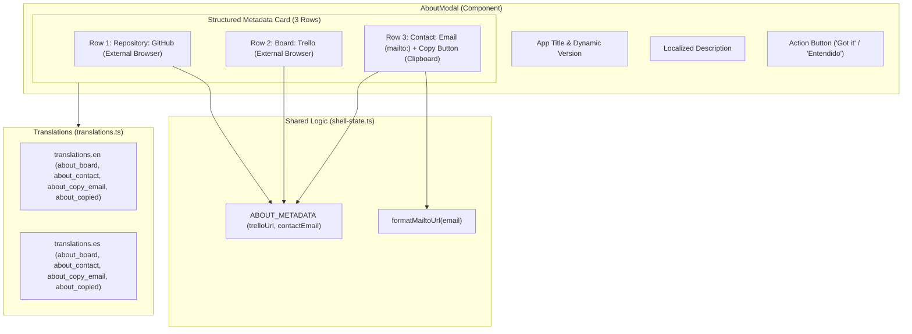

# Technical Plan: Spec 003 — About Modal Project Links & Contact Metadata

## Architecture and Overview
This document specifies the technical design, component extensions, decoupled business logic, and automated testing strategy to fulfill [specs/003-about-links/spec.md](file:///C:/wamp64/www/prydrive/specs/003-about-links/spec.md).

The About dialog ([`AboutModal.tsx`](file:///C:/wamp64/www/prydrive/src/renderer/src/components/shell/AboutModal.tsx)) will be enriched with a multi-row structured metadata card featuring:
1. **Repository Entry:** Existing GitHub repository link opening in the OS default browser.
2. **Project Board Entry:** Public Trello management board link opening in the OS default browser.
3. **Contact Entry:** Developer email address with dual interaction:
   - Primary text link: Triggers the default system email client (`mailto:sebiplay@hotmail.com`).
   - Action button: Isolated clipboard copy button copying `sebiplay@hotmail.com` with instantaneous visual confirmation (icon switches from `Copy` to `Check`, color shifts to `emerald-400`, and tooltip switches from *"Copy email"* / *"Copiar correo"* to *"Copied!"* / *"¡Copiado!"* for 2 seconds).



---

## 1. Files and Responsibilities

### Shared State & Business Logic
- **`src/shared/shell-state.ts`**:
  - Extend `AboutMetadata` interface with `trelloUrl: string` and `contactEmail: string`.
  - Update `ABOUT_METADATA` constant with `trelloUrl: 'https://trello.com/b/aPzGPiHF/prydrive'` and `contactEmail: 'sebiplay@hotmail.com'`.
  - Export pure helper `formatMailtoUrl(email: string): string` returning `mailto:${email}`.

### Internationalization & Dictionaries
- **`src/shared/i18n/translations.ts`**:
  - Add 4 new translation keys to both `translations.en` and `translations.es`:
    - `about_board`: `'Board:'` (EN) / `'Tablero:'` (ES)
    - `about_contact`: `'Contact:'` (EN) / `'Contacto:'` (ES)
    - `about_copy_email`: `'Copy email'` (EN) / `'Copiar correo'` (ES)
    - `about_copied`: `'Copied!'` (EN) / `'¡Copiado!'` (ES)

### Renderer UI Component
- **`src/renderer/src/components/shell/AboutModal.tsx`**:
  - Update the metadata card to render 3 distinct rows with consistent styling:
    - Row 1: Repository (GitHub)
    - Row 2: Board (Trello) with `ExternalLink` icon
    - Row 3: Contact (Email) with `Mail` icon, `mailto:` link, and quick `Copy`/`Check` action button
  - Manage transient copy state (`isCopied: boolean`) with automatic 2-second timeout and clean timer disposal on unmount or modal close (`useEffect` cleanup).
  - Isolate copy click event (`e.stopPropagation()`, `e.preventDefault()`) so clicking the copy icon does not trigger the `mailto:` client.
  - Implement graceful clipboard error handling (`navigator.clipboard.writeText().catch(...)`).

### Automated Test Suites
- **`tests/unit/about-metadata.test.ts`**:
  - Unit tests validating `ABOUT_METADATA` values, `formatMailtoUrl` helper, and copy feedback state transition mechanics.
- **`tests/unit/translations.test.ts`**:
  - Unit tests verifying 100% dictionary key parity for all new `about_*` keys in English and Spanish.

---

## 2. Business Logic and Decoupled Functions

All domain contracts and URL helpers are decoupled into pure functions in `src/shared/shell-state.ts`:

```typescript
export interface AboutMetadata {
  appName: string;
  version: string;
  description: string;
  website: string;
  trelloUrl: string;
  contactEmail: string;
}

export const ABOUT_METADATA: AboutMetadata = {
  appName: APP_NAME,
  version: APP_VERSION,
  description: 'Fast, visual native desktop client for Google Drive.',
  website: 'https://github.com/sebix7/Prydrive',
  trelloUrl: 'https://trello.com/b/aPzGPiHF/prydrive',
  contactEmail: 'sebiplay@hotmail.com'
};

/**
 * Generates a valid mailto: link for the given email address.
 */
export function formatMailtoUrl(email: string): string {
  return `mailto:${email.trim()}`;
}
```

---

## 3. Algorithm in Pseudocode (Copy Action & Timer Cleanup)

```text
INITIALIZE isCopied = false
INITIALIZE copyTimeoutRef = ref(null)

FUNCTION handleCopyEmail(event):
  event.stopPropagation()
  event.preventDefault()
  
  IF copyTimeoutRef.current IS NOT null:
    clearTimeout(copyTimeoutRef.current)
    
  TRY:
    AWAIT navigator.clipboard.writeText(ABOUT_METADATA.contactEmail)
    SET isCopied = true
    copyTimeoutRef.current = setTimeout(() => {
      SET isCopied = false
      copyTimeoutRef.current = null
    }, 2000)
  CATCH error:
    // Graceful fallback: do not crash, keep resting state
    SET isCopied = false

EFFECT ON UNMOUNT OR MODAL CLOSE:
  CLEANUP:
    IF copyTimeoutRef.current IS NOT null:
      clearTimeout(copyTimeoutRef.current)
```

---

## 4. Interface Design and Accessibility Layout

### Visual Architecture
- **Metadata Card Container:** `bg-slate-900/60 border border-slate-800/80 rounded-xl p-3 text-xs flex flex-col gap-2 font-mono text-[11px] w-full`.
- **Row 1 (Repository):**
  - Left: `text-slate-500` $\rightarrow$ `{getTranslation(language, 'about_repository')}`
  - Right: `text-blue-400 hover:text-blue-300 flex items-center gap-1 hover:underline` $\rightarrow$ `GitHub` + `<ExternalLink className="w-3 h-3" />`
- **Row 2 (Board):**
  - Left: `text-slate-500` $\rightarrow$ `{getTranslation(language, 'about_board')}`
  - Right: `text-blue-400 hover:text-blue-300 flex items-center gap-1 hover:underline` $\rightarrow$ `Trello` + `<ExternalLink className="w-3 h-3" />`
- **Row 3 (Contact):**
  - Left: `text-slate-500 shrink-0` $\rightarrow$ `{getTranslation(language, 'about_contact')}`
  - Right container: `flex items-center gap-1.5 min-w-0`
    - Email link: `text-slate-300 hover:text-blue-300 truncate hover:underline` $\rightarrow$ `{ABOUT_METADATA.contactEmail}`
    - Quick Copy Button:
      - Normal: `text-slate-400 hover:text-white hover:bg-slate-800 p-1 rounded transition-colors` $\rightarrow$ `<Copy className="w-3 h-3" />` (title: *"Copy email"*)
      - Copied: `text-emerald-400 bg-emerald-500/10 p-1 rounded transition-colors` $\rightarrow$ `<Check className="w-3 h-3" />` (title: *"Copied!"*)

---

## 5. Justified Technical Decisions

| Decision | Alternative Discarded | Justification |
| :--- | :--- | :--- |
| **Extend `ABOUT_METADATA` singleton** | Hardcoded URLs in JSX component | Adheres to Constitution Principle 1 & 6; single source of truth, 100% testable in unit tests without mounting React components. |
| **`navigator.clipboard.writeText` with try/catch** | External clipboard npm packages (e.g. `clipboard-copy`) | Respects Constitution Principle 3 (Stack simplicity); standard Web Clipboard API is natively supported in Electron's Chromium runtime without extra bundle weight. |
| **`e.stopPropagation()` on copy button** | Single combined click trigger | Prevents firing the default mail client when the user only wants to copy the email address. |
| **2000ms transient state with timer cleanup** | Permanent state or toast alert | Lightweight, clean in-place visual feedback matching modern desktop UI design without obstructing the modal dialog. |

---

## 6. Automated Testing Strategy (TDD)

Following Constitution Principle 4 (Testing policy: Zero Red Tests):

1. **Red Phase (Test First):**
   - Create `tests/unit/about-metadata.test.ts` testing:
     - `ABOUT_METADATA.trelloUrl` matches `https://trello.com/b/aPzGPiHF/prydrive`.
     - `ABOUT_METADATA.contactEmail` matches `sebiplay@hotmail.com`.
     - `formatMailtoUrl` correctly prefixes email with `mailto:`.
   - Update `tests/unit/translations.test.ts` with assertions for `about_board`, `about_contact`, `about_copy_email`, and `about_copied`.
   - Run `pnpm test` $\rightarrow$ fails red.

2. **Green Phase (Implementation):**
   - Update `src/shared/shell-state.ts` with new metadata and `formatMailtoUrl`.
   - Update `src/shared/i18n/translations.ts` with English and Spanish dictionaries.
   - Update `src/renderer/src/components/shell/AboutModal.tsx` with the 3-row layout, copy feedback, and timer cleanup.
   - Run `pnpm test` $\rightarrow$ passes green.

3. **Typecheck and Build:**
   - Run `pnpm run typecheck` $\rightarrow$ 0 errors.
   - Run `pnpm run build` $\rightarrow$ clean bundling.

---

## 7. Traceability Matrix & Story Dependencies

| User Story | Requirements | Technical Component | Automated Test |
| :--- | :--- | :--- | :--- |
| **US-1** (Trello Board Link) | FR-1, FR-2, NFR-1 | `shell-state.ts`, `AboutModal.tsx` | `tests/unit/about-metadata.test.ts` |
| **US-2** (Contact Email & Copy Button) | FR-3, FR-4, FR-5, FR-6, NFR-2, EC-1, EC-2, EC-3, EC-4, EC-5 | `shell-state.ts`, `AboutModal.tsx` | `tests/unit/about-metadata.test.ts` |
| **US-3** (Bilingual Localization) | FR-7 | `translations.ts`, `AboutModal.tsx` | `tests/unit/translations.test.ts` |

### Story Dependencies (for `tasks.md`):
- **Task 1 (`US-1`):** Depends on: *None* (adds Trello board metadata and external browser link).
- **Task 2 (`US-2`):** Depends on: `T1` (adds contact email, mailto launcher, and isolated copy-to-clipboard action with feedback).
- **Task 3 (`US-3`):** Depends on: `T1, T2` (integrates bilingual translation parity and dynamic tooltips across all new elements).
