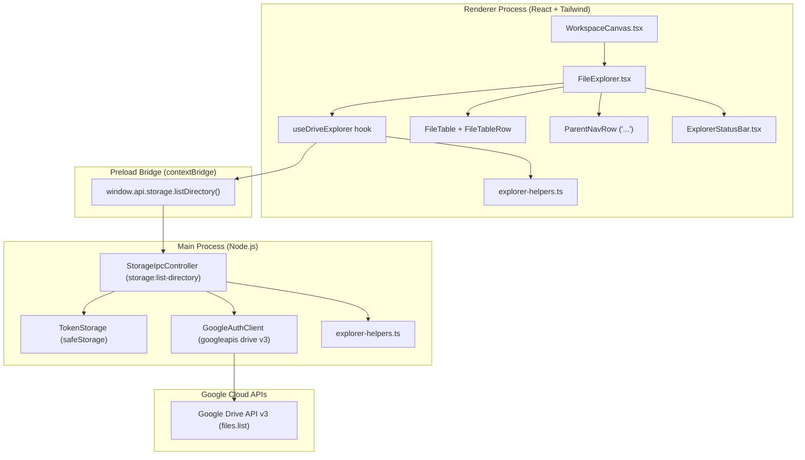
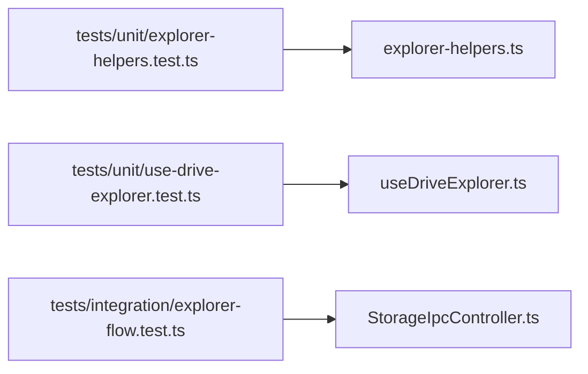

# Technical Plan: Spec 004 — Google Drive File and Folder Explorer

## Architectural Overview & Context
This technical plan defines the architecture, data models, IPC protocols, pure business logic, and UI components to implement the Google Drive File and Folder Explorer in the central workspace canvas of Prydrive.

In strict alignment with **Constitution Principle 2 (Multi-provider decoupled architecture)**, all Google Drive SDK operations are isolated within the Electron Main process. The Renderer interacts solely with provider-agnostic abstractions (`StorageItem`, `ListDirectoryParams`, `ListDirectoryResult`) via strongly typed IPC channels exposed through the secure `preload` bridge.



---

## 1. Files and Responsibilities

| File Path | Layer | Responsibility |
| :--- | :--- | :--- |
| `src/shared/types.ts` | Shared Types | Defines provider-agnostic `StorageItem`, `ListDirectoryParams`, `ListDirectoryResult`, and `FolderMetrics`. |
| `src/shared/ipc-channels.ts` | Shared Constants | Declares `STORAGE_LIST_DIRECTORY: 'storage:list-directory'`. |
| `src/shared/explorer-helpers.ts` | Shared Pure Logic | Pure functions for sorting (folders first), date formatting (`DD/MM/YYYY HH:mm:ss`), size formatting, metrics calculation, and MIME icon resolution. |
| `src/shared/i18n/translations.ts` | Shared i18n | Bilingual dictionary entries (EN/ES) for column headers, status bar metrics, empty folder messages, and tooltips. |
| `src/main/core/google-client.ts` | Main Core | Extends `GoogleAuthClient` with `listDirectory(refreshToken, folderId, pageToken, pageSize)` querying `drive.files.list` with `trashed = false`. |
| `src/main/ipc/storage-ipc.ts` | Main IPC | Handles `STORAGE_LIST_DIRECTORY`, validates session, maps Google Drive files to `StorageItem`, sorts items, and returns `IpcResult<ListDirectoryResult>`. |
| `src/preload/index.ts` | Preload Bridge | Exposes `window.api.storage.listDirectory(params)` via `contextBridge`. |
| `src/preload/index.d.ts` | Preload Types | TypeScript declarations for `window.api.storage.listDirectory`. |
| `src/renderer/src/hooks/useDriveExplorer.ts` | Renderer Hook | Manages folder navigation stack, pagination state, active selection, loading/error states, and directory refreshing. |
| `src/renderer/src/components/explorer/FileExplorer.tsx` | Renderer UI | Main explorer container: compact table header, scroll container with infinite scroll sentinel, empty state, and status bar. |
| `src/renderer/src/components/explorer/FileTableRow.tsx` | Renderer UI | Individual row component: item icon, truncated name, creation date, size, selection styling, and double-click handler. |
| `src/renderer/src/components/explorer/ParentNavRow.tsx` | Renderer UI | Virtual `"..."` parent directory row; double-click pops the navigation history and ascends one folder level. |
| `src/renderer/src/components/explorer/ExplorerStatusBar.tsx` | Renderer UI | Fixed bottom telemetry bar: folder count, file count, aggregate file size, and manual refresh button. |
| `src/renderer/src/components/shell/WorkspaceCanvas.tsx` | Renderer Shell | Replaces static placeholder with `FileExplorer` when authenticated. |
| `tests/unit/explorer-helpers.test.ts` | Unit Tests | Tests for date formatting, size units, folder-first sorting, folder metrics, and icon mapping. |
| `tests/unit/use-drive-explorer.test.ts` | Unit Tests | Tests for navigation stack, selection reset on folder change, empty state handling, and status bar metrics. |
| `tests/integration/explorer-flow.test.ts` | Integration Tests | IPC integration tests with mock Google Drive client validating session validation, `trashed = false` filtering, and pagination. |

---

## 2. Business Logic and Decoupled Functions

All data transformations and formatting are isolated in `src/shared/explorer-helpers.ts` as pure, deterministic functions without DOM, Electron, or network dependencies:

### Data Interfaces (`src/shared/types.ts`)
```typescript
export type StorageItemType =
  | 'folder'
  | 'document'
  | 'spreadsheet'
  | 'presentation'
  | 'image'
  | 'video'
  | 'audio'
  | 'pdf'
  | 'archive'
  | 'shortcut'
  | 'file';

export interface StorageItem {
  id: string;
  name: string;
  mimeType: string;
  isDirectory: boolean;
  sizeBytes: number | null;
  formattedSize: string;
  createdAt: string; // ISO 8601 string
  formattedCreatedAt: string; // DD/MM/YYYY HH:mm:ss in local time
  iconType: StorageItemType;
  isShortcut: boolean;
}

export interface ListDirectoryParams {
  folderId?: string; // defaults to 'root'
  pageToken?: string;
  pageSize?: number; // defaults to 50
}

export interface ListDirectoryResult {
  items: StorageItem[];
  nextPageToken: string | null;
  currentFolderId: string;
  parentFolderId: string | null;
}

export interface FolderMetrics {
  folderCount: number;
  fileCount: number;
  totalSizeBytes: number;
  formattedTotalSize: string;
}
```

### Pure Function Signatures (`src/shared/explorer-helpers.ts`)
```typescript
/**
 * Formats an ISO date string into DD/MM/YYYY HH:mm:ss in the local timezone (FR-1).
 */
export function formatItemCreationDate(isoDateString: string, targetDate?: Date): string;

/**
 * Formats byte values into human-readable units (B, KB, MB, GB).
 * Returns '--' if bytes is null, undefined, or negative (FR-1, EC-1).
 */
export function formatItemSize(bytes: number | null | undefined): string;

/**
 * Resolves item category icon based on MIME type and folder flag (FR-1, EC-2, EC-5).
 */
export function resolveItemIconType(mimeType: string, isDirectory: boolean): StorageItemType;

/**
 * Sorts storage items: folders first (alphabetical A-Z), then files (alphabetical A-Z) (FR-5).
 */
export function sortStorageItems(items: StorageItem[]): StorageItem[];

/**
 * Calculates folder counts, file counts, and aggregate file size.
 * Strictly excludes any virtual parent entry ('...') from counts (FR-12).
 */
export function calculateFolderMetrics(items: StorageItem[]): FolderMetrics;

/**
 * Maps a raw Google Drive file object to a decoupled StorageItem.
 */
export function mapGoogleDriveFileToStorageItem(rawFile: Record<string, unknown>): StorageItem;
```

---

## 3. Algorithm in Pseudocode

### A. Main Process: Fetch & Map Directory (`StorageIpcController`)
```text
FUNCTION handleListDirectory(params):
    session = TokenStorage.loadSession()
    IF NOT session THEN:
        RETURN Error("UNAUTHENTICATED", "No active session")
    
    targetFolderId = params.folderId OR 'root'
    pageSize = params.pageSize OR 50
    pageToken = params.pageToken OR null

    // Google Drive query: must be in parent and NOT in trash (FR-2)
    query = `'${targetFolderId}' in parents and trashed = false`
    fields = 'nextPageToken, files(id, name, mimeType, size, quotaBytesUsed, createdTime, shortcutDetails, trashed)'

    rawResult = GoogleClient.listDirectory(session.refreshToken, query, fields, pageSize, pageToken)
    
    items = []
    FOR EACH file IN rawResult.files:
        item = mapGoogleDriveFileToStorageItem(file)
        APPEND item TO items

    sortedItems = sortStorageItems(items)

    RETURN Success({
        items: sortedItems,
        nextPageToken: rawResult.nextPageToken OR null,
        currentFolderId: targetFolderId,
        parentFolderId: params.parentFolderId OR null
    })
```

### B. Renderer Process: Folder Navigation & History Stack (`useDriveExplorer`)
```text
STATE:
    folderStack = [{ id: 'root', name: 'My Drive' }]
    items = []
    selectedId = null
    nextPageToken = null
    isLoading = false

FUNCTION openFolder(folderItem):
    IF NOT folderItem.isDirectory THEN RETURN // no-op for files (FR-7)
    selectedId = null // clear selection on navigate (FR-6)
    folderStack.push({ id: folderItem.id, name: folderItem.name })
    fetchDirectory(folderItem.id, reset=true)

FUNCTION navigateUp():
    IF folderStack.length <= 1 THEN RETURN // already at root (FR-10)
    selectedId = null // clear selection on navigate (FR-9)
    folderStack.pop()
    parent = folderStack.top()
    fetchDirectory(parent.id, reset=true)

FUNCTION handleScroll(event):
    IF event.scrollHeight - event.scrollTop <= event.clientHeight + 50:
        IF nextPageToken != null AND NOT isLoadingMore:
            fetchNextPage(currentFolderId, nextPageToken)
```

---

## 4. Interface Design and UI Contracts

### Layout Structure (`FileExplorer.tsx`)
```text
+-----------------------------------------------------------------------------------+
|  [Tipo]  |  [Nombre]               |  [Fecha de creación]     |  [Tamaño]         | (Header)
+-----------------------------------------------------------------------------------+
|  [Icon]  |  ...                    |                          |                   | (ParentNavRow - subfolders only)
|  [Icon]  |  Finanzas 2026          |  15/01/2026 10:24:15     |  --               | (FolderRow)
|  [Icon]  |  Reporte Q1.pdf         |  20/02/2026 18:45:00     |  2.4 MB           | (FileRow)
|  [Icon]  |  Documento sin título   |  06/01/2026 12:00:30     |  1 KB             | (Workspace Doc)
|                                                                                   |
|  ... (Infinite Scroll loading sentinel)                                           |
+-----------------------------------------------------------------------------------+
| [Actualizar] | 1 carpeta, 2 archivos                          | Total: 2.4 MB     | (ExplorerStatusBar)
+-----------------------------------------------------------------------------------+
```

### Component Breakdown
1. **`FileExplorer`**: Hosts table header, scrollable body (`overflow-y-auto min-h-0 flex-1`), parent `"..."` row, empty folder state, and fixed bottom status bar.
2. **`FileTableRow`**: High-density row (`h-9` / 36px). Includes selection ring/background (`bg-blue-600/20 text-white` when selected; `hover:bg-slate-800/60` resting).
3. **`ParentNavRow`**: Fixed at the top of subfolders. Folder icon with `"..."` label. Double-click calls `navigateUp()`.
4. **`ExplorerStatusBar`**: Dark background (`#161B22`), border-t (`border-slate-800`), containing:
   - Left: Refresh button (`RotateCw` icon, `title="Actualizar"`).
   - Center: Localized item count (e.g. `1 carpeta, 2 archivos`).
   - Right: Localized total size (e.g. `Total: 2.4 MB`).
5. **Empty State**: Rendered below `"..."` in subfolders, or centered in root. Displays `Folder` icon and `"Carpeta vacía"` / `"Empty folder"`.

---

## 5. Justified Technical Decisions

| Decision | Alternative Considered | Technical Rationale |
| :--- | :--- | :--- |
| **Provider-agnostic `StorageItem` contract** | Directly exposing Google Drive API v3 `drive_v3.Schema$File` to React | **Constitution Principle 2**: Prevents vendor lock-in. Future cloud storage providers (OneDrive, Dropbox) will implement the same adapter interface without touching UI components. |
| **Double-click activation for `"..."`** | Single-click activation | Consistency: all folder transitions require double-click. Prevents accidental folder jumps when a user clicks to select or focus. |
| **Scroll-based batch pagination (`pageToken`)** | Fetching all files recursively or full table pagination buttons | Memory efficiency and performance: folders with thousands of files load instantly in 50-item chunks without blocking main-thread IPC. |
| **Exclusion of `"..."` from metrics calculation** | Including `"..."` as an item | Accuracy: `"..."` is a UI navigation affordance, not a real Google Drive file/folder entity. It must not distort telemetry metrics. |
| **Reporting Google Workspace file sizes (`quotaBytesUsed`)** | Hardcoding Workspace files to `0 B` or `--` | User requirement & fidelity: Google Drive reports actual quota usage for native docs (e.g. `1 KB`, `339 KB`), and users expect these to contribute to the folder total. |

---

## 6. Automated Testing Strategy (TDD)



### Planned Test Suites
1. **`tests/unit/explorer-helpers.test.ts`**:
   - `formatItemCreationDate`: Validates local timezone output matching `DD/MM/YYYY HH:mm:ss`.
   - `formatItemSize`: Validates `0 B`, `512 B`, `1.5 KB`, `10.2 MB`, `1.2 GB`, and null/negative `--`.
   - `sortStorageItems`: Verifies folders are sorted ahead of files, and items within each group are alphabetized A-Z.
   - `calculateFolderMetrics`: Verifies folder and file count calculations, size summation, and exclusion of virtual `"..."` entries.
   - `resolveItemIconType`: Verifies mapping of standard MIME types, Workspace types, shortcuts, and directories.

2. **`tests/unit/translations.test.ts` (extended)**:
   - Verifies 100% dictionary symmetry in `en` and `es` for all new explorer translation keys (`explorer_*`).

3. **`tests/integration/explorer-flow.test.ts`**:
   - Mocks `GoogleAuthClient.listDirectory` and `TokenStorage`.
   - Verifies session validation (`UNAUTHENTICATED` error if no saved token).
   - Verifies Google Drive query incorporates `'root' in parents and trashed = false`.
   - Verifies mapping of raw Drive files to `StorageItem` objects.
   - Verifies pagination passing `pageToken` and receiving `nextPageToken`.
   - Verifies API error handling returning structured `IpcResult` error payload.

---

## 7. Traceability Matrix & Story Dependencies

| User Story | Requirements | Technical Components | Automated Tests | Depends on |
| :--- | :--- | :--- | :--- | :--- |
| **US-1: Compact List Presentation** | FR-1, FR-2, FR-4, NFR-1, NFR-2, EC-1, EC-2 | `StorageItem`, `explorer-helpers.ts`, `FileExplorer.tsx`, `FileTableRow.tsx` | `explorer-helpers.test.ts`, `explorer-flow.test.ts` | None |
| **US-2: Folder Navigation & "..." Parent Row** | FR-5, FR-6, FR-7, FR-8, FR-9, FR-10, EC-4 | `ParentNavRow.tsx`, `useDriveExplorer.ts`, `GoogleAuthClient.listDirectory` | `explorer-helpers.test.ts`, `explorer-flow.test.ts` | US-1 |
| **US-3: Selection & Unified Navigation Rail** | FR-3, FR-11, EC-5 | `useDriveExplorer.ts`, `WorkspaceCanvas.tsx`, `NavigationRail.tsx` | `use-drive-explorer.test.ts` | US-1, US-2 |
| **US-4: Status Bar Telemetry & Refresh Action** | FR-12, FR-13, NFR-3 | `ExplorerStatusBar.tsx`, `calculateFolderMetrics`, `useDriveExplorer.ts` | `explorer-helpers.test.ts`, `explorer-flow.test.ts` | US-1, US-2 |
| **US-5: Empty State, Pagination & Error Resilience** | FR-14, FR-15, FR-16, FR-17, EC-6 | `FileExplorer.tsx`, `useDriveExplorer.ts`, `StorageIpcController` | `explorer-flow.test.ts` | US-1, US-2, US-4 |
| **US-6: Bilingual Localization Parity** | FR-18 | `translations.ts`, `FileExplorer.tsx`, `ExplorerStatusBar.tsx` | `translations.test.ts` | US-1, US-2, US-4, US-5 |
