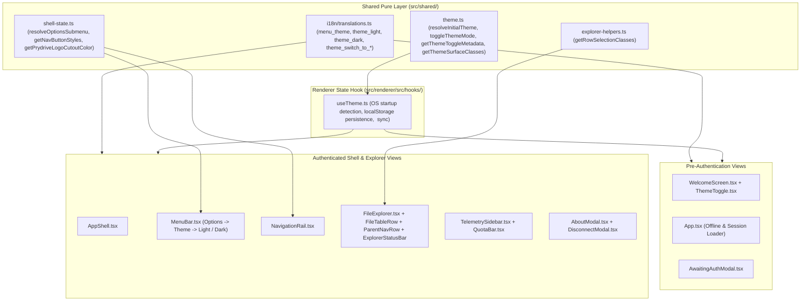

# Technical Plan: Spec 005 — Light and Dark Theme Mode

## Architectural Overview & Context
This technical plan defines the architecture, pure state/styling functions, persistence strategy, and UI component adaptations required to deliver **Light Mode** and **Dark Mode** across the entire Prydrive desktop application (Pre-Authentication Views, Authenticated Desktop Shell, Google Drive File Explorer, and Modal Dialogs).

In strict alignment with **docs/constitution.md**:
- **Principle 1 & 3 (Stack Simplicity & YAGNI):** Theme management is implemented using pure TypeScript modules, React state/hooks, Tailwind CSS (`darkMode: 'class'`), and native `localStorage` + `window.matchMedia`, requiring zero external third-party libraries.
- **Principle 4 (Zero Red Tests / TDD):** All theme resolution, toggle metadata, submenu mutual exclusion, and surface class calculations are encapsulated as pure deterministic functions in `src/shared/` and tested first with Vitest.



---

## 1. Files and Responsibilities

| File Path | Layer | Responsibility |
| :--- | :--- | :--- |
| `src/shared/types.ts` | Shared Types | Declares `ThemeMode = 'light' | 'dark'`. |
| `src/shared/theme.ts` | Shared Pure Logic | Pure functions for startup OS theme resolution, validation, toggling, Moon/Sun button metadata, and surface palette class resolution. |
| `src/shared/shell-state.ts` | Shared Pure Logic | Adds `OptionsSubmenu` mutual exclusion helper (`resolveOptionsSubmenu`), theme-aware `getNavButtonStyles`, `getSidebarClasses`, and `getPrydriveLogoCutoutColor`. |
| `src/shared/explorer-helpers.ts` | Shared Pure Logic | Extends `getRowSelectionClasses(isSelected, theme)` for high-contrast row selection and hover states in both Light and Dark modes. |
| `src/shared/i18n/translations.ts` | Shared i18n | Bilingual dictionary entries (`en` / `es`) for `menu_theme`, `theme_light`, `theme_dark`, `theme_switch_to_dark`, and `theme_switch_to_light`. |
| `tailwind.config.js` | Build Config | Enables `darkMode: 'class'` so `dark:*` utility classes respond to the root `.dark` class. |
| `src/renderer/src/assets/main.css` | Global CSS | Defines light and dark scrollbar track/thumb styles and `color-scheme` based on `html.dark` vs `html:not(.dark)`. |
| `src/renderer/src/hooks/useTheme.ts` | Renderer Hook | Evaluates initial theme once at startup (`localStorage` $\rightarrow$ `matchMedia` $\rightarrow$ `'dark'`), persists user overrides, and syncs `<html class="dark" data-theme="...">`. |
| `src/renderer/src/components/ui/ThemeToggle.tsx` | Renderer UI | Action-oriented Moon/Sun icon button for pre-authentication views (`Moon` in Light Mode, `Sun` in Dark Mode). |
| `src/renderer/src/components/ui/LanguageToggle.tsx` | Renderer UI | Adapts language pill toggle colors for both Light and Dark surfaces. |
| `src/renderer/src/components/auth/WelcomeScreen.tsx` | Renderer UI | Renders `<ThemeToggle />` next to `<LanguageToggle />` in the top-right corner and applies Light/Dark card and button styles. |
| `src/renderer/src/components/auth/AwaitingAuthModal.tsx` | Renderer UI | Applies Light/Dark modal surface, progress track, and cancel button styles. |
| `src/renderer/src/components/auth/DisconnectModal.tsx` | Renderer UI | Applies Light/Dark modal dialog, warning badge, and button styles. |
| `src/renderer/src/App.tsx` | Renderer Root | Initializes `useTheme()`, passes `theme` and `onSetTheme` / `onToggleTheme` to all child views and modals, and styles session loader and offline screen. |
| `src/renderer/src/components/shell/AppShell.tsx` | Renderer Shell | Propagates `theme` and `onSetTheme` to `MenuBar`, `NavigationRail`, `WorkspaceCanvas`, `TelemetrySidebar`, and `AboutModal`. |
| `src/renderer/src/components/shell/MenuBar.tsx` | Renderer Shell | Adds `Options -> Theme -> Light / Dark` flyout submenu with active checkmark and mutual exclusion with the `Language` submenu. |
| `src/renderer/src/components/shell/NavigationRail.tsx` | Renderer Shell | Applies theme-aware rail surface, button styles, and Prydrive logo cutout color (`EC-6`). |
| `src/renderer/src/components/shell/WorkspaceCanvas.tsx` | Renderer Shell | Passes `theme` to `FileExplorer` and adapts canvas background. |
| `src/renderer/src/components/explorer/FileExplorer.tsx` | Renderer UI | Applies Light/Dark styles to sticky table header, loading spinner, empty state, and error banner. |
| `src/renderer/src/components/explorer/FileTableRow.tsx` | Renderer UI | Applies theme-aware row text, borders, hover, and selected highlight classes. |
| `src/renderer/src/components/explorer/ParentNavRow.tsx` | Renderer UI | Applies theme-aware `"..."` parent row text and hover styles. |
| `src/renderer/src/components/explorer/ExplorerStatusBar.tsx` | Renderer UI | Applies Light/Dark footer bar background, border, refresh button, and telemetry text styles. |
| `src/renderer/src/components/shell/TelemetrySidebar.tsx` | Renderer Shell | Applies Light/Dark sidebar cards, divider toggle button, and passes `variant={theme}` to `QuotaBar`. |
| `src/renderer/src/components/shell/AboutModal.tsx` | Renderer Shell | Applies Light/Dark dialog container, metadata box, and action button styles. |
| `tests/unit/theme.test.ts` | Unit Tests | Validates OS fallback detection, persistence validation, corrupted storage fallback, and theme toggling (`US-1`). |
| `tests/unit/theme-toggle.test.ts` | Unit Tests | Validates Moon/Sun icon semantics and target action tooltips (`US-2`). |
| `tests/unit/menu-bar.test.ts` | Unit Tests | Validates `Options -> Theme` submenu toggling and mutual exclusion with `Language` (`US-3`). |
| `tests/unit/theme-surfaces.test.ts` | Unit Tests | Validates Light/Dark surface palettes, explorer row selection classes, and Prydrive logo cutout adaptation (`US-4`). |
| `tests/unit/translations.test.ts` | Unit Tests | Validates 100% EN/ES parity for all new theme translation keys (`US-5`). |

---

## 2. Business Logic and Decoupled Functions

All core theme decisions are isolated in `src/shared/theme.ts`, `src/shared/shell-state.ts`, and `src/shared/explorer-helpers.ts` as pure functions with explicit injectable parameters:

### Signatures (`src/shared/theme.ts`)
```typescript
import type { ThemeMode } from './types';
import type { TranslationKey } from './i18n/translations';

export const THEME_STORAGE_KEY = 'prydrive_theme';

/**
 * Type guard verifying if an unknown persisted value is a valid ThemeMode ('light' | 'dark') (EC-2).
 */
export function isValidThemeMode(value: unknown): value is ThemeMode;

/**
 * Resolves the startup theme mode (FR-1, FR-3, EC-1, EC-2):
 * 1. If savedValue is 'light' or 'dark', returns savedValue.
 * 2. Otherwise, if systemPrefersDark is a boolean, returns systemPrefersDark ? 'dark' : 'light'.
 * 3. Otherwise (OS detection unavailable), defaults to 'dark' (EC-1).
 */
export function resolveInitialTheme(
  savedValue: unknown,
  systemPrefersDark?: boolean | null
): ThemeMode;

/**
 * Alternates between 'light' and 'dark' theme modes (FR-5).
 */
export function toggleThemeMode(current: ThemeMode): ThemeMode;

/**
 * Resolves action-oriented toggle button metadata (FR-4, FR-13):
 * - When activeTheme is 'light' -> Moon icon + 'theme_switch_to_dark' tooltip.
 * - When activeTheme is 'dark'  -> Sun icon  + 'theme_switch_to_light' tooltip.
 */
export interface ThemeToggleMetadata {
  targetTheme: ThemeMode;
  iconName: 'moon' | 'sun';
  tooltipKey: TranslationKey;
}

export function getThemeToggleMetadata(activeTheme: ThemeMode): ThemeToggleMetadata;

/**
 * Resolves standardized semantic surface and typography classes for Light and Dark modes (FR-9, FR-10, NFR-2).
 */
export interface ThemeSurfacePalette {
  canvasBg: string;
  secondaryBg: string;
  cardBg: string;
  modalBg: string;
  border: string;
  textPrimary: string;
  textSecondary: string;
  textMuted: string;
}

export function getThemeSurfaceClasses(theme: ThemeMode): ThemeSurfacePalette;
```

### Submenu & Brand Contrast Signatures (`src/shared/shell-state.ts` & `src/shared/explorer-helpers.ts`)
```typescript
export type OptionsSubmenu = 'language' | 'theme' | null;

/**
 * Enforces mutual exclusion between 'language' and 'theme' submenus inside Options (FR-6).
 */
export function resolveOptionsSubmenu(
  current: OptionsSubmenu,
  target: OptionsSubmenu
): OptionsSubmenu;

/**
 * Resolves the inner cutout circle color for the Prydrive brand icon so it remains crisp
 * against both active blue and inactive light/dark button backgrounds (FR-11, EC-6).
 */
export function getPrydriveLogoCutoutColor(
  isActive: boolean,
  theme: ThemeMode = 'dark'
): string;

/**
 * Resolves table row classes for selected and unselected states across Light and Dark modes (FR-11, EC-3).
 */
export function getRowSelectionClasses(
  isSelected: boolean,
  theme: ThemeMode = 'dark'
): string;
```

---

## 3. Algorithm in Pseudocode

### A. Startup Theme Resolution & Persistence (`useTheme`)
```text
FUNCTION initializeTheme():
    savedValue = null
    TRY:
        savedValue = localStorage.getItem('prydrive_theme')
    CATCH:
        savedValue = null // storage restricted (FR-12)

    systemPrefersDark = null
    TRY:
        IF window.matchMedia IS DEFINED THEN:
            systemPrefersDark = window.matchMedia('(prefers-color-scheme: dark)').matches
    CATCH:
        systemPrefersDark = null

    RETURN resolveInitialTheme(savedValue, systemPrefersDark)

FUNCTION setTheme(nextTheme):
    state.theme = nextTheme
    document.documentElement.classList.toggle('dark', nextTheme == 'dark')
    document.documentElement.setAttribute('data-theme', nextTheme)
    TRY:
        localStorage.setItem('prydrive_theme', nextTheme)
    CATCH:
        // Continue in memory without throwing (FR-12)
```

### B. Options Menu Flyout Mutual Exclusion (`MenuBar`)
```text
STATE:
    activeSubmenu: 'language' | 'theme' | null = null

ON HOVER OR CLICK 'Language' item:
    activeSubmenu = 'language' // automatically closes 'theme'

ON HOVER OR CLICK 'Theme' item:
    activeSubmenu = 'theme' // automatically closes 'language'

ON CLICK Theme Option ('light' OR 'dark'):
    onSetTheme(selectedTheme)
    activeSubmenu = null
    onCloseMenus()
```

---

## 4. Interface Design and Visual Palette Contract

### Color Hierarchy & Contrast Contract (`NFR-2` — WCAG AA $\ge 4.5:1$)

| Surface / Element | Dark Mode (`dark`) | Light Mode (`light`) |
| :--- | :--- | :--- |
| **Primary Canvas (`FileExplorer`, `WelcomeScreen` bg)** | `bg-[#0D1117]` / `text-slate-100` | `bg-white` (Explorer) & `bg-slate-50` (Welcome) / `text-slate-900` |
| **Secondary Bars (`MenuBar`, `NavigationRail`, `ExplorerTableHeader`, `ExplorerStatusBar`, `TelemetrySidebar`)** | `bg-[#161B22]` / `border-slate-800` | `bg-slate-100/90` / `border-slate-200` |
| **Elevated Cards & Modals (`Welcome` card, `AboutModal`, `DisconnectModal`, `AwaitingAuthModal`, Dropdowns)** | `bg-[#161B22]` / `border-slate-700/80` / `text-slate-100` | `bg-white` / `border-slate-200` / `text-slate-900` |
| **Explorer Row Hover** | `hover:bg-slate-800/50 text-slate-200` | `hover:bg-slate-100 text-slate-800` |
| **Explorer Row Selected (`FR-11`)** | `bg-blue-600/20 text-white border-blue-500/30` | `bg-blue-50 text-blue-950 border-blue-200` |
| **Scrollbars (`main.css`)** | Track `#0D1117`, Thumb `#30363D` | Track `#F1F5F9`, Thumb `#CBD5E1` |

### UI Control Layouts

#### 1. Pre-Authentication Top-Right Controls (`WelcomeScreen.tsx` & Offline View)
```text
+-------------------------------------------------------+
|                                  [ (Moon/Sun) ] [EN|ES] |
|                                                       |
|               +-----------------------+               |
|               |   Welcome to Prydrive |               |
|               | [Sign in with Google] |               |
|               +-----------------------+               |
+-------------------------------------------------------+
```

#### 2. Authenticated Top Menu Bar (`MenuBar.tsx`)
```text
[ Opciones ] [ Ayuda ]
  +--------------------+
  | Idioma           > |
  | Tema             > | +------------------+
  |--------------------| | Claro          ✓ |
  | Desconectar        | | Oscuro           |
  +--------------------+ +------------------+
```

---

## 5. Justified Technical Decisions

| Decision | Alternative Considered | Technical Rationale |
| :--- | :--- | :--- |
| **Pure `src/shared/theme.ts` + Tailwind `darkMode: 'class'`** | CSS-in-JS runtime library (e.g. `styled-components` or `emotion`) | **Constitution Principle 3**: Zero new dependencies, instantaneous class toggle (< 5ms), and 100% unit-testable in Node/Vitest without DOM overhead. |
| **One-time startup evaluation of `window.matchMedia` (`FR-1`, `EC-5`)** | Attaching a live `change` listener to `matchMedia` | User agreement in QA Audit (Finding 4): prevents unexpected mid-session visual flashes while the user is working. |
| **Target-action icon semantics (`Moon` in Light, `Sun` in Dark)** | Showing current state icon | User agreement in QA Audit (Finding 1): clearly communicates the action that clicking the button will perform, matching standard web/desktop toggle conventions. |
| **Single `activeSubmenu: 'language' \| 'theme' \| null` state in `MenuBar`** | Independent boolean flags `isLangOpen` and `isThemeOpen` | Guarantees by construction that both nested submenus can never be open simultaneously (`FR-6`). |

---

## 6. Automated Testing Strategy (TDD)

1. **`tests/unit/theme.test.ts` (`US-1` / `T1`):**
   - Verifies `resolveInitialTheme` returns OS preference (`'dark'` or `'light'`) when no saved preference exists (`FR-1`).
   - Verifies `resolveInitialTheme` prioritizes valid saved preferences (`'light'` or `'dark'`) over OS preference (`FR-2`, `FR-3`).
   - Verifies `resolveInitialTheme` falls back to OS preference when saved preference is corrupted/invalid (`EC-2`), and defaults to `'dark'` when OS detection is unavailable (`EC-1`).
   - Verifies `toggleThemeMode` alternates deterministically between `'light'` and `'dark'`.

2. **`tests/unit/theme-toggle.test.ts` (`US-2` / `T2`):**
   - Verifies `getThemeToggleMetadata('light')` returns `iconName: 'moon'`, `targetTheme: 'dark'`, and `tooltipKey: 'theme_switch_to_dark'` (`FR-4`, `FR-5`).
   - Verifies `getThemeToggleMetadata('dark')` returns `iconName: 'sun'`, `targetTheme: 'light'`, and `tooltipKey: 'theme_switch_to_light'` (`FR-4`, `FR-5`).

3. **`tests/unit/menu-bar.test.ts` (extended for `US-3` / `T3`):**
   - Verifies `resolveOptionsSubmenu` opens `'theme'`, closes `'language'` when switching to `'theme'` (mutual exclusion `FR-6`), and toggles closed on repeat click.

4. **`tests/unit/theme-surfaces.test.ts` (`US-4` / `T4`):**
   - Verifies `getThemeSurfaceClasses('dark')` and `getThemeSurfaceClasses('light')` return distinct high-contrast palettes (`FR-9`, `FR-10`, `NFR-2`).
   - Verifies `getRowSelectionClasses(true/false, 'light'/'dark')` and `getNavButtonStyles(true/false, 'light'/'dark')` maintain interactive state contrast (`FR-11`, `EC-3`).
   - Verifies `getPrydriveLogoCutoutColor` adapts inner cutout contrast across active/inactive states in both themes (`EC-6`).

5. **`tests/unit/translations.test.ts` (extended for `US-5` / `T5`):**
   - Verifies 100% key parity and non-empty strings in `en` and `es` for `menu_theme`, `theme_light`, `theme_dark`, `theme_switch_to_dark`, and `theme_switch_to_light` (`FR-13`).

---

## 7. Traceability Matrix & Story Dependencies

| User Story | Requirements | Technical Components | Automated Tests | Depends on |
| :--- | :--- | :--- | :--- | :--- |
| **US-1: OS Default Theme Detection & Cross-Session Persistence** | FR-1, FR-2, FR-3, FR-12, EC-1, EC-2, EC-5 | `src/shared/types.ts`, `src/shared/theme.ts`, `src/renderer/src/hooks/useTheme.ts`, `tailwind.config.js` | `tests/unit/theme.test.ts` | None |
| **US-2: Theme Toggle on Sign-In & Pre-Authentication Views** | FR-4, FR-5 | `src/shared/theme.ts`, `src/renderer/src/components/ui/ThemeToggle.tsx`, `WelcomeScreen.tsx`, `App.tsx` | `tests/unit/theme-toggle.test.ts` | US-1 |
| **US-3: Theme Selector in Application Options Menu** | FR-6, FR-7, FR-8 | `src/shared/shell-state.ts`, `src/renderer/src/components/shell/MenuBar.tsx`, `AppShell.tsx` | `tests/unit/menu-bar.test.ts` | US-1 |
| **US-4: Uniform Theme Styling Across All Application Surfaces & Modals** | FR-9, FR-10, FR-11, NFR-1, NFR-2, EC-3, EC-4, EC-6 | `src/shared/theme.ts`, `src/shared/explorer-helpers.ts`, `main.css`, `WelcomeScreen.tsx`, `AppShell.tsx`, `NavigationRail.tsx`, `FileExplorer.tsx`, `FileTableRow.tsx`, `ParentNavRow.tsx`, `ExplorerStatusBar.tsx`, `TelemetrySidebar.tsx`, `AboutModal.tsx`, `DisconnectModal.tsx`, `AwaitingAuthModal.tsx` | `tests/unit/theme-surfaces.test.ts` | US-1, US-2, US-3 |
| **US-5: Bilingual Localization Parity for Theme Controls** | FR-13 | `src/shared/i18n/translations.ts`, `ThemeToggle.tsx`, `MenuBar.tsx` | `tests/unit/translations.test.ts` | US-1, US-2, US-3 |
