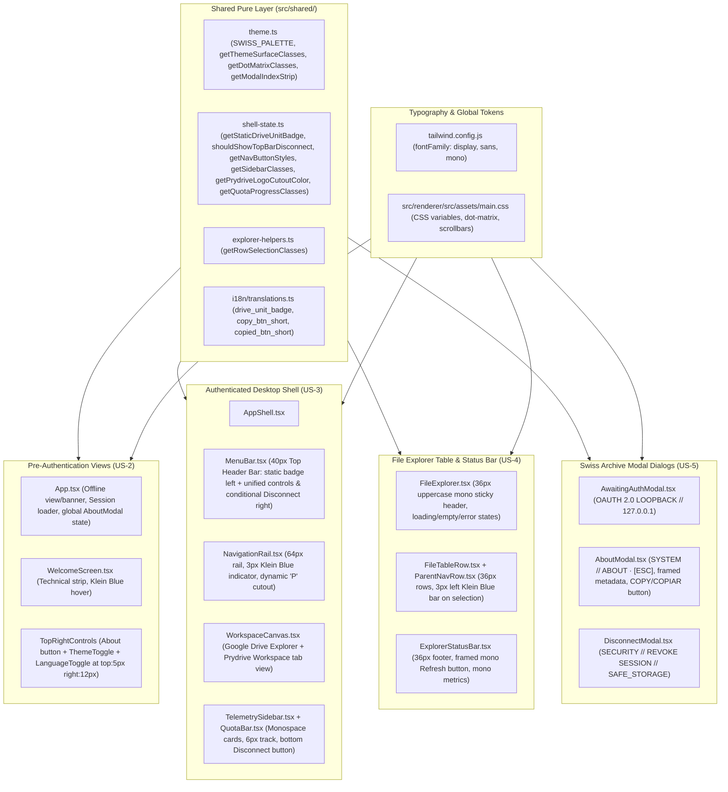

# Technical Plan: Spec 006 — Swiss Archive Visual Design System

## Architectural Overview & Context
This technical plan defines the design tokens, pure styling/state helper functions, component adaptations, and automated test strategy required to transition the entire Prydrive desktop application to the **Swiss Archive** visual design system across both **Light Mode** and **Dark Mode**.

In strict alignment with **docs/constitution.md**:
- **Principle 1 & 3 (Stack Simplicity & YAGNI):** All Swiss Archive palettes, CSS custom properties, dot-matrix canvas rules, and three-tier font stacks (`font-display`, `font-sans`, `font-mono`) are implemented via Tailwind CSS (`tailwind.config.js`), global CSS (`src/renderer/src/assets/main.css`), and pure TypeScript modules in `src/shared/`, adding **zero new runtime dependencies**.
- **Principle 4 (Zero Red Tests / TDD):** Every token mapping, surface palette resolver, conditional top-bar disconnect visibility rule, static header unit badge resolver, row selection indicator rule, and modal index strip descriptor is encapsulated in pure deterministic functions in `src/shared/` and tested first with Vitest.



---

## 1. Files and Responsibilities

| File Path | Layer | Responsibility |
| :--- | :--- | :--- |
| `tailwind.config.js` | Build Config | Defines the three-tier typographic families (`display`: `['Space Grotesk', 'Segoe UI', 'system-ui', 'sans-serif']`, `sans`: `['Inter', '-apple-system', 'BlinkMacSystemFont', 'Segoe UI', 'sans-serif']`, `mono`: `['IBM Plex Mono', 'Cascadia Mono', 'Consolas', 'monospace']`) (`FR-3`, `NFR-2`). |
| `src/renderer/index.html` | Renderer Entry | Loads non-blocking Google Fonts stylesheet (`Space Grotesk`, `Inter`, `IBM Plex Mono`) with `display=swap` and sets default Swiss Archive body classes (`FR-3`, `NFR-2`). |
| `src/renderer/src/assets/main.css` | Global CSS | Declares Swiss Archive Light and Dark CSS variables (`--bg-canvas`, `--bg-secondary`, `--bg-card`, `--rule-strong`, `--rule-subtle`, `--klein`, etc.), `.swiss-dot-matrix` radial grid utility (`20px × 20px`), and Swiss Archive scrollbar tracks/thumbs (`FR-1`, `FR-2`, `FR-5`). |
| `src/shared/theme.ts` | Shared Pure Logic | Updates `getThemeSurfaceClasses(theme)` to return exact Swiss Archive Light (`#FAF9F6` / `#F2F0EA` / `#FFFFFF` / `#C9C6BD`) and Dark (`#101216` / `#15181E` / `#181C23` / `#2C323D`) surface/border/text classes; adds `getTechnicalIndexStrip(context, version)` for cards and modals (`FR-1`, `FR-2`, `FR-6`, `FR-17`). |
| `src/shared/shell-state.ts` | Shared Pure Logic | Updates `getNavButtonStyles`, `getSidebarClasses`, and `getPrydriveLogoCutoutColor` (`#FFFFFF` / `#181C23` when active; `#F2F0EA` / `#15181E` when inactive); adds `getStaticDriveUnitBadge(language)` (`'UNIDAD: //MY_DRIVE'` in `es`, `'DRIVE: //MY_DRIVE'` in `en`), `shouldShowTopBarDisconnect(isSidebarExpanded)` (`!isSidebarExpanded`), and `getQuotaProgressColorClass(percentage, isUnmetered, theme)` (`FR-9`, `FR-10`, `FR-11`, `FR-15`, `FR-16`, `EC-5`, `EC-6`). |
| `src/shared/explorer-helpers.ts` | Shared Pure Logic | Updates `getRowSelectionClasses(isSelected, theme)` to apply Swiss Archive selected surfaces (`bg-[#DDE7FA] text-[#1B44E8]` in Light, `bg-[#1C2D52] text-[#3B66FF]` in Dark) and hover surfaces (`hover:bg-[#ECEAE3]` / `hover:bg-[#1E232C]`) (`FR-12`, `FR-13`). |
| `src/shared/i18n/translations.ts` | Shared i18n | Adds bilingual keys (`en` / `es`) for `drive_unit_badge` (`'DRIVE: //MY_DRIVE'` / `'UNIDAD: //MY_DRIVE'`), `about_copy_short` (`'COPY'` / `'COPIAR'`), and `about_copied_short` (`'COPIED!'` / `'¡COPIADO!'`) (`FR-9`, `FR-10`, `FR-17`). |
| `src/renderer/src/components/ui/ThemeToggle.tsx` | Renderer UI | Styles the `30px × 30px` (`w-[30px] h-[30px] rounded-[4px]`) Moon/Sun button with `1px` Swiss Archive border (`#C9C6BD` / `#2C323D`), elevated card background, and Klein Blue hover border/text (`FR-4`, `FR-7`). |
| `src/renderer/src/components/ui/LanguageToggle.tsx` | Renderer UI | Styles the `30px`-tall (`h-[30px] rounded-[4px]`) `EN | ES` control group with `font-mono`, `1px` structural border, and elevated active button with Klein Blue text (`FR-4`, `FR-7`). |
| `src/renderer/src/components/auth/WelcomeScreen.tsx` | Renderer UI | Applies `.swiss-dot-matrix` canvas, top-right control cluster (`top-[5px] right-[12px] gap-2` with `About` info button + `ThemeToggle` + `LanguageToggle`), `6px` framed card with `PRYDRIVE // AUTHENTICATION` · `OAUTH 2.0 · v<version>` strip, Klein Blue cloud badge, `font-display` heading, and Google sign-in button with Klein Blue hover state (`FR-5`, `FR-6`, `FR-7`, `FR-8`). |
| `src/renderer/src/App.tsx` | Renderer Root | Mounts `<AboutModal />` globally so it opens from both Pre-Authentication (Sign-In / Offline) and Authenticated views (`FR-7`, `EC-7`); styles Offline Mode screen (`PRYDRIVE // OFFLINE` · `NETWORK_STATUS`), Offline banner, and Session Validation spinner with Swiss Archive tokens and `.swiss-dot-matrix` (`EC-1`). |
| `src/renderer/src/components/shell/MenuBar.tsx` | Renderer Shell | Replaces legacy `Options` and `Help` dropdown menus with the `40px` Swiss Archive top header bar: static `UNIDAD: //MY_DRIVE` (`DRIVE: //MY_DRIVE`) monospace badge on the left, and unified `About` (`i`) + `ThemeToggle` + `LanguageToggle` + conditional icon-only `Disconnect` SVG button (`!isSidebarExpanded`) on the right (`FR-7`, `FR-9`, `FR-10`, `FR-16`, `EC-3`, `EC-6`). |
| `src/renderer/src/components/shell/AppShell.tsx` | Renderer Shell | Wires `isSidebarExpanded`, `onOpenAbout`, `onDisconnect`, `language`, and `theme` into `MenuBar`, `NavigationRail`, `WorkspaceCanvas`, and `TelemetrySidebar` (`US-3`). |
| `src/renderer/src/components/shell/NavigationRail.tsx` | Renderer Shell | Styles the `64px` (`w-16`) left rail with `#F2F0EA` / `#15181E` background, `1px` right border, `3px` (`w-[3px]`) vertical Klein Blue active indicator bar, `40px × 40px` (`rounded-[6px]`) framed active button, and dynamic `"P"` cutout (`FR-11`, `EC-5`). |
| `src/renderer/src/components/shell/WorkspaceCanvas.tsx` | Renderer Shell | Renders `FileExplorer` when `activeNav === 'google-drive'` and renders the Swiss Archive `PRYDRIVE // WORKSPACE` framed card over `.swiss-dot-matrix` when `activeNav === 'prydrive'` (`US-3`, `FR-5`). |
| `src/renderer/src/components/shell/TelemetrySidebar.tsx` | Renderer Shell | Styles the `260px` right sidebar with `28px × 28px` circular divider toggle button, provider header, `1px`-bordered `CUENTA` and `ALMACENAMIENTO` cards (`rounded-[6px]`, `10px` uppercase mono headers), and the bottom-pinned full-width danger `Disconnect` (`Desconectar`) button (`FR-15`, `FR-16`, `EC-6`). |
| `src/renderer/src/components/storage/QuotaBar.tsx` | Renderer UI | Styles storage quota telemetry in `font-mono` with a `6px`-high (`h-1.5 rounded-[2px]`) rectangular bordered track preserving usage color thresholds (`< 75%` Klein Blue, `>= 75%` signal/amber, `>= 90%` danger/red, and unlimited storage) (`FR-15`). |
| `src/renderer/src/components/explorer/FileExplorer.tsx` | Renderer UI | Styles the central table container (`#FFFFFF` / `#181C23`), `36px` (`h-9`) sticky header in `11px` uppercase `font-mono` with secondary background and `1px` strong bottom border, and Swiss Archive loading/empty/error states (`FR-12`, `EC-2`). |
| `src/renderer/src/components/explorer/FileTableRow.tsx` | Renderer UI | Styles `36px` (`h-9`) rows with `1px` subtle bottom rule (`#DFDDD6` / `#222730`), `3px` left Klein Blue accent bar when selected, and `font-mono` creation timestamps and file sizes (`FR-12`, `FR-13`). |
| `src/renderer/src/components/explorer/ParentNavRow.tsx` | Renderer UI | Styles the `36px` virtual `"..."` parent row with Swiss Archive folder icon, bold `font-mono` `"..."` label, and subtle bottom border (`FR-12`). |
| `src/renderer/src/components/explorer/ExplorerStatusBar.tsx` | Renderer UI | Styles the `36px` (`h-9`) footer bar with secondary surface background, `1px` top strong border, framed `4px`-radius `font-mono` `Refresh` (`Actualizar`) button, and `font-mono` counts and total size (`FR-14`). |
| `src/renderer/src/components/auth/AwaitingAuthModal.tsx` | Renderer UI | Adds `OAUTH 2.0 LOOPBACK` // `127.0.0.1` technical header strip, `6px` framed modal container, rectangular `6px` countdown bar, and `4px`-radius cancel button (`FR-17`). |
| `src/renderer/src/components/shell/AboutModal.tsx` | Renderer Shell | Adds `SYSTEM // ABOUT` // `[ESC]` interactive technical header strip, rectangular `3px`-radius `font-mono` version badge, `1px` framed metadata box, bordered `COPY` / `COPIAR` (`COPIED!` / `¡COPIADO!`) button, and `4px`-radius Klein Blue primary button (`FR-17`). |
| `src/renderer/src/components/auth/DisconnectModal.tsx` | Renderer UI | Adds `SECURITY // REVOKE SESSION` // `SAFE_STORAGE` technical header strip, `6px`-radius danger icon badge, `font-display` title, and `4px`-radius geometric cancel/confirm buttons (`FR-17`). |
| `tests/unit/theme-surfaces.test.ts` | Unit Tests | Validates Swiss Archive Light/Dark surface palettes, dot-matrix helper, row selection classes with `3px` left Klein Blue indicator, and Prydrive logo cutout hex values (`US-1`, `US-4`). |
| `tests/unit/welcome-screen.test.ts` | Unit Tests | Validates pre-authentication technical index strip descriptors (`PRYDRIVE // AUTHENTICATION`, `PRYDRIVE // OFFLINE`), top-right control cluster offsets (`top-[5px] right-[12px] gap-2`), and About modal trigger (`US-2`). |
| `tests/unit/menu-bar.test.ts` & `tests/unit/shell-state.test.ts` | Unit Tests | Validates static `UNIDAD: //MY_DRIVE` / `DRIVE: //MY_DRIVE` badge across folders and rail tabs, conditional top-bar icon-only `Disconnect` visibility (`shouldShowTopBarDisconnect`), and quota threshold colors (`US-3`). |
| `tests/unit/drive-explorer.test.ts` | Unit Tests | Validates Swiss Archive explorer row selection classes, `3px` left accent bar, and monospace table/status bar formatting (`US-4`). |
| `tests/unit/about-modal.test.ts` | Unit Tests | Validates technical index strip descriptors for all three modals (`AwaitingAuthModal`, `AboutModal`, `DisconnectModal`) and localized `COPY`/`COPIAR` button labels (`US-5`). |

---

## 2. Business Logic and Decoupled Functions

All visual token mappings and conditional UI state rules are defined as pure, deterministic functions in `src/shared/`:

### A. Swiss Archive Surface & Technical Strip Helpers (`src/shared/theme.ts`)
```typescript
import type { ThemeMode } from './types';
import { APP_VERSION } from './version';

export interface ThemeSurfacePalette {
  frameBg: string;
  canvasBg: string;
  secondaryBg: string;
  cardBg: string;
  modalBg: string;
  hoverBg: string;
  selectedBg: string;
  border: string;
  borderSubtle: string;
  textPrimary: string;
  textSecondary: string;
  textMuted: string;
  accentBg: string;
  accentText: string;
  accentBorder: string;
}

/**
 * Returns the exact Swiss Archive Light or Dark palette classes (FR-1, FR-2, NFR-1).
 */
export function getThemeSurfaceClasses(theme: ThemeMode): ThemeSurfacePalette;

export type TechnicalStripContext =
  | 'welcome'
  | 'offline'
  | 'workspace'
  | 'awaiting_auth'
  | 'about'
  | 'disconnect';

export interface TechnicalStripDescriptor {
  leftLabel: string;
  rightLabel: string;
}

/**
 * Pure resolver returning the uppercase monospace labels for card and modal technical index strips (FR-6, FR-17).
 */
export function getTechnicalIndexStrip(
  context: TechnicalStripContext,
  version: string = APP_VERSION
): TechnicalStripDescriptor;
```

### B. Shell Header, Rail & Telemetry Helpers (`src/shared/shell-state.ts`)
```typescript
import type { LanguageCode, ThemeMode } from './types';

/**
 * Returns the static monospace unit indicator for the left side of the 40px top header bar (FR-9, FR-10, EC-3).
 * Always returns 'UNIDAD: //MY_DRIVE' for 'es' and 'DRIVE: //MY_DRIVE' for 'en'.
 */
export function getStaticDriveUnitBadge(language: LanguageCode = 'en'): string;

/**
 * Determines whether the compact 30x30 icon-only Disconnect SVG button is shown
 * in the top header bar to the right of the EN|ES selector (FR-16, EC-6).
 * True strictly when the right telemetry sidebar is collapsed.
 */
export function shouldShowTopBarDisconnect(isSidebarExpanded: boolean): boolean;

/**
 * Resolves the inner cutout circle hex color for the Prydrive 'P' logo in the left rail (FR-11, EC-5):
 * - Active: '#FFFFFF' (light) | '#181C23' (dark)
 * - Inactive: '#F2F0EA' (light) | '#15181E' (dark)
 */
export function getPrydriveLogoCutoutColor(
  isActive: boolean,
  theme: ThemeMode = 'dark'
): string;

/**
 * Resolves the storage quota fill bar color class preserving thresholds (FR-15):
 * - isUnmetered: Klein Blue at 60% opacity
 * - >= 90%: Danger red ('bg-[#DC2626]' in light, 'bg-[#EF4444]' in dark)
 * - >= 75%: Warning signal ('bg-[#D95D1E]' in light, 'bg-[#F97316]' in dark)
 * - < 75%: Klein Blue ('bg-[#1B44E8]' in light, 'bg-[#3B66FF]' in dark)
 */
export function getQuotaProgressColorClass(
  percentage: number,
  isUnmetered: boolean = false,
  theme: ThemeMode = 'dark'
): string;
```

### C. Explorer Row Selection & Accent Bar Helper (`src/shared/explorer-helpers.ts`)
```typescript
/**
 * Resolves Swiss Archive row classes for selected and unselected states across Light and Dark modes (FR-12, FR-13).
 * Selected rows receive the selected surface ('bg-[#DDE7FA]' / 'bg-[#1C2D52]'), Klein Blue text ('text-[#1B44E8]' / 'text-[#3B66FF]'),
 * and a 3px left Klein Blue indicator bar.
 */
export function getRowSelectionClasses(
  isSelected: boolean,
  theme: ThemeMode = 'dark'
): string;
```

---

## 3. Algorithm in Pseudocode

### A. Unified Top-Right Controls & Conditional Disconnect Rendering (`WelcomeScreen` & `MenuBar`)
```text
FUNCTION renderTopRightControlCluster(context, language, theme, isSidebarExpanded):
    // Identical position in both Pre-Auth (absolute top-[5px] right-[12px]) and Auth Header (h-[40px] px-[12px])
    RENDER container WITH classes "flex items-center gap-2":
        1. AboutIconButton (30x30, rounded-[4px], 1px border --rule-strong):
           ON CLICK -> openAboutModal()
        2. ThemeToggle (30x30, rounded-[4px], 1px border --rule-strong):
           ICON -> Moon if theme == 'light' ELSE Sun
           ON CLICK -> toggleTheme()
        3. LanguageToggle (h-[30px], rounded-[4px], 1px border --rule-strong, font-mono):
           BUTTON 'EN' (active if language == 'en' -> cardBg + Klein Blue text)
           BUTTON 'ES' (active if language == 'es' -> cardBg + Klein Blue text)
        4. IF context == 'authenticated' AND shouldShowTopBarDisconnect(isSidebarExpanded) IS TRUE:
           RENDER CompactDisconnectIconButton (30x30, rounded-[4px], 1px danger border, logout SVG only)
           ON CLICK -> openDisconnectModal()
```

### B. Technical Index Strip Resolution (`getTechnicalIndexStrip`)
```text
FUNCTION getTechnicalIndexStrip(context, version):
    SWITCH context:
        CASE 'welcome':
            RETURN { leftLabel: 'PRYDRIVE // AUTHENTICATION', rightLabel: 'OAUTH 2.0 · ' + version }
        CASE 'offline':
            RETURN { leftLabel: 'PRYDRIVE // OFFLINE', rightLabel: 'NETWORK_STATUS' }
        CASE 'workspace':
            RETURN { leftLabel: 'PRYDRIVE // WORKSPACE', rightLabel: version }
        CASE 'awaiting_auth':
            RETURN { leftLabel: 'OAUTH 2.0 LOOPBACK', rightLabel: '127.0.0.1' }
        CASE 'about':
            RETURN { leftLabel: 'SYSTEM // ABOUT', rightLabel: '[ESC]' }
        CASE 'disconnect':
            RETURN { leftLabel: 'SECURITY // REVOKE SESSION', rightLabel: 'SAFE_STORAGE' }
```

---

## 4. Interface Design and Visual Palette Contract

### A. Swiss Archive Color Tokens (`FR-1`, `FR-2`, `NFR-1`)

| Token Role | Light Mode (`light`) | Dark Mode (`dark`) |
| :--- | :--- | :--- |
| **Primary Canvas (`--bg-canvas`)** | `#FAF9F6` (Warm Stone Paper) | `#101216` (Deep Carbon Ink) |
| **Secondary Bars/Rail/Sidebar (`--bg-secondary`)** | `#F2F0EA` | `#15181E` |
| **Elevated Card / Table / Modal (`--bg-card`)** | `#FFFFFF` | `#181C23` |
| **Row / Control Hover (`--bg-hover`)** | `#ECEAE3` | `#1E232C` |
| **Selected Row Surface (`--bg-selected`)** | `#DDE7FA` | `#1C2D52` |
| **Primary Ink (`--ink-primary`)** | `#111315` | `#F3F4F6` |
| **Secondary Ink (`--ink-secondary`)** | `#4A4E54` | `#9CA3AF` |
| **Muted Ink (`--ink-muted`)** | `#7C8087` | `#6B7280` |
| **Strong Structural 1px Rule (`--rule-strong`)** | `#C9C6BD` | `#2C323D` |
| **Subtle Row 1px Rule (`--rule-subtle`)** | `#DFDDD6` | `#222730` |
| **Primary Klein Blue Accent (`--klein`)** | `#1B44E8` (Hover `#1231B5`) | `#3B66FF` (Hover `#5A7FFF`) |
| **Warning / Signal Accent (`--signal`)** | `#D95D1E` | `#F97316` |
| **Danger Accent (`--danger`)** | `#DC2626` | `#EF4444` |

### B. Structural Layout Diagrams

#### 1. Pre-Authentication View (`WelcomeScreen.tsx` & `App.tsx`)
```text
+-----------------------------------------------------------------------+
|                                            [ i ] [ Moon/Sun ] [EN|ES] | <- top: 5px, right: 12px, gap: 8px
|  .  .  .  .  .  .  .  .  .  .  .  .  .  .  .  .  .  .  .  .  .  .  .  |
|               +---------------------------------------+               |
|               | PRYDRIVE // AUTH   OAUTH 2.0 · v0.4.0 | (32px strip)  |
|               +---------------------------------------+               |
|               |              [ Cloud ]                |               |
|               |        Bienvenido a Prydrive          | (font-display)|
|               |   Gestión de archivos rápida...       | (font-sans)   |
|               |  [ [G] Iniciar sesión con Google -> ] | (Klein hover) |
|               |  -----------------------------------  |               |
|               |  La autenticación se realiza...       | (font-mono)   |
|               +---------------------------------------+               |
+-----------------------------------------------------------------------+
```

#### 2. Authenticated 4-Zone Desktop Shell (`AppShell.tsx`)
```text
+-----------------------------------------------------------------------+
| UNIDAD: //MY_DRIVE                   [ i ] [ Moon/Sun ] [EN|ES] [Out] | <- 40px header ([Out] only if sidebar collapsed)
+------+------------------------------------------+---------------------+
| [P/] | TIPO | NOMBRE        | FECHA     | TAMAÑO| Google Drive        |
| ---- |------+---------------+-----------+-------| o Conectado         |
| [GD] |  []  | ...           |           |       | +-----------------+ |
|      |▌ []  | Financial.xls | 14/07/... | 167 KB| | CUENTA          | |
|      |  []  | NDA doc.pdf   | 14/07/... | 3.0 MB| | sebiplay@...    | |
|      |                                          | +-----------------+ |
|      |                                          | | ALMACENAMIENTO  | |
|      |                                          | | 8.4 / 15 GB 56% | |
|      |< (28x28 circular divider toggle)         | | [=======      ] | |
|      +------------------------------------------+ +-----------------+ |
|      | [Actualizar]   4 carpetas, 6 arch   1.2GB| | [ Desconectar ] | |
+------+------------------------------------------+---------------------+
```

---

## 5. Justified Technical Decisions

| Decision | Alternative Considered | Technical Rationale |
| :--- | :--- | :--- |
| **Tailwind font families + CSS variables + non-blocking Google Fonts with system metric fallbacks** | Adding `@fontsource/*` npm packages | **Constitution Principle 3**: Avoids adding new npm dependencies while providing `Space Grotesk`, `Inter`, and `IBM Plex Mono` when online and zero-shift fallback (`Segoe UI` / `Cascadia Mono` / `Consolas`) when offline (`NFR-2`). |
| **Global `<AboutModal />` state managed at `App.tsx` level and passed down** | Duplicating `<AboutModal />` inside `WelcomeScreen` and `AppShell` | Allows the unified top-right `About` (`i`) button (`FR-7`, `EC-7`) to open the exact same modal instance whether the user is on Sign-In, Offline Mode, or the File Explorer. |
| **Repurposing `MenuBar.tsx` as the `40px` Swiss Archive Top Header Bar** | Deleting `MenuBar.tsx` and inlining header markup into `AppShell.tsx` | Preserves modularity and component boundaries (`AppShell` Zone 1) while replacing the legacy `Options`/`Help` dropdowns with the static drive unit badge on the left and the unified control cluster on the right (`FR-9`, `FR-16`). |
| **Pure `shouldShowTopBarDisconnect(isSidebarExpanded)` helper** | CSS-only media query | Sidebar collapse can be triggered manually by the user at any window width (`FR-16`, `EC-6`); a pure boolean predicate tied to `isSidebarExpanded` is 100% deterministic and unit-testable. |

---

## 6. Automated Testing Strategy (TDD)

All tasks follow the strict Red $\rightarrow$ Green $\rightarrow$ Refactor cycle using Vitest (`pnpm test`):

1. **`tests/unit/theme-surfaces.test.ts` (`US-1` / `T1`):**
   - Verifies `getThemeSurfaceClasses('light')` returns `#FAF9F6` canvas, `#F2F0EA` secondary, `#FFFFFF` card, `#C9C6BD` strong border, and `#111315` primary ink (`FR-1`).
   - Verifies `getThemeSurfaceClasses('dark')` returns `#101216` canvas, `#15181E` secondary, `#181C23` card, `#2C323D` strong border, and `#F3F4F6` primary ink (`FR-2`).
   - Verifies `getTechnicalIndexStrip` returns exact left/right uppercase labels for `'welcome'`, `'offline'`, `'workspace'`, `'awaiting_auth'`, `'about'`, and `'disconnect'` (`FR-6`, `FR-17`).

2. **`tests/unit/welcome-screen.test.ts` (`US-2` / `T2`):**
   - Verifies pre-authentication technical strip labels include `PRYDRIVE // AUTHENTICATION` and `OAUTH 2.0 · v<version>` (`FR-6`).
   - Verifies offline technical strip labels include `PRYDRIVE // OFFLINE` and `NETWORK_STATUS` (`FR-6`, `EC-1`).
   - Verifies unified top-right control cluster metadata and `About` modal trigger on pre-authentication views (`FR-7`, `EC-7`).

3. **`tests/unit/menu-bar.test.ts` & `tests/unit/shell-state.test.ts` (`US-3` / `T3`):**
   - Verifies `getStaticDriveUnitBadge('es') === 'UNIDAD: //MY_DRIVE'` and `getStaticDriveUnitBadge('en') === 'DRIVE: //MY_DRIVE'` (`FR-9`, `FR-10`, `EC-3`).
   - Verifies `shouldShowTopBarDisconnect(true) === false` and `shouldShowTopBarDisconnect(false) === true` (`FR-16`, `EC-6`).
   - Verifies `getPrydriveLogoCutoutColor` returns `#FFFFFF` (active light), `#181C23` (active dark), `#F2F0EA` (inactive light), and `#15181E` (inactive dark) (`FR-11`, `EC-5`).
   - Verifies `getQuotaProgressColorClass` preserves `< 75%` Klein Blue, `>= 75%` signal orange, and `>= 90%` danger red (`FR-15`).

4. **`tests/unit/drive-explorer.test.ts` (`US-4` / `T4`):**
   - Verifies `getRowSelectionClasses(true, 'light')` includes `#DDE7FA` surface, `#1B44E8` text, and `3px` left Klein Blue indicator bar (`FR-13`).
   - Verifies `getRowSelectionClasses(true, 'dark')` includes `#1C2D52` surface, `#3B66FF` text, and `3px` left Klein Blue indicator bar (`FR-13`).
   - Verifies unselected row hover classes use `#ECEAE3` (light) and `#1E232C` (dark) (`FR-12`).

5. **`tests/unit/about-modal.test.ts` & `tests/unit/translations.test.ts` (`US-5` / `T5`):**
   - Verifies modal technical index strips for `awaiting_auth` (`OAUTH 2.0 LOOPBACK` / `127.0.0.1`), `about` (`SYSTEM // ABOUT` / `[ESC]`), and `disconnect` (`SECURITY // REVOKE SESSION` / `SAFE_STORAGE`) (`FR-17`).
   - Verifies 100% EN/ES translation key parity including `drive_unit_badge`, `about_copy_short`, and `about_copied_short`.

---

## 7. Traceability Matrix & Story Dependencies

| User Story | Requirements Satisfied | Files Modified / Created | Automated Tests | Depends on |
| :--- | :--- | :--- | :--- | :--- |
| **US-1: Swiss Archive Color Palette, Typography & Geometric Tokens** | FR-1, FR-2, FR-3, FR-4, NFR-1, NFR-2 | `tailwind.config.js`, `src/renderer/index.html`, `src/renderer/src/assets/main.css`, `src/shared/theme.ts` | `tests/unit/theme-surfaces.test.ts` | None |
| **US-2: Swiss Archive Pre-Authentication & Offline Views** | FR-5, FR-6, FR-7, FR-8, EC-1, EC-7 | `src/shared/theme.ts`, `src/renderer/src/components/ui/ThemeToggle.tsx`, `src/renderer/src/components/ui/LanguageToggle.tsx`, `src/renderer/src/components/auth/WelcomeScreen.tsx`, `src/renderer/src/App.tsx` | `tests/unit/welcome-screen.test.ts` | US-1 |
| **US-3: Swiss Archive Desktop Shell, Unified Top-Right Controls & Telemetry Sidebar** | FR-7, FR-9, FR-10, FR-11, FR-15, FR-16, EC-3, EC-5, EC-6 | `src/shared/shell-state.ts`, `src/shared/i18n/translations.ts`, `src/renderer/src/components/shell/AppShell.tsx`, `src/renderer/src/components/shell/MenuBar.tsx`, `src/renderer/src/components/shell/NavigationRail.tsx`, `src/renderer/src/components/shell/WorkspaceCanvas.tsx`, `src/renderer/src/components/shell/TelemetrySidebar.tsx`, `src/renderer/src/components/storage/QuotaBar.tsx` | `tests/unit/menu-bar.test.ts`, `tests/unit/shell-state.test.ts` | US-1, US-2 |
| **US-4: Swiss Archive File Explorer Table, Selection Rule & Status Bar** | FR-12, FR-13, FR-14, NFR-3, EC-2, EC-4 | `src/shared/explorer-helpers.ts`, `src/renderer/src/components/explorer/FileExplorer.tsx`, `src/renderer/src/components/explorer/FileTableRow.tsx`, `src/renderer/src/components/explorer/ParentNavRow.tsx`, `src/renderer/src/components/explorer/ExplorerStatusBar.tsx` | `tests/unit/drive-explorer.test.ts`, `tests/unit/theme-surfaces.test.ts` | US-1, US-3 |
| **US-5: Swiss Archive Modal Dialogs with Technical Header Strips** | FR-17, EC-4, EC-7 | `src/shared/theme.ts`, `src/shared/i18n/translations.ts`, `src/renderer/src/components/auth/AwaitingAuthModal.tsx`, `src/renderer/src/components/shell/AboutModal.tsx`, `src/renderer/src/components/auth/DisconnectModal.tsx` | `tests/unit/about-modal.test.ts`, `tests/unit/translations.test.ts` | US-1, US-2, US-3 |
