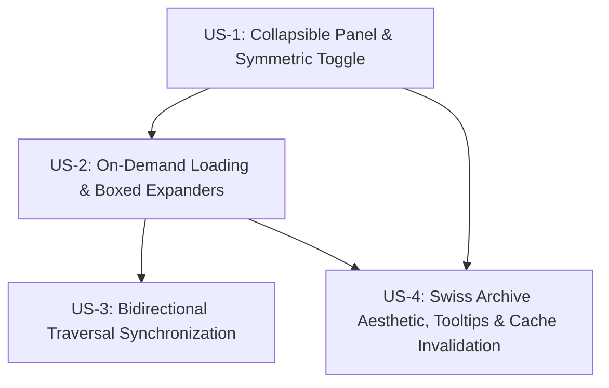

# Technical Plan: Spec 007 — Directory Tree Navigation Panel

## 1. Files and Responsibilities

| File Path | Role | Concrete Technical Responsibility |
| :--- | :--- | :--- |
| `src/shared/types.ts` | Shared Types | Extends `ListDirectoryParams` with `foldersOnly?: boolean` and defines `TreeNode`, `TreeStateMap`, and tree interaction interfaces. |
| `src/shared/shell-state.ts` | Shell State & Layout | Extends `ShellState` with `isTreeExpanded: boolean` (default: `false`), `TOGGLE_TREE`, and `SET_TREE_EXPANDED` actions, plus `shouldAutoCollapseTree` and `getTreePanelClasses`. |
| `src/shared/tree-helpers.ts` | Pure Business Logic | Implements decoupled, pure functions for tree initialization, lazy-loaded branch merging, leaf detection, collapse navigation (`[-]` to parent), ancestor traversal expansion, and cache invalidation. |
| `src/main/core/google-client.ts` | Main Process API | Adds `foldersOnly?: boolean` parameter to `listDirectory` to filter Google Drive queries by `mimeType = 'application/vnd.google-apps.folder'`, excluding files and conserving quota. |
| `src/main/ipc/storage-ipc.ts` | Main IPC Controller | Passes `foldersOnly` from renderer IPC requests to `GoogleAuthClient` and returns sorted folder-only `StorageItem[]`. |
| `src/preload/index.ts` & `index.d.ts` | IPC Bridge | Exposes `window.api.storage.listDirectory(params)` with typed `foldersOnly` parameter. |
| `src/renderer/src/components/tree/DirectoryTreePanel.tsx` | UI Container | Collapsible 240px Swiss Archive panel containing the upper Technical Index Strip (`DRIVE // TREE` · `MY_DRIVE`), scrollable tree canvas, loading spinner, and error retry badges. |
| `src/renderer/src/components/tree/TreeNodeItem.tsx` | UI Component | Renders a 32px uniform folder row with dotted hierarchy guidelines, boxed `[+]` / `[-]` toggle or leaf line, folder icon, single-line text with ellipsis, persistent hover tooltip (`title`), and 3px Klein Blue selection bar. |
| `src/renderer/src/components/tree/TreeExpanderBox.tsx` | UI Component | Geometric 12px × 12px square button with 1px border displaying `+` or `−` in monospace font. |
| `src/renderer/src/hooks/useDirectoryTree.ts` | React Hook | Coordinates tree state, on-demand lazy IPC loading, memory branch caching, bidirectional synchronization with `useDriveExplorer`, and manual refresh invalidation. |
| `src/renderer/src/components/shell/NavigationRail.tsx` | UI Shell | Adds the symmetrical 28px circular `RailDividerToggle` on the right border of the 64px rail with chevron iconography (`>` / `<`). |
| `src/renderer/src/components/explorer/FileExplorer.tsx` | UI Layout | Embeds `DirectoryTreePanel` side-by-side with the central table canvas, connecting selection and traversal states. |
| `tests/unit/tree-helpers.test.ts` | Unit Tests | Validates pure tree state transitions, branch merging, leaf state transitions, collapse-to-parent navigation, and breadcrumb chain expansion. |
| `tests/unit/tree-shell-state.test.ts` | Unit Tests | Validates tree panel reducers, responsive auto-collapse thresholds, and CSS class resolvers across Light and Dark modes. |
| `tests/unit/directory-tree.test.ts` | Component Tests | Validates DOM structure, Technical Index Strip labels, 32px row heights, ellipsis, tooltips, dotted guidelines, and `[+]`/`[-]` expander rendering. |
| `tests/integration/tree-navigation-flow.test.ts` | Integration Tests | Validates end-to-end bidirectional synchronization: clicking a tree folder updates the table; navigating inside the table auto-expands ancestor branches and highlights the tree node. |

---

## 2. Business Logic and Decoupled Functions

All tree algorithms are isolated into `src/shared/tree-helpers.ts`, strictly decoupled from React, Electron, and the Google Drive SDK.

```ts
// src/shared/types.ts extensions
export interface TreeNode {
  id: string;
  name: string;
  parentId: string | null;
  depth: number;
  isExpanded: boolean;
  isLoading: boolean;
  hasLoadedChildren: boolean;
  isLeaf: boolean;
  childrenIds: string[];
  error?: string | null;
}

export type TreeStateMap = Record<string, TreeNode>;

// src/shared/tree-helpers.ts pure signatures
export function createInitialTree(rootLabel: string = 'My Drive'): TreeStateMap;

export function addChildrenToTree(
  tree: TreeStateMap,
  parentId: string,
  folders: StorageItem[]
): TreeStateMap;

export function collapseTreeNode(
  tree: TreeStateMap,
  nodeId: string
): { tree: TreeStateMap; navigateToParentId: string | null };

export function expandTreeNode(
  tree: TreeStateMap,
  nodeId: string
): TreeStateMap;

export function syncTreeWithFolderStack(
  tree: TreeStateMap,
  folderStack: FolderCrumb[],
  currentFolderId: string
): TreeStateMap;

export function invalidateTreeCache(
  tree: TreeStateMap,
  rootLabel?: string
): TreeStateMap;
```

---

## 3. Algorithm in Pseudocode

### 3.1. On-Demand Branch Expansion and Leaf Evaluation (`expandOrFetchBranch`)
```text
FUNCTION handleExpanderClick(nodeId, tree, fetchSubfoldersApi):
  node = tree[nodeId]
  IF node IS NULL OR node.isLoading:
    RETURN tree

  // 1. If already expanded, collapse and navigate to parent (FR-6)
  IF node.isExpanded:
    parentResult = collapseTreeNode(tree, nodeId)
    IF parentResult.navigateToParentId:
      NAVIGATE_CENTRAL_TABLE(parentResult.navigateToParentId)
    RETURN parentResult.tree

  // 2. If cached in memory, re-expand immediately without network roundtrip (FR-9)
  IF node.hasLoadedChildren:
    newTree = expandTreeNode(tree, nodeId)
    RETURN newTree

  // 3. Trigger lazy fetch (FR-5, NFR-1)
  tree[nodeId].isLoading = true
  tree[nodeId].error = null
  EMIT_STATE(tree)

  TRY:
    folders = AWAIT fetchSubfoldersApi({ folderId: nodeId, foldersOnly: true })
    newTree = addChildrenToTree(tree, nodeId, folders)
    // If no child folders exist, mark as leaf (FR-7)
    IF folders.length == 0:
      newTree[nodeId].isLeaf = true
      newTree[nodeId].isExpanded = false
    ELSE:
      newTree[nodeId].isLeaf = false
      newTree[nodeId].isExpanded = true
    newTree[nodeId].isLoading = false
    newTree[nodeId].hasLoadedChildren = true
    RETURN newTree
  CATCH error:
    tree[nodeId].isLoading = false
    tree[nodeId].error = error.message
    RETURN tree
```

### 3.2. Bidirectional Traversal Synchronization (`syncTreeWithFolderStack`)
```text
FUNCTION syncTreeWithFolderStack(tree, folderStack, currentFolderId):
  newTree = CLONE(tree)
  
  // Ensure every crumb in the known active breadcrumb path is present and expanded
  FOR index FROM 0 TO folderStack.length - 1:
    crumb = folderStack[index]
    parentId = (index == 0) ? null : folderStack[index - 1].id
    
    IF NOT newTree[crumb.id]:
      newTree[crumb.id] = {
        id: crumb.id,
        name: crumb.name,
        parentId: parentId,
        depth: index,
        isExpanded: (crumb.id != currentFolderId),
        isLoading: false,
        hasLoadedChildren: false,
        isLeaf: false,
        childrenIds: []
      }
      IF parentId AND newTree[parentId]:
        IF crumb.id NOT IN newTree[parentId].childrenIds:
          newTree[parentId].childrenIds.APPEND(crumb.id)
    ELSE:
      IF crumb.id != currentFolderId:
        newTree[crumb.id].isExpanded = true

  RETURN newTree
```

---

## 4. Interface Design and API Contracts

### 4.1. Storage Provider Query Contract (`src/shared/types.ts`)
```ts
export interface ListDirectoryParams {
  folderId?: string;
  pageToken?: string;
  pageSize?: number;
  foldersOnly?: boolean; // When true, Google Drive q adds "and mimeType = 'application/vnd.google-apps.folder'"
}
```

### 4.2. Tree Component Structure & Guidelines
```
┌────────────────────────────────────────────────────────┐
│ DRIVE // TREE                              MY_DRIVE    │ <- 32px Technical Index Strip
├────────────────────────────────────────────────────────┤
│ [-] 📁 My Drive                                        │ <- Root node (depth 0)
│  :                                                     │
│  +-- [+] 📁 Documents                                  │ <- Node with subfolders (depth 1)
│  :    :                                                │
│  :    +-- 📁 Notes.txt (excluded - folders only)       │
│  :                                                     │
│  +-- [-] 📁 Projects                                   │ <- Expanded node (depth 1)
│  :    :                                                │
│  :    +-- [+] 📁 Prydrive                              │ <- Subfolder (depth 2)
│  :    :                                                │
│  :    +-- 📁 Archive                                   │ <- Leaf folder (no box, depth 2)
│  :                                                     │
│  +-- 📁 Finances                                       │ <- Leaf folder (no box, depth 1)
└────────────────────────────────────────────────────────┘
```

- **Guidelines**: Rendered via pure CSS pseudo-elements:
  - Vertical dotted border: `border-l border-dotted border-[#C9C6BD] dark:border-[#2C323D]`.
  - Horizontal branch connector: `before:w-3 before:border-b before:border-dotted`.
- **Expander Box (`TreeExpanderBox`)**:
  - Dimensions: `12px × 12px`, `rounded-[2px]`, `border border-[#7C8087] dark:border-[#6B7280]`.
  - Content: Monospace `+` or `−` in font size `9px`.
- **Row Styling**:
  - Uniform `32px` (`h-8`), flex items center, `text-xs`.
  - Unselected: `text-[#111315] dark:text-[#F3F4F6] hover:bg-[#ECEAE3] dark:hover:bg-[#1E232C]`.
  - Active (selected): `bg-[#DDE7FA] dark:bg-[#1C2D52] text-[#1B44E8] dark:text-[#3B66FF] border-l-[3px] border-l-[#1B44E8] dark:border-l-[#3B66FF]`.
  - Text truncation: `truncate` (`overflow-hidden text-ellipsis whitespace-nowrap`) with mandatory native `title={node.name}`.

---

## 5. Justified Technical Decisions

| Technical Choice | Alternative Discarded | Justification |
| :--- | :--- | :--- |
| **Normalized Dictionary State (`Record<string, TreeNode>`)** | Deeply nested recursive JSON tree object | A normalized map allows $O(1)$ lookups, instant node expansion/collapse updates without deep tree cloning, and simplifies ancestor resolution. |
| **Extending `ListDirectoryParams` with `foldersOnly?: boolean`** | Creating a separate new IPC channel `storage:list-tree-folders` | Reuses the battle-tested, secure `STORAGE_LIST_DIRECTORY` IPC channel, reducing maintenance surface and preserving provider-agnostic contracts. |
| **Dotted Guide Lines via CSS borders** | Heavy SVG tree canvas or external library (e.g. `react-complex-tree`) | Complies strictly with Constitution Principle 3 (Stack Simplicity) with zero additional packages, guaranteed 60fps rendering, and native Tailwind theming. |
| **Differentiating Leaf Nodes by Omission of Box** | Inactive disabled `[ ]` empty square | Omitting the box for leaf folders matches the user's reference image and classic desktop file manager aesthetics, avoiding visual clutter. |
| **Responsive Auto-Collapse Threshold (`shouldAutoCollapseTree`)** | Horizontal scroll overflow on small windows | When window width is constrained, preserving central table readability is paramount; auto-collapsing both sidebars guarantees the main content remains functional. |

---

## 6. Automated Testing Strategy

### 6.1. Unit Test Suites (TDD Cycle)
1. **`tests/unit/tree-helpers.test.ts`**:
   - `createInitialTree`: verifies root node initialization with depth 0 and localized label.
   - `addChildrenToTree`: tests merging children into parent `childrenIds`, depth incrementation, and leaf flag when array is empty.
   - `collapseTreeNode`: tests collapsing node and returning `navigateToParentId`.
   - `syncTreeWithFolderStack`: tests automatic ancestor expansion along breadcrumb chain.
   - `invalidateTreeCache`: tests resetting `hasLoadedChildren` while preserving root.
2. **`tests/unit/tree-shell-state.test.ts`**:
   - `shellReducer`: tests `TOGGLE_TREE` and `SET_TREE_EXPANDED`.
   - `shouldAutoCollapseTree`: tests threshold calculations with sidebar expanded/collapsed.
   - `getTreePanelClasses`: tests width and border transitions for Light and Dark modes.
3. **`tests/unit/directory-tree.test.ts`**:
   - Verifies rendering of `DirectoryTreePanel`, `DRIVE // TREE` technical strip, 32px row heights, `title` tooltips, `TreeExpanderBox`, and leaf connections.

### 6.2. Integration Test Suites
1. **`tests/integration/tree-navigation-flow.test.ts`**:
   - Verifies two-way interaction: clicking a tree folder fires table fetch; double-clicking a table folder reflects traversal in the tree and updates active indicator bar.

---

## 7. Traceability Matrix & Story Dependencies

### 7.1. Traceability Matrix

| User Story | Requirements | Production Modules | Test Suites |
| :--- | :--- | :--- | :--- |
| **US-1** (Collapsible Panel & Symmetric Toggle) | FR-1, FR-2, FR-14, NFR-2 | `shell-state.ts`, `NavigationRail.tsx`, `DirectoryTreePanel.tsx` | `tests/unit/tree-shell-state.test.ts` |
| **US-2** (On-Demand Loading & Boxed Expanders) | FR-4, FR-5, FR-6, FR-7, NFR-1, EC-1, EC-6 | `tree-helpers.ts`, `TreeExpanderBox.tsx`, `TreeNodeItem.tsx`, `google-client.ts`, `storage-ipc.ts` | `tests/unit/tree-helpers.test.ts`, `tests/unit/directory-tree.test.ts` |
| **US-3** (Bidirectional Traversal Synchronization) | FR-8, FR-9, NFR-3, EC-3 | `useDirectoryTree.ts`, `tree-helpers.ts`, `FileExplorer.tsx` | `tests/integration/tree-navigation-flow.test.ts` |
| **US-4** (Swiss Archive Aesthetic, Tooltips & Cache Invalidation) | FR-3, FR-10, FR-11, FR-12, FR-13, EC-2, EC-4, EC-5 | `DirectoryTreePanel.tsx`, `TreeNodeItem.tsx`, `theme-surfaces.ts`, `translations.ts` | `tests/unit/directory-tree.test.ts`, `tests/unit/tree-helpers.test.ts` |

### 7.2. Story Dependencies



- **US-1** has no dependencies; it establishes shell state, divider toggle, and layout containers.
- **US-2** depends on US-1; it implements the data structures, IPC query filtering, and boxed expanders.
- **US-3** depends on US-2; it connects the tree with the file explorer table for parallel two-way navigation.
- **US-4** depends on US-1 and US-2; it applies Swiss Archive surfaces, guidelines, tooltips, and refresh cache invalidation.
