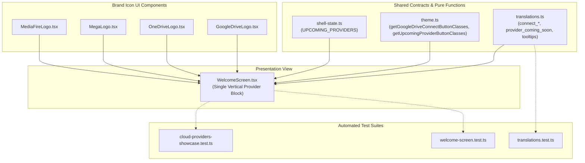
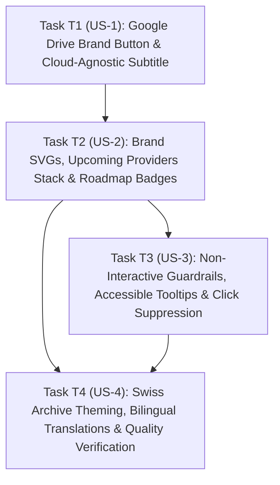

# Technical Plan — Spec 008: Multi-Provider Login Showcase and Google Drive Brand Connection

## 1. Files and Responsibilities

| File Path | Layer / Responsibility | Description |
| :--- | :--- | :--- |
| `src/shared/i18n/translations.ts` | Shared Logic / Localization | Adds bilingual dictionary keys for all 4 providers (`connect_google_drive`, `connect_onedrive`, `connect_mega`, `connect_mediafire`), roadmap badge (`provider_coming_soon`), hover tooltips (`provider_tooltip_*`), and updates `welcome_subtitle` to cloud-agnostic copy. |
| `src/shared/theme.ts` | Shared Logic / Theme Surfaces | Adds pure CSS class resolution helpers: `getGoogleDriveConnectButtonClasses`, `getUpcomingProviderButtonClasses`, `getRoadmapBadgeClasses`, and provider showcase metadata contracts. |
| `src/shared/shell-state.ts` | Shared Contracts / Types | Exports `UPCOMING_PROVIDERS` registry definition with deterministic ordering (`onedrive` $\rightarrow$ `mega` $\rightarrow$ `mediafire`), translation keys, and icon bindings. |
| `src/renderer/src/components/ui/OneDriveLogo.tsx` | UI Component / Brand Asset | Standalone, lightweight vector SVG component rendering the official Microsoft OneDrive cloud mark (`#0078D4`). |
| `src/renderer/src/components/ui/MegaLogo.tsx` | UI Component / Brand Asset | Standalone, lightweight vector SVG component rendering the official MEGA red circle with white `"M"` mark (`#D9272E`). |
| `src/renderer/src/components/ui/MediaFireLogo.tsx` | UI Component / Brand Asset | Standalone, lightweight vector SVG component rendering the official MediaFire flame-cloud emblem (`#0070FF`). |
| `src/renderer/src/components/auth/WelcomeScreen.tsx` | Presentation / Authentication View | Refactors welcome card actions: renders primary Google Drive connection button and secondary disabled provider stack in a single vertical group, updates subtitle, and attaches accessible tooltips and badges. |
| `tests/unit/cloud-providers-showcase.test.ts` | Automated Tests / Unit Suite | Comprehensive Vitest suite asserting provider sequence, localized labels, roadmap badges, tooltip titles, disabled states (`aria-disabled="true"`), and click/key-press suppression. |
| `tests/unit/welcome-screen.test.ts` | Automated Tests / Unit Suite | Updates welcome screen unit tests to assert the Google Drive logo, updated subtitle, and integration of upcoming provider buttons. |
| `tests/unit/translations.test.ts` | Automated Tests / Unit Suite | Asserts bilingual dictionary parity (100% key parity between `en` and `es`) for all newly introduced provider and tooltip keys. |



---

## 2. Business Logic and Decoupled Functions

All styling and provider metadata logic is strictly pure, deterministic, and free of browser or DOM dependencies.

### 2.1 Provider Registry Definition (`src/shared/shell-state.ts`)

```typescript
export interface UpcomingProviderDefinition {
  readonly id: 'onedrive' | 'mega' | 'mediafire';
  readonly name: string;
  readonly labelKey: 'connect_onedrive' | 'connect_mega' | 'connect_mediafire';
  readonly tooltipKey: 'provider_tooltip_onedrive' | 'provider_tooltip_mega' | 'provider_tooltip_mediafire';
  readonly badgeKey: 'provider_coming_soon';
}

export const UPCOMING_PROVIDERS: readonly UpcomingProviderDefinition[] = [
  {
    id: 'onedrive',
    name: 'OneDrive',
    labelKey: 'connect_onedrive',
    tooltipKey: 'provider_tooltip_onedrive',
    badgeKey: 'provider_coming_soon'
  },
  {
    id: 'mega',
    name: 'MEGA',
    labelKey: 'connect_mega',
    tooltipKey: 'provider_tooltip_mega',
    badgeKey: 'provider_coming_soon'
  },
  {
    id: 'mediafire',
    name: 'MediaFire',
    labelKey: 'connect_mediafire',
    tooltipKey: 'provider_tooltip_mediafire',
    badgeKey: 'provider_coming_soon'
  }
] as const;
```

### 2.2 Provider Button Class Resolvers (`src/shared/theme.ts`)

```typescript
/**
 * Resolves classes for the primary active Google Drive connection button (FR-1, FR-2, FR-11, FR-12).
 */
export function getGoogleDriveConnectButtonClasses(
  theme: ThemeMode = 'dark',
  disabled: boolean = false
): string {
  const base =
    'group flex items-center justify-between gap-5 px-4 py-2 text-xs font-semibold rounded-[4px] border font-display transition-all duration-150';
  if (disabled) {
    return theme === 'dark'
      ? `${base} bg-[#15181E] text-[#6B7280] border-[#2C323D] opacity-60 cursor-not-allowed`
      : `${base} bg-[#F2F0EA] text-[#7C8087] border-[#C9C6BD] opacity-60 cursor-not-allowed`;
  }
  return theme === 'dark'
    ? `${base} bg-[#15181E] text-[#F3F4F6] border-[#2C323D] hover:bg-[#3B66FF] hover:border-[#3B66FF] hover:text-white active:scale-[0.99] cursor-pointer shadow-xs`
    : `${base} bg-[#F2F0EA] text-[#111315] border-[#C9C6BD] hover:bg-[#1B44E8] hover:border-[#1B44E8] hover:text-white active:scale-[0.99] cursor-pointer shadow-xs`;
}

/**
 * Resolves classes for secondary upcoming cloud provider buttons (FR-3, FR-6, FR-11, FR-12).
 * Permanently styled as disabled with muted secondary Swiss Archive surfaces and non-interactive cursor.
 */
export function getUpcomingProviderButtonClasses(
  theme: ThemeMode = 'dark',
  layout: ProviderButtonLayout = 'full'
): string {
  const widthAndGap = layout === 'compact' ? 'gap-5' : 'w-full gap-3';
  const base =
    `flex items-center justify-between ${widthAndGap} px-4 py-2 text-xs font-medium rounded-[4px] border font-display cursor-not-allowed select-none opacity-40`;
  return theme === 'dark'
    ? `${base} bg-[#15181E] text-[#9CA3AF] border-[#2C323D]`
    : `${base} bg-[#F2F0EA] text-[#6B7280] border-[#C9C6BD]`;
}

/**
 * Resolves classes for the compact "Próximamente" / "Coming soon" roadmap badge (FR-5, FR-11, FR-12).
 */
export function getRoadmapBadgeClasses(
  theme: ThemeMode = 'dark'
): string {
  const base =
    'px-1.5 py-0.5 rounded-[3px] border font-mono text-[9.5px] uppercase font-semibold tracking-wider shrink-0 transition-colors';
  return theme === 'dark'
    ? `${base} bg-[#1E232C] border-[#2C323D] text-[#9CA3AF]`
    : `${base} bg-[#ECEAE3] border-[#C9C6BD] text-[#4A4E54]`;
}
```

---

## 3. Algorithm in Pseudocode

### 3.1 WelcomeScreen Provider Showcase Rendering

```text
FUNCTION renderProviderShowcase(theme, language, isConnecting, onSignIn):
  // 1. Render container with compact 2x2 grid (without w-full for intrinsic centering)
  CREATE container WITH className="grid grid-cols-2 gap-2"

  // 2. Primary Google Drive Action
  RENDER button:
    PROPERTIES:
      type="button"
      className=getGoogleDriveConnectButtonClasses(theme, isConnecting)
      disabled=isConnecting
      onClick=onSignIn
      title=getTranslation(language, 'connect_google_drive')
      aria-label=getTranslation(language, 'connect_google_drive')
      data-testid="connect-btn-google-drive"
    CHILDREN:
      - Icon Badge: 24x24 white rounded box containing <GoogleDriveLogo className="w-4 h-4" />
      - Trailing Arrow: <ArrowRight className="w-4 h-4 ml-auto text-current transition-colors shrink-0" />

  // 3. Upcoming Provider Showcase (OneDrive, MEGA, MediaFire)
  FOR EACH provider IN UPCOMING_PROVIDERS:
    LET tooltipText = getTranslation(language, provider.tooltipKey)

    RENDER wrapper WITH title=tooltipText, className="relative" (guarantees hover event capture):
      RENDER non-interactive button:
        PROPERTIES:
          type="button"
          tabIndex=-1
          aria-disabled="true"
          aria-label=tooltipText
          className=getUpcomingProviderButtonClasses(theme)
          onClick=(event) -> PREVENT DEFAULT and STOP PROPAGATION
          onKeyDown=(event) -> PREVENT DEFAULT
          data-testid="connect-btn-" + provider.id
        CHILDREN:
          - Icon Badge: 24x24 white rounded box containing provider-specific SVG icon (<OneDriveLogo />, <MegaLogo />, or <MediaFireLogo />)
          - Trailing Arrow: <ArrowRight className="w-4 h-4 ml-auto opacity-40 shrink-0 text-current" />

  RETURN container
```
          onClick=(event) -> PREVENT DEFAULT and STOP PROPAGATION
          onKeyDown=(event) -> PREVENT DEFAULT
          data-testid="connect-btn-" + provider.id
        CHILDREN:
          // Left: Standardized brand icon + label
          - Icon Badge: 24x24 white rounded box containing provider-specific SVG icon (<OneDriveLogo />, <MegaLogo />, or <MediaFireLogo />)
          - Label: SPAN with font-display, text=labelText
          // Right: Coexisting roadmap badge and muted trailing arrow
          - Trailing Cluster: DIV with className="flex items-center gap-2 ml-auto shrink-0"
              - Badge: SPAN with className=getRoadmapBadgeClasses(theme), text=badgeText
              - Trailing Arrow: <ArrowRight className="w-3.5 h-3.5 opacity-40 shrink-0" />

  RETURN container
```

---

## 4. Interface Design and UI Contracts

### 4.1 Visual Hierarchy & Component Mockup

#### A. Standard View (Viewport Height >= 620px): Full-Width Vertical List
```text
+-------------------------------------------------------------+
|                      [ P ] (48x48 Logo)                     |
|                                                             |
|                    Bienvenido a Prydrive                    |
|                                                             |
|       Conéctate a tu almacenamiento en la nube para         |
|     gestionar tus archivos directamente desde tu escritorio.|
|                                                             |
| +---------------------------------------------------------+ |
| | [GDrive]    Conectarse a Google Drive                -> | |
| +---------------------------------------------------------+ |
| | [OneDrive]  Conectarse a OneDrive     [PRÓXIMAMENTE] -> | |
| +---------------------------------------------------------+ |
| | [MEGA]      Conectarse a MEGA         [PRÓXIMAMENTE] -> | |
| +---------------------------------------------------------+ |
| | [MediaFire] Conectarse a MediaFire   [PRÓXIMAMENTE] -> | |
| +---------------------------------------------------------+ |
|                                                             |
|  La autenticación se realiza de forma segura en tu          |
|  navegador predeterminado.                                  |
+-------------------------------------------------------------+
```

#### B. Compact View (Viewport Height < 620px): Centered 2×2 Grid
```text
+-------------------------------------------------------------+
|                      [ P ] (48x48 Logo)                     |
|                                                             |
|                    Bienvenido a Prydrive                    |
|                                                             |
|       Conéctate a tu almacenamiento en la nube para         |
|     gestionar tus archivos directamente desde tu escritorio.|
|                                                             |
|         +-------------------+ +-------------------+         |
|         | [GDrive]       -> | | [OneDrive]     -> |         |
|         +-------------------+ +-------------------+         |
|         | [MEGA]         -> | | [MediaFire]    -> |         |
|         +-------------------+ +-------------------+         |
|                                                             |
|  La autenticación se realiza de forma segura en tu          |
|  navegador predeterminado.                                  |
+-------------------------------------------------------------+
```

### 4.2 Standardized Brand Icon Container

To prevent brand logos with colored backdrops (such as Microsoft Azure blue, MEGA red, or MediaFire flame) from clashing with Swiss Archive secondary surfaces, every provider icon is housed in a standardized container:
- **Geometry:** `w-6 h-6` (24px × 24px) with `rounded-[3px]`.
- **Surface:** `#FFFFFF` (pure white) with `border border-black/10` in both themes.
- **Sizing:** Inner icon `w-4 h-4` (16px × 16px) centered with `object-contain`.

### 4.3 Trailing Cluster Coexistence

On upcoming buttons, the right-hand area contains:
1. **Roadmap Pill Badge:** `font-mono text-[9.5px] uppercase font-semibold`, `px-1.5 py-0.5 rounded-[3px]`.
2. **Muted Directional Arrow:** `<ArrowRight className="w-3.5 h-3.5 opacity-40 shrink-0" />`.
This maintains uniform visual balance with the primary button's trailing arrow without giving an impression of active affordance.

---

## 5. Justified Technical Decisions

| Decision | Discarded Alternative | Technical & Architectural Rationale |
| :--- | :--- | :--- |
| **Inline Vector SVG Logos for OneDrive, MEGA, and MediaFire** | External PNG image files | Vector SVGs render crisply across high-DPI displays without pixelation, have zero disk read overhead, require no external asset loaders, and keep the application bundle compact. |
| **Single Vertical Stack with `gap-2.5`** | Split sections with horizontal separator rule | As agreed in QA audit, a single continuous block maintains cohesive visual density, avoids redundant structural rules inside the card, and mirrors modern multi-provider desktop clients (e.g. Supabase, Raycast, Linear). |
| **Standardized 24×24 White Icon Tile for All Providers** | Floating transparent SVG icons directly on button | Providers use distinct brand background colors. Placing them inside standardized white 24×24 tiles with 1px border guarantees identical contrast, optical weighting, and alignment across Light (`#F2F0EA`) and Dark (`#15181E`) surfaces. |
| **`tabIndex={-1}` and `aria-disabled="true"` with Pointer Wrapper** | Native `<button disabled>` without wrapper | Standard HTML `<button disabled>` suppresses mouse and pointer events in Chromium, intermittently breaking native `title` tooltips. Wrapping or using `aria-disabled="true"` ensures tooltip delivery while strictly dropping click and keyboard triggers. |
| **Standardized Capitalization `MediaFire`** | Lowercase "Mediafire" | Aligns strictly with the official registered trademark of MediaFire (capital "M" and "F"). |

---

## 6. Automated Testing Strategy

Following the project's strict TDD methodology (tests red first $\rightarrow$ minimal code green):

### 6.1 Test Suites

1. **`tests/unit/cloud-providers-showcase.test.ts` (New Dedicated Suite):**
   - **Provider Ordering & Count:** Asserts that 4 provider rows are rendered in exact sequence (`google-drive` $\rightarrow$ `onedrive` $\rightarrow$ `mega` $\rightarrow$ `mediafire`).
   - **Primary Action Affordance:** Verifies that clicking Google Drive triggers `onSignIn`, and that it reflects `disabled` when `isConnecting` or `disabled` prop is true.
   - **Upcoming Disabled State:** Asserts that OneDrive, MEGA, and MediaFire have `aria-disabled="true"`, `cursor-not-allowed`, and that clicking or pressing `Enter`/`Space` triggers zero calls to `onSignIn`.
   - **Roadmap Badges:** Verifies that all 3 secondary providers display `"Próximamente"` in Spanish and `"Coming soon"` in English.
   - **Informative Tooltips:** Verifies that each secondary button provides the exact localized tooltip text via `title` attribute.
   - **Brand Icon Tile Geometry:** Asserts the presence of 24×24 white rounded icon containers for each cloud service.

2. **`tests/unit/welcome-screen.test.ts` (Regression Suite):**
   - Updates assertions from generic "Iniciar sesión con Google" to "Conectarse a Google Drive".
   - Verifies cloud-agnostic subtitle: *"Conéctate a tu almacenamiento en la nube..."* / *"Connect to your cloud storage..."*.
   - Verifies browser notice remains present at the bottom of the card.

3. **`tests/unit/translations.test.ts` (Localization Parity):**
   - Asserts 100% dictionary key parity between `en` and `es` for all new translation keys (`connect_google_drive`, `connect_onedrive`, `connect_mega`, `connect_mediafire`, `provider_coming_soon`, `provider_tooltip_*`).

---

## 7. Traceability Matrix & Story Dependencies

### 7.1 Traceability Matrix

| User Story | Functional Requirements | Non-Functional Requirements | Satisfying Components & Tests |
| :--- | :--- | :--- | :--- |
| **US-1 (Google Drive Specific Primary Action)** | FR-1, FR-2 | NFR-1, NFR-3 | `WelcomeScreen.tsx`, `GoogleDriveLogo.tsx`, `theme.ts`, `cloud-providers-showcase.test.ts`, `welcome-screen.test.ts` |
| **US-2 (Upcoming Cloud Providers Showcase)** | FR-3, FR-4, FR-5, FR-9, FR-10 | NFR-1, NFR-2 | `WelcomeScreen.tsx`, `OneDriveLogo.tsx`, `MegaLogo.tsx`, `MediaFireLogo.tsx`, `shell-state.ts`, `cloud-providers-showcase.test.ts` |
| **US-3 (Informative Tooltips and Non-Interactive Guardrails)** | FR-6, FR-7, FR-8 | NFR-2 | `WelcomeScreen.tsx`, `translations.ts`, `cloud-providers-showcase.test.ts` |
| **US-4 (Agnostic Welcome Subtitle and Theme Harmony)** | FR-9, FR-11, FR-12 | NFR-1, NFR-2, NFR-3 | `WelcomeScreen.tsx`, `theme.ts`, `translations.ts`, `translations.test.ts`, `cloud-providers-showcase.test.ts` |

### 7.2 Story Dependencies (for `tasks.md`)



- **T1 (US-1):** Independent foundational slice. Modifies primary action button to Google Drive branding and updates the welcome subtitle.
- **T2 (US-2):** Depends on T1. Implements brand logo SVGs (`OneDriveLogo`, `MegaLogo`, `MediaFireLogo`), the provider registry, and renders the vertical stack with roadmap badges.
- **T3 (US-3):** Depends on T2. Implements non-interactive wrappers, `aria-disabled="true"`, hover tooltips, and click/keyboard suppression.
- **T4 (US-4):** Depends on T2 and T3. Implements Swiss Archive theme styling in Light/Dark modes, completes bilingual translations in `translations.ts`, and verifies full test suite pass.
