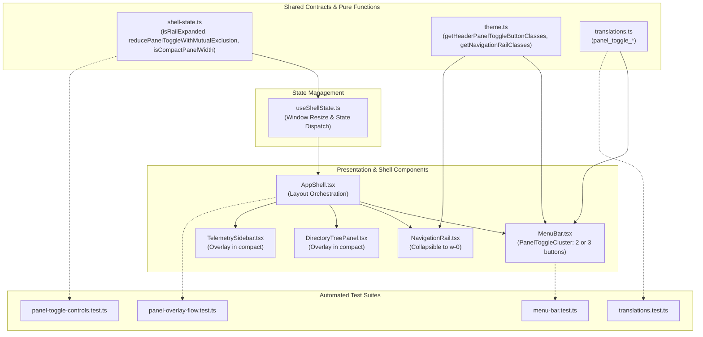
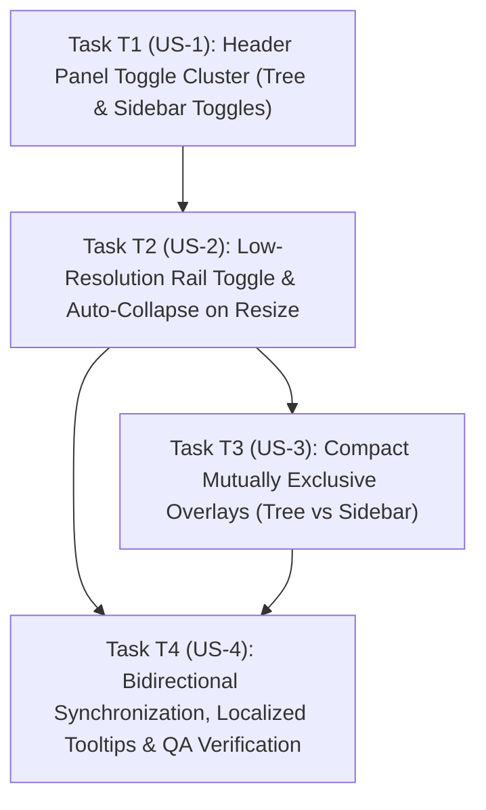

# Technical Plan — Spec 009: Panel Visibility Toggle Controls

## 1. Files and Responsibilities

| File Path | Layer / Responsibility | Description |
| :--- | :--- | :--- |
| `src/shared/shell-state.ts` | Shared Contracts / Pure Logic | Extends `ShellState` with `isRailExpanded: boolean`, adds `TOGGLE_RAIL`, `SET_RAIL_EXPANDED` action types, defines `PANEL_COMPACT_WIDTH_THRESHOLD = 784`, and implements pure state transition reducers: `isCompactPanelWidth`, `reducePanelToggleWithMutualExclusion`, and `resolveResponsivePanelCollapse`. |
| `src/shared/theme.ts` | Shared Logic / Theme Surfaces | Adds pure class resolvers: `getHeaderPanelToggleButtonClasses` (handling pressed vs neutral states across Light `#DDE7FA` / Dark `#1C2D52`), `getNavigationRailClasses` (smooth collapse to `w-0`), and `getPanelOverlayClasses` (overlay positioning in compact mode). |
| `src/shared/i18n/translations.ts` | Shared Logic / Localization | Adds bilingual dictionary keys for panel tooltips and accessible labels: `panel_toggle_rail_hide`, `panel_toggle_rail_show`, `panel_toggle_tree_hide`, `panel_toggle_tree_show`, `panel_toggle_sidebar_hide`, and `panel_toggle_sidebar_show`. |
| `src/renderer/src/hooks/useShellState.ts` | State Hook / Event Listeners | Wire window width resize listener to dispatch responsive transitions across the 784px boundary, exposing `isCompactWidth`, `isRailExpanded`, and centralized panel toggle handlers. |
| `src/renderer/src/components/shell/MenuBar.tsx` | UI Component / Header Bar | Replaces the static `UNIDAD: //MY_DRIVE` badge with the interactive `PanelToggleCluster`, rendering 2 buttons in standard resolution and 3 buttons in compact resolution with pressed-state attributes (`aria-pressed`). |
| `src/renderer/src/components/shell/NavigationRail.tsx` | UI Component / Navigation Rail | Implements `w-0` collapsible container transition and conditionally hides `RailDividerToggle` when `isCompactWidth` is true. |
| `src/renderer/src/components/shell/AppShell.tsx` | Layout Shell / Wiring | Passes responsive panel state and toggle callbacks down to `MenuBar`, `NavigationRail`, `DirectoryTreePanel`, and `TelemetrySidebar`. |
| `src/renderer/src/components/tree/DirectoryTreePanel.tsx` | UI Component / Tree Panel | Adopts overlay positioning (`absolute left-0 z-20 h-full shadow-md`) when expanded in compact resolution. |
| `src/renderer/src/components/shell/TelemetrySidebar.tsx` | UI Component / Sidebar | Adopts overlay positioning (`absolute right-0 z-20 h-full shadow-md`) and conditionally hides its floating circular toggle button (`sidebar-toggle-btn`) when in compact resolution (`isCompactWidth`). |
| `src/renderer/src/components/explorer/ExplorerStatusBar.tsx` | UI Component / Status Bar | Remains permanently visible and persistent at all resolutions, preserving manual Refresh, folder/file metrics, and size telemetry. |
| `tests/unit/panel-toggle-controls.test.ts` | Automated Tests / Unit Suite | Comprehensive Vitest suite testing pure threshold evaluators, state reducers with mutual exclusion, responsive transitions, and theme class resolvers. |
| `tests/unit/menu-bar.test.ts` | Automated Tests / Unit Suite | Updates MenuBar unit tests to verify presence of panel toggle buttons in place of the static unit badge. |
| `tests/unit/translations.test.ts` | Automated Tests / Unit Suite | Verifies 100% bilingual dictionary key parity for all 6 new panel toggle tooltip keys. |
| `tests/integration/panel-overlay-flow.test.ts` | Automated Tests / Integration Suite | Verifies multi-panel coordination: mutual exclusion in compact mode, rail collapse, and standard resolution restoration. |



---

## 2. Business Logic and Decoupled Functions

All layout calculations, state reductions, and CSS class resolutions are strictly pure, deterministic, and free of DOM dependencies.

### 2.1 Threshold Constants & Evaluator (`src/shared/shell-state.ts`)

```typescript
/**
 * Viewport width threshold below which lateral panels cannot simultaneously expand
 * alongside the central 480px canvas without visual crowding (Spec 009 FR-3, FR-4).
 */
export const PANEL_COMPACT_WIDTH_THRESHOLD = 784;

/**
 * Pure evaluator checking if window width is in compact resolution mode (FR-4).
 */
export function isCompactPanelWidth(windowWidth?: number): boolean {
  if (typeof windowWidth !== 'number' || isNaN(windowWidth)) {
    return false;
  }
  return windowWidth < PANEL_COMPACT_WIDTH_THRESHOLD;
}
```

### 2.2 Pure State Reducer with Compact Mutual Exclusion (`src/shared/shell-state.ts`)

```typescript
export type ToggleablePanel = 'rail' | 'tree' | 'sidebar';

/**
 * Pure state reducer applying panel toggles:
 * - Standard resolution (width >= 784): independent toggling.
 * - Compact resolution (width < 784): strict mutual exclusion (opening any panel closes all others) (FR-9).
 */
export function reducePanelToggleWithMutualExclusion(
  state: ShellState,
  targetPanel: ToggleablePanel,
  isCompactWidth: boolean
): ShellState {
  if (!isCompactWidth) {
    switch (targetPanel) {
      case 'rail':
        return { ...state, isRailExpanded: !state.isRailExpanded };
      case 'tree':
        return { ...state, isTreeExpanded: !state.isTreeExpanded };
      case 'sidebar':
        return { ...state, isSidebarExpanded: !state.isSidebarExpanded };
    }
  }

  // Compact resolution: mutual exclusion (only 1 panel open at a time)
  switch (targetPanel) {
    case 'rail': {
      const willExpand = !state.isRailExpanded;
      return {
        ...state,
        isRailExpanded: willExpand,
        isTreeExpanded: false,
        isSidebarExpanded: false
      };
    }
    case 'tree': {
      const willExpand = !state.isTreeExpanded;
      return {
        ...state,
        isTreeExpanded: willExpand,
        isRailExpanded: false,
        isSidebarExpanded: false
      };
    }
    case 'sidebar': {
      const willExpand = !state.isSidebarExpanded;
      return {
        ...state,
        isSidebarExpanded: willExpand,
        isRailExpanded: false,
        isTreeExpanded: false
      };
    }
  }
}

/**
 * Pure responsive transition resolver handling crossing the 784px threshold (FR-7, FR-8, EC-6, EC-7).
 */
export function resolveResponsivePanelCollapse(
  state: ShellState,
  prevWidth: number,
  newWidth: number
): ShellState {
  const wasCompact = isCompactPanelWidth(prevWidth);
  const isNowCompact = isCompactPanelWidth(newWidth);

  // Crossing into compact resolution (< 784px): auto-collapse all 3 lateral bars (FR-7)
  if (!wasCompact && isNowCompact) {
    return {
      ...state,
      isRailExpanded: false,
      isTreeExpanded: false,
      isSidebarExpanded: false
    };
  }

  // Crossing back into standard resolution (>= 784px): auto-restore navigation rail (FR-8)
  if (wasCompact && !isNowCompact) {
    return {
      ...state,
      isRailExpanded: true
    };
  }

  return state;
}
```

### 2.3 Swiss Archive Button Class Resolver (`src/shared/theme.ts`)

```typescript
/**
 * Resolves classes for the header panel toggle buttons supporting pressed and neutral states (FR-2, FR-6, NFR-1).
 */
export function getHeaderPanelToggleButtonClasses(
  isPressed: boolean,
  theme: ThemeMode = 'dark'
): string {
  const base =
    'inline-flex items-center justify-center w-[30px] h-[30px] rounded-[4px] border transition-all duration-150 focus:outline-none focus-visible:ring-1 focus-visible:ring-[#1B44E8] dark:focus-visible:ring-[#3B66FF] active:scale-95 select-none shrink-0';

  if (isPressed) {
    return theme === 'dark'
      ? `${base} bg-[#1C2D52] border-[#3B66FF] text-[#3B66FF] shadow-xs`
      : `${base} bg-[#DDE7FA] border-[#1B44E8] text-[#1B44E8] shadow-xs`;
  }

  return theme === 'dark'
    ? `${base} bg-[#181C23] border-[#2C323D] text-[#F3F4F6] hover:bg-[#1E232C] hover:border-[#3B66FF] hover:text-[#3B66FF]`
    : `${base} bg-[#FFFFFF] border-[#C9C6BD] text-[#111315] hover:bg-[#ECEAE3] hover:border-[#1B44E8] hover:text-[#1B44E8]`;
}

/**
 * Resolves classes for the navigation rail supporting smooth collapsible transitions to w-0 (FR-7).
 */
export function getNavigationRailClasses(
  isExpanded: boolean,
  theme: ThemeMode = 'dark'
): string {
  const base =
    'relative border-r bg-[#F2F0EA] dark:bg-[#15181E] border-[#C9C6BD] dark:border-[#2C323D] flex flex-col items-center py-3 gap-2.5 z-20 shrink-0 h-full select-none transition-all duration-200';

  if (!isExpanded) {
    return `${base} w-0 p-0 m-0 border-r-0 overflow-hidden opacity-0 pointer-events-none`;
  }

  return `${base} w-16 opacity-100`;
}
```

---

## 3. Algorithm in Pseudocode

### 3.1 Header PanelToggleCluster Rendering (`MenuBar.tsx`)

```text
FUNCTION renderPanelToggleCluster(isCompactWidth, state, dispatch, theme, language):
  CREATE buttonsContainer WITH className="flex items-center gap-1.5"

  // 1. Navigation Rail Button (Rendered conditionally in compact resolution) (FR-4)
  IF isCompactWidth THEN:
    LET tooltip = getTranslation(language, state.isRailExpanded ? 'panel_toggle_rail_hide' : 'panel_toggle_rail_show')
    RENDER button:
      type="button"
      className=getHeaderPanelToggleButtonClasses(state.isRailExpanded, theme)
      aria-pressed=state.isRailExpanded
      aria-label=tooltip
      title=tooltip
      onClick=() -> dispatch({ type: 'TOGGLE_RAIL' })
      CHILD: <PanelLeft className="w-3.5 h-3.5" />

  // 2. Directory Tree Toggle Button (FR-3, FR-4)
  LET treeTooltip = getTranslation(language, state.isTreeExpanded ? 'panel_toggle_tree_hide' : 'panel_toggle_tree_show')
  RENDER button:
    type="button"
    className=getHeaderPanelToggleButtonClasses(state.isTreeExpanded, theme)
    aria-pressed=state.isTreeExpanded
    aria-label=treeTooltip
    title=treeTooltip
    onClick=() -> dispatch({ type: 'TOGGLE_TREE' })
    CHILD: <FolderTree className="w-3.5 h-3.5" />

  // 3. Right Sidebar Toggle Button (FR-3, FR-4)
  LET sidebarTooltip = getTranslation(language, state.isSidebarExpanded ? 'panel_toggle_sidebar_hide' : 'panel_toggle_sidebar_show')
  RENDER button:
    type="button"
    className=getHeaderPanelToggleButtonClasses(state.isSidebarExpanded, theme)
    aria-pressed=state.isSidebarExpanded
    aria-label=sidebarTooltip
    title=sidebarTooltip
    onClick=() -> dispatch({ type: 'TOGGLE_SIDEBAR' })
    CHILD: <PanelRight className="w-3.5 h-3.5" />

  RETURN buttonsContainer
```

### 3.2 Overlay Layer Rendering in Compact Mode (`AppShell.tsx`)

```text
FUNCTION renderAppShellWorkspace(state, isCompactWidth):
  RENDER NavigationRail WITH isExpanded=state.isRailExpanded, isCompact=isCompactWidth

  IF isCompactWidth THEN:
    // Overlay Mode: Panels float over central table with z-20 without shifting workspace canvas width
    IF state.isTreeExpanded THEN:
      RENDER DirectoryTreePanel WITH className="absolute left-0 top-0 bottom-0 z-20 shadow-lg w-[240px]"
    IF state.isSidebarExpanded THEN:
      RENDER TelemetrySidebar WITH className="absolute right-0 top-0 bottom-0 z-20 shadow-lg w-[260px]"
  ELSE:
    // Standard Mode: Fluid columns side-by-side
    RENDER DirectoryTreePanel WITH isExpanded=state.isTreeExpanded
    RENDER TelemetrySidebar WITH isExpanded=state.isSidebarExpanded

  RENDER WorkspaceCanvas (always fills flex-1)
```

---

## 4. Interface Design and UI Contracts

### 4.1 Visual Hierarchy & Component Mockup

#### A. Standard Resolution ($\ge 784px$): 2 Header Buttons
```text
+-----------------------------------------------------------------------------+
| [FolderTree] [PanelRight]                                 [Info] [Sun] [ES] |
+-----+----------------+------------------------------------------------+-----+
| R   |                |                                                | S   |
| A   | DIRECTORY TREE | CENTRAL FILE EXPLORER WORKSPACE                | I   |
| I   | (240px column) | (Fluid desktop canvas)                         | D   |
| L   |                |                                                | E   |
+-----+----------------+------------------------------------------------+-----+
```

#### B. Compact Resolution ($< 784px$): 3 Header Buttons & Overlay Mode
```text
+-----------------------------------------------------------------------------+
| [PanelLeft] [FolderTree] [PanelRight]                     [Info] [Sun] [ES] |
+-----------------------------------------------------------------------------+
| +----------------+                                                          |
| | DIRECTORY TREE |                                                          |
| | (240px overlay)|  CENTRAL FILE EXPLORER WORKSPACE (100% full width)        |
| |  superimposed) |                                                          |
| +----------------+                                                          |
+-----------------------------------------------------------------------------+
```

### 4.2 Standardized Button Dimensions
- **Dimensions:** `w-[30px] h-[30px]` with `rounded-[4px]`.
- **Icon Sizing:** Inner Lucide icons `w-3.5 h-3.5` (14px × 14px), matching the top-right cluster (`About`, `ThemeToggle`, `LanguageToggle`).
- **Cluster Spacing:** `gap-1.5` (6px) between buttons.

---

## 5. Justified Technical Decisions

| Decision | Discarded Alternative | Technical & Architectural Rationale |
| :--- | :--- | :--- |
| **Top-Left Header Cluster replacing static text badge** | Additional toolbar row or floating FAB buttons | Avoids consuming vertical canvas height with extra toolbars. Replaces non-functional decorative text (`UNIDAD: //MY_DRIVE`) with high-utility interactive controls. |
| **Pure Reducer Mutual Exclusion in Compact Mode** | Imperative event listeners or DOM state manipulation | Centralizes all panel coordination in deterministic, unit-testable pure functions in `shell-state.ts`, eliminating desync bugs and race conditions. |
| **Auto-collapse all panels upon crossing $< 784px$** | Keeping active panels open and forcing horizontal overflow scroll | Immediately yields 100% of the narrow screen to the user's files and folders, preventing clipped layouts on small laptop screens and split-screen desktop windows. |
| **Hiding redundant floating buttons in compact mode** | Leaving rail divider and status bar toggles visible | Eliminates visual noise and prevents overlapping floating controls when panels collapse or superimpose. Top-left header becomes the single source of truth. |
| **Standard CSS Overlay via Absolute Positioning** | Third-party React drawer/modal libraries | Complies strictly with Constitution Principle 3 (Stack Simplicity: zero unnecessary dependencies). Pure Tailwind `absolute z-20` provides 60fps native transitions. |

---

## 6. Automated Testing Strategy

### 6.1 Test Suites

1. **`tests/unit/panel-toggle-controls.test.ts` (New Dedicated Suite):**
   - **Threshold Evaluator:** Tests `isCompactPanelWidth(width)` across boundaries: 783 (true), 784 (false), 1200 (false), NaN/undefined (false).
   - **State Reducers:** Tests `reducePanelToggleWithMutualExclusion` ensuring standard mode toggles independently, while compact mode closes other open panels.
   - **Responsive Auto-Collapse:** Tests `resolveResponsivePanelCollapse` ensuring crossing into compact mode collapses all 3 bars, and crossing back restores the rail.
   - **Theme Class Resolution:** Asserts exact Swiss Archive light (`#DDE7FA` / `#1B44E8`) and dark (`#1C2D52` / `#3B66FF`) pressed states vs neutral states.
   - **Rail Transition Classes:** Asserts `w-16` when expanded and `w-0 overflow-hidden opacity-0` when collapsed.

2. **`tests/unit/menu-bar.test.ts` (Regression Suite):**
   - Verifies replacement of static unit badge with `PanelToggleCluster`.
   - Asserts rendering of 2 buttons when `isCompactWidth=false` and 3 buttons when `isCompactWidth=true`.
   - Verifies `aria-pressed` attributes matching panel states.

3. **`tests/unit/translations.test.ts` (Localization Parity):**
   - Asserts 100% key parity between English and Spanish for all 6 new tooltip keys (`panel_toggle_rail_hide`, `panel_toggle_rail_show`, `panel_toggle_tree_hide`, `panel_toggle_tree_show`, `panel_toggle_sidebar_hide`, `panel_toggle_sidebar_show`).

4. **`tests/integration/panel-overlay-flow.test.ts` (Integration Suite):**
   - Simulates window resizing into compact mode, verifying rail collapse to `w-0` and mutual exclusion when toggling tree vs sidebar.

---

## 7. Traceability Matrix & Story Dependencies

### 7.1 Traceability Matrix

| User Story | Functional Requirements | Non-Functional Requirements | Satisfying Modules & Test Files |
| :--- | :--- | :--- | :--- |
| **US-1 (Top Header Panel Toggle Cluster)** | FR-1, FR-2, FR-3, FR-5, FR-6 | NFR-1, NFR-2 | `MenuBar.tsx`, `theme.ts`, `shell-state.ts`, `panel-toggle-controls.test.ts`, `menu-bar.test.ts` |
| **US-2 (Low-Resolution Adaptive Navigation Rail Toggle)** | FR-4, FR-7, FR-8, FR-11 | NFR-1, NFR-3 | `shell-state.ts`, `theme.ts`, `NavigationRail.tsx`, `MenuBar.tsx`, `panel-toggle-controls.test.ts` |
| **US-3 (Low-Resolution Mutually Exclusive Overlays)** | FR-9, FR-10 | NFR-1, NFR-2, NFR-3 | `shell-state.ts`, `AppShell.tsx`, `DirectoryTreePanel.tsx`, `TelemetrySidebar.tsx`, `panel-overlay-flow.test.ts` |
| **US-4 (Bidirectional Synchronization and Accessible Feedback)** | FR-11, FR-12, FR-13, FR-14 | NFR-2, NFR-3 | `translations.ts`, `useShellState.ts`, `TelemetrySidebar.tsx`, `NavigationRail.tsx`, `ExplorerStatusBar.tsx`, `translations.test.ts`, `panel-toggle-controls.test.ts` |

### 7.2 Story Dependencies (for `tasks.md`)



- **T1 (US-1):** Foundational slice. Replaces static text badge in `MenuBar.tsx` with 2 buttons (`FolderTree`, `PanelRight`) and pressed-state theme styling. *Depends on: None*.
- **T2 (US-2):** Adaptive rail slice. Adds `isRailExpanded`, `PanelLeft` button in compact resolution ($< 784px$), and auto-collapse/restore logic on window resize. *Depends on: T1*.
- **T3 (US-3):** Overlay coordination slice. Implements mutual exclusion between panels in compact resolution and overlay positioning over the central workspace canvas. *Depends on: T2*.
- **T4 (US-4):** Synchronization & quality slice. Synchronizes pressed state with rail and sidebar toggles, hides secondary floating controls (rail divider and sidebar buttons) in compact mode while preserving the bottom ExplorerStatusBar permanently visible, adds 100% bilingual tooltip keys, and completes integration testing. *Depends on: T2, T3*.
