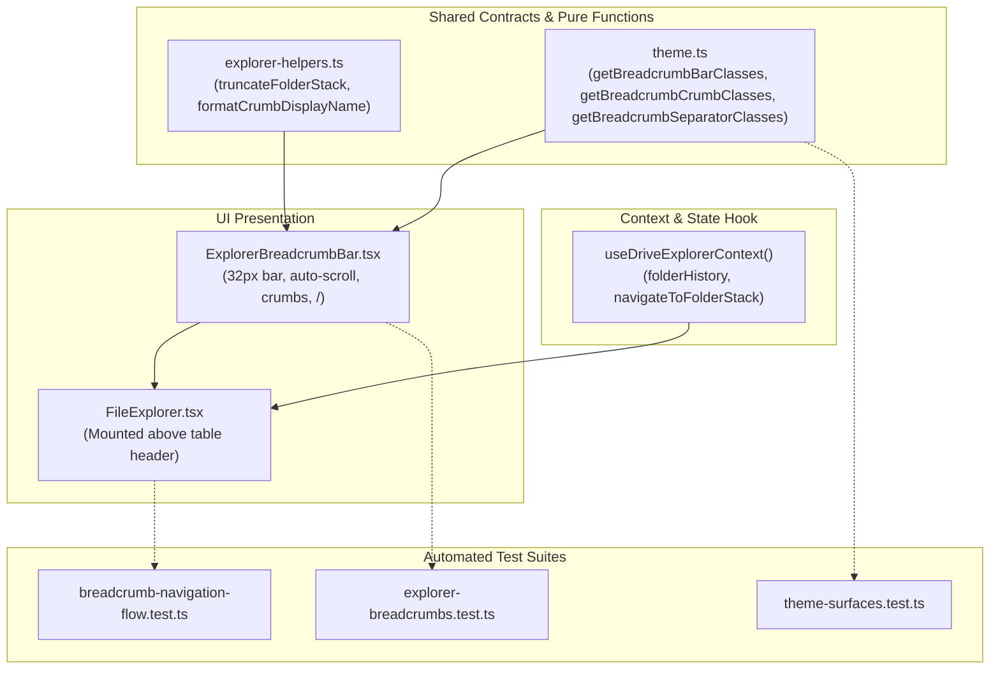
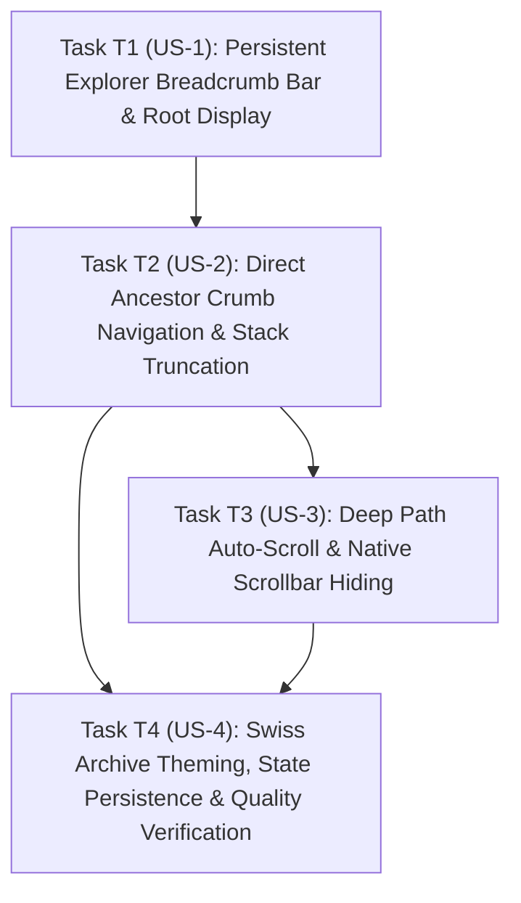

# Technical Plan — Spec 010: Explorer Navigation Breadcrumbs

## 1. Files and Responsibilities

| File Path | Layer / Responsibility | Description |
| :--- | :--- | :--- |
| `src/shared/explorer-helpers.ts` | Shared Logic / Pure Functions | Implements pure path functions: `truncateFolderStack(stack, targetFolderId)` to slice ancestor paths deterministically, and `formatCrumbDisplayName(crumb, isRoot, language)` to localize root display text (`Mi unidad` / `My Drive`). |
| `src/shared/theme.ts` | Shared Logic / Theme Surfaces | Adds pure class resolvers: `getBreadcrumbBarClasses(theme)` (handling 32px height, borders, surfaces, `scrollbar-none`), `getBreadcrumbCrumbClasses(isActive, theme)` (active prominent text vs ancestor interactive hover), and `getBreadcrumbSeparatorClasses(theme)`. |
| `src/renderer/src/components/explorer/ExplorerBreadcrumbBar.tsx` | Presentation / Breadcrumb Bar | Standalone UI component rendering the persistent 32px breadcrumb bar with horizontal scrolling container, auto-scroll to end on navigation, ancestor buttons, slashes, and prominent active crumb text. |
| `src/renderer/src/components/explorer/FileExplorer.tsx` | Presentation / View Container | Mounts `<ExplorerBreadcrumbBar>` immediately above `<div data-testid="explorer-table-header">`, wiring `folderHistory` and `navigateToFolderStack` from `useDriveExplorerContext()`. |
| `tests/unit/explorer-breadcrumbs.test.ts` | Automated Tests / Unit Suite | Comprehensive Vitest suite validating pure helper functions (`truncateFolderStack`, `formatCrumbDisplayName`), theme class resolvers, breadcrumb rendering, separator presence, and active crumb attributes. |
| `tests/unit/theme-surfaces.test.ts` | Automated Tests / Regression Suite | Asserts Swiss Archive palette compliance for breadcrumb bar container, active crumb, ancestor hover, and separator classes across Light and Dark themes. |
| `tests/integration/breadcrumb-navigation-flow.test.ts` | Automated Tests / Integration Suite | Verifies end-to-end integration: navigating into subfolders updates trail; clicking ancestor jumps to folder and truncates history; clicking root resets trail; double-clicking `...` pops current level; persistence across loading/empty/error states. |



---

## 2. Business Logic and Decoupled Functions

All path calculations, stack operations, and class resolvers are strictly pure, deterministic, and free of DOM dependencies.

### 2.1 Pure Stack Slicing & Formatting (`src/shared/explorer-helpers.ts`)

```typescript
/**
 * Truncates a folder navigation stack up to the specified targetFolderId (Spec 010 FR-5).
 * - If targetFolderId is found, returns stack sliced from root (index 0) up to targetIndex inclusive.
 * - If targetFolderId matches the active folder, returns the stack unchanged.
 * - If targetFolderId is not found or stack is empty, safely returns baseline INITIAL_FOLDER_HISTORY.
 */
export function truncateFolderStack(
  stack: FolderCrumb[],
  targetFolderId: string
): FolderCrumb[] {
  if (!stack || stack.length === 0) {
    return [{ id: 'root', name: 'My Drive' }];
  }
  const targetIndex = stack.findIndex((crumb) => crumb.id === targetFolderId);
  if (targetIndex === -1) {
    return stack;
  }
  return stack.slice(0, targetIndex + 1);
}

/**
 * Resolves the localized display name for a breadcrumb segment (Spec 010 FR-2, EC-3).
 * - Root folder (id === 'root' or isRoot === true) displays 'Mi unidad' for 'es', 'My Drive' for 'en'.
 * - Child folders return their original name string without artificial character truncation.
 */
export function formatCrumbDisplayName(
  crumb: FolderCrumb,
  isRoot: boolean,
  language: LanguageCode = 'en'
): string {
  if (isRoot || crumb.id === 'root') {
    return language === 'es' ? 'Mi unidad' : 'My Drive';
  }
  return crumb.name || 'Untitled';
}
```

### 2.2 Swiss Archive Theme Class Resolvers (`src/shared/theme.ts`)

```typescript
/**
 * Resolves container classes for the 32px Explorer Breadcrumb Bar (Spec 010 FR-1, FR-8, FR-11, FR-12).
 */
export function getBreadcrumbBarClasses(theme: ThemeMode = 'dark'): string {
  const base =
    'h-8 px-3 border-b flex items-center gap-1.5 overflow-x-auto scrollbar-none font-mono text-[11px] shrink-0 select-none transition-colors';
  return theme === 'dark'
    ? `${base} bg-[#15181E] border-[#2C323D] text-[#9CA3AF]`
    : `${base} bg-[#F2F0EA] border-[#C9C6BD] text-[#4A4E54]`;
}

/**
 * Resolves typography and interactive classes for an individual crumb item (Spec 010 FR-6, FR-7, FR-11, FR-12).
 */
export function getBreadcrumbCrumbClasses(
  isActive: boolean,
  theme: ThemeMode = 'dark'
): string {
  if (isActive) {
    return theme === 'dark'
      ? 'font-semibold text-[#F3F4F6] cursor-default shrink-0'
      : 'font-semibold text-[#111315] cursor-default shrink-0';
  }

  return theme === 'dark'
    ? 'text-[#9CA3AF] hover:text-[#3B66FF] hover:underline cursor-pointer shrink-0 transition-colors focus:outline-none focus-visible:ring-1 focus-visible:ring-[#3B66FF] rounded-[2px]'
    : 'text-[#7C8087] hover:text-[#1B44E8] hover:underline cursor-pointer shrink-0 transition-colors focus:outline-none focus-visible:ring-1 focus-visible:ring-[#1B44E8] rounded-[2px]';
}

/**
 * Resolves classes for the typographical slash (/) path separator (Spec 010 FR-4, NFR-2).
 */
export function getBreadcrumbSeparatorClasses(theme: ThemeMode = 'dark'): string {
  return theme === 'dark'
    ? 'text-[#4B5563] font-mono text-[11px] select-none shrink-0'
    : 'text-[#A0A4A8] font-mono text-[11px] select-none shrink-0';
}
```

---

## 3. Algorithm in Pseudocode

### 3.1 ExplorerBreadcrumbBar Rendering and Auto-Scroll

```text
COMPONENT ExplorerBreadcrumbBar(folderHistory, onNavigateToCrumb, language, theme):
  INITIALIZE containerRef = useRef(null)

  // Auto-scroll to end on navigation (FR-8)
  ON folderHistory CHANGE:
    IF containerRef.current THEN:
      containerRef.current.scrollLeft = containerRef.current.scrollWidth

  RENDER <nav> WITH:
    ref = containerRef
    role = "navigation"
    aria-label = localized "Folder path"
    className = getBreadcrumbBarClasses(theme)
    data-testid = "explorer-breadcrumb-bar"

    FOR EACH (crumb, index) IN folderHistory:
      LET isRoot = (index === 0 OR crumb.id === 'root')
      LET isActive = (index === folderHistory.length - 1)
      LET displayName = formatCrumbDisplayName(crumb, isRoot, language)

      // 1. Render separator before all crumbs except the first
      IF index > 0 THEN:
        RENDER <span>:
          aria-hidden = "true"
          className = getBreadcrumbSeparatorClasses(theme)
          data-testid = "breadcrumb-separator"
          TEXT = "/"

      // 2. Render Active Crumb (final item: prominent non-clickable text) (FR-6)
      IF isActive THEN:
        RENDER <span>:
          aria-current = "page"
          className = getBreadcrumbCrumbClasses(true, theme)
          data-testid = "breadcrumb-active-crumb"
          title = displayName
          TEXT = displayName

      // 3. Render Ancestor Crumb (clickable link that jumps to level) (FR-5, FR-7)
      ELSE:
        RENDER <button>:
          type = "button"
          onClick = () -> onNavigateToCrumb(crumb.id)
          className = getBreadcrumbCrumbClasses(false, theme)
          data-testid = "breadcrumb-crumb-" + crumb.id
          title = displayName
          aria-label = displayName
          TEXT = displayName

  RETURN <nav>
```

### 3.2 FileExplorer Integration

```text
IN FileExplorer.tsx:
  OBTAIN { folderHistory, navigateToFolderStack } FROM useDriveExplorerContext()

  DEFINE handleBreadcrumbNavigate(targetId):
    LET newStack = truncateFolderStack(folderHistory, targetId)
    CALL navigateToFolderStack(newStack)

  RENDER:
    <div data-testid="file-explorer" className="...">
      // 1. Mount Breadcrumb Bar immediately above table headers (FR-1)
      <ExplorerBreadcrumbBar
        folderHistory={folderHistory}
        onNavigateToCrumb={handleBreadcrumbNavigate}
        language={language}
        theme={theme}
      />

      // 2. Scrollable table body with sticky column headers (unchanged)
      <div role="table" data-testid="explorer-table-body" className="...">
        <div role="row" data-testid="explorer-table-header" className="sticky top-0 ...">
          ...
        </div>
        ...
      </div>
    </div>
```

---

## 4. Interface Design and UI Contracts

### 4.1 Visual Hierarchy & Component Mockup

```text
+-----------------------------------------------------------------------------+
| [FolderTree] [PanelRight]                                 [Info] [Sun] [ES] |
+-----+----------------+------------------------------------------------+-----+
| R   |                | Mi unidad / Documentos / 2026 / Facturas       | S   | <- 32px Breadcrumb Bar
| A   | DIRECTORY TREE |------------------------------------------------| I   |
| I   | (240px column) | TIPO   NOMBRE          CREADO        TAMAÑO    | D   | <- 36px Sticky Header
| L   |                |------------------------------------------------| E   |
|     |                | [..]   ...                                     |     | <- ParentNavRow
|     |                | [DIR]  Enero           12/11/2026    --        |     |
|     |                | [FILE] Recibo_01.pdf   12/11/2026    142 KB    |     |
+-----+----------------+------------------------------------------------+-----+
| Actualizar | 2 carpetas, 1 archivo                           Total: 142 KB  | <- 36px Status Bar
+-----------------------------------------------------------------------------+
```

### 4.2 Element Metrics & Aesthetics
- **Bar Dimensions:** `h-8` (32px), `px-3`, border-b 1px (`#C9C6BD` / `#2C323D`).
- **Typography:** `font-mono text-[11px]`, leading-none.
- **Path Separators:** Slashes `/` with `text-[11px]` and muted contrast (`#A0A4A8` / `#4B5563`).
- **Active Crumb:** `font-semibold text-[#111315] dark:text-[#F3F4F6]`.
- **Ancestor Crumbs:** `text-[#7C8087] dark:text-[#9CA3AF]`, with hover color transition to Klein Blue (`#1B44E8` / `#3B66FF`) and subtle underline.
- **Scroll Behavior:** `overflow-x-auto scrollbar-none`. Hiding native scrollbars preserves the 32px height cleanly without UI distortion on Windows.

---

## 5. Justified Technical Decisions

| Decision | Discarded Alternative | Technical & Architectural Rationale |
| :--- | :--- | :--- |
| **Direct slice via `truncateFolderStack` + existing `navigateToFolderStack`** | Creating a new IPC channel or refetching folder trees | Leverages the existing robust `NAVIGATE_TO_FOLDER_STACK` reducer action established in Spec 004, preserving full bidirectional synchronization with `useDirectoryTree` with zero new IPC overhead. |
| **`scrollbar-none` with smooth programmatic auto-scroll** | Native Windows horizontal scrollbar | A 12px-17px native scrollbar in a 32px bar would consume half the bar's vertical height, creating an ugly layout. `scrollbar-none` keeps the bar slim while permitting wheel, trackpad, and programmatic scroll to the active folder. |
| **Full folder name without artificial character limits** | Truncating individual crumbs to 15-20 characters | Users need to read exact folder names to distinguish between similarly named directories. The horizontal scroll capability ensures unlimited length without sacrificing clarity. |
| **Mounted outside the scrollable table body** | Inside `explorer-table-body` alongside sticky headers | Placing the breadcrumb bar above `explorer-table-body` ensures it remains permanently pinned to the top of the canvas, visible even when scrolling thousands of file rows down the table. |
| **Retention of `...` (`ParentNavRow`)** | Removing `...` row from the table | As confirmed in the QA interview, retaining `...` inside the table provides a fast 1-level ascent for keyboard/double-click table navigation, while the breadcrumb provides multi-level jumps. |

---

## 6. Automated Testing Strategy

### 6.1 Test Suites

1. **`tests/unit/explorer-breadcrumbs.test.ts` (New Dedicated Suite):**
   - **`truncateFolderStack` Pure Function:**
     - Slices stack up to target folder ID correctly.
     - Truncating to root returns array of length 1 containing root crumb.
     - Target ID not found returns stack untouched.
     - Slicing to current folder returns stack unchanged.
   - **`formatCrumbDisplayName` Pure Function:**
     - Returns `"Mi unidad"` in Spanish and `"My Drive"` in English for root.
     - Returns `crumb.name` unchanged for non-root folders.
   - **Component Rendering (`ExplorerBreadcrumbBar.tsx`):**
     - Renders root crumb only with active style when at root.
     - Renders correct sequence of ancestor buttons, `/` separators, and final active crumb when in subfolders.
     - Verifies `onNavigateToCrumb` is called with target ID when ancestor button is clicked.
     - Verifies active crumb has `aria-current="page"` and is not a button.
     - Verifies `scrollbar-none` and `overflow-x-auto` container classes.

2. **`tests/unit/theme-surfaces.test.ts` (Regression Suite):**
   - Tests `getBreadcrumbBarClasses`, `getBreadcrumbCrumbClasses`, and `getBreadcrumbSeparatorClasses` in both Light and Dark themes.

3. **`tests/integration/breadcrumb-navigation-flow.test.ts` (New Integration Suite):**
   - Renders `FileExplorer` with `DriveExplorerProvider`.
   - Simulates navigating into subfolders, asserting breadcrumb updates trail.
   - Simulates clicking an ancestor crumb, verifying history stack truncates and directory loads.
   - Simulates double-clicking `...` row in table, verifying breadcrumb pops one level.
   - Verifies breadcrumb persists during loading, empty folder, and error states.

---

## 7. Traceability Matrix & Story Dependencies

### 7.1 Traceability Matrix

| User Story | Functional Requirements | Non-Functional Requirements | Satisfying Modules & Test Files |
| :--- | :--- | :--- | :--- |
| **US-1 (Persistent Top Path Bar)** | FR-1, FR-2, FR-3, FR-4, FR-9 | NFR-1, NFR-2 | `ExplorerBreadcrumbBar.tsx`, `FileExplorer.tsx`, `explorer-helpers.ts`, `explorer-breadcrumbs.test.ts` |
| **US-2 (Direct Ancestor Navigation)** | FR-5, FR-6, FR-7, FR-13 | NFR-1, NFR-2, NFR-3 | `ExplorerBreadcrumbBar.tsx`, `explorer-helpers.ts`, `breadcrumb-navigation-flow.test.ts` |
| **US-3 (Deep Path Auto-Scroll & Horizontal Navigation)** | FR-8 | NFR-1, NFR-2 | `ExplorerBreadcrumbBar.tsx`, `theme.ts`, `explorer-breadcrumbs.test.ts` |
| **US-4 (Aesthetic Harmony & State Persistence)** | FR-10, FR-11, FR-12 | NFR-1, NFR-2, NFR-3 | `theme.ts`, `FileExplorer.tsx`, `theme-surfaces.test.ts`, `breadcrumb-navigation-flow.test.ts` |

### 7.2 Story Dependencies (for `tasks.md`)



- **T1 (US-1):** Foundational slice. Implements `formatCrumbDisplayName`, `getBreadcrumbBarClasses`, creates `ExplorerBreadcrumbBar.tsx`, and mounts it above the table headers in `FileExplorer.tsx`. *Depends on: None*.
- **T2 (US-2):** Navigation slice. Implements `truncateFolderStack`, connects ancestor crumb clicks to `navigateToFolderStack`, verifies active crumb non-clickability, and syncs with `...` parent row. *Depends on: T1*.
- **T3 (US-3):** Horizontal scroll & overflow slice. Implements `scrollbar-none`, programmatic auto-scroll to end on navigation, and full-length crumb rendering. *Depends on: T2*.
- **T4 (US-4):** Theming & lifecycle resilience slice. Implements Swiss Archive theme classes across Light/Dark modes, verifies persistence across empty/loading/error states, and completes integration testing. *Depends on: T2, T3*.
