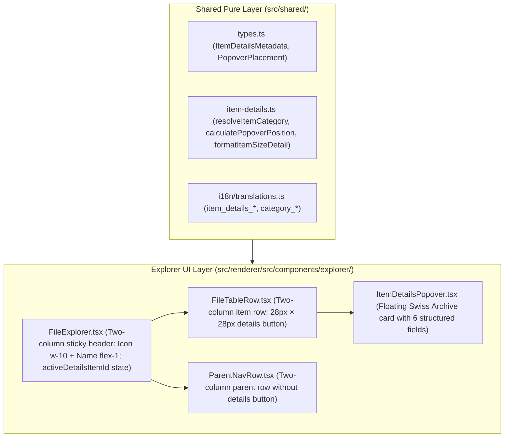

# Technical Plan: Spec 011 — Item Details Popover and Table Column Optimization

## Architectural Overview & Context
This technical plan defines the data models, pure helper functions, UI component refactoring, accessibility bindings, and automated test suite required to transition the Google Drive file explorer table to a clean **Two-Column Explorer Table** (`Icon` and `Name`), replacing the fixed `Creation Date` (`176px`) and `Size` (`96px`) columns with a persistent, accessible **Details Action Button** (`28px × 28px`) at the trailing end of each row that opens an anchored **Item Details Popover**.

In strict accordance with **docs/constitution.md**:
- **Principle 1 & 3 (The Spec Rules & Stack Simplicity):** The floating popover positioning, boundary detection, and event dismissal logic are implemented purely using React hooks and Tailwind CSS without introducing heavy third-party positioning libraries (such as `@floating-ui/react` or `popper.js`), keeping bundle size minimal and dependencies simple.
- **Principle 4 (Testing Policy / Zero Red Tests):** All category resolvers, size formatting logic, boundary positioning math, and state reduction rules are encapsulated in pure deterministic functions in `src/shared/item-details.ts` and verified with Vitest prior to component integration.
- **Principle 6 (Language & Conventions):** All code, interfaces, comments, test descriptions, and git commits are 100% English. User-facing labels support complete bilingual parity (`en` / `es`).



---

## 1. Files and Responsibilities

| File Path | Layer | Responsibility |
| :--- | :--- | :--- |
| `src/shared/types.ts` | Shared Types | Defines `PopoverPosition` (`top`, `left`, `placement`) and popover metadata contracts (`US-2`, `US-3`). |
| `src/shared/item-details.ts` | Shared Pure Logic | Implements pure deterministic functions: `resolveItemCategory(iconType, isDirectory, language)`, `calculatePopoverPosition(anchorRect, viewportRect)`, and `formatItemSizeDetail(sizeBytes, isDirectory, formattedSize)` (`US-3`, `FR-6`, `FR-8`). |
| `src/shared/i18n/translations.ts` | Shared i18n | Declares localized string keys (`en` / `es`) for popover field headers (`item_details_title`, `item_details_name`, `item_details_type`, `item_details_size`, `item_details_created`, `item_details_mime`, `item_details_id`, `item_details_tooltip`) and category labels (`category_folder`, `category_document`, etc.) (`US-5`, `FR-10`). |
| `src/renderer/src/components/explorer/ItemDetailsPopover.tsx` | Renderer UI Component | Floating contextual card rendered conditionally via React portal or anchored container adhering strictly to Swiss Archive design tokens; displays 6 structured metadata fields; closes on click-outside, Escape, table scroll, or directory navigation (`US-3`, `US-4`, `FR-6`, `FR-7`, `NFR-1`). |
| `src/renderer/src/components/explorer/FileTableRow.tsx` | Renderer UI Component | Refactors row layout to Two Columns: Column 1 (Type Icon, `w-10`) and Column 2 (Name, `flex-1 min-w-0`), housing a `28px × 28px` (`rounded-[4px]`) Details Action Button at its trailing edge (`US-1`, `US-2`, `FR-1`, `FR-3`, `FR-4`). |
| `src/renderer/src/components/explorer/ParentNavRow.tsx` | Renderer UI Component | Updates parent directory navigation row (`"..."`) to Two Columns without rendering any details button (`US-1`, `FR-9`, `EC-3`). |
| `src/renderer/src/components/explorer/FileExplorer.tsx` | Renderer UI Component | Refactors sticky table header to strictly Two Columns (`Icon` `w-10` + `Name` `flex-1`); manages single popover cardinality (`activeDetailsItemId: string | null`), and dismisses open popover on table scroll (`onScroll`) and directory navigation (`US-1`, `US-4`, `FR-2`, `FR-5`, `FR-7`). |
| `tests/unit/item-details.test.ts` | Unit Tests | Validates `resolveItemCategory`, `calculatePopoverPosition` edge cases (top, bottom, left, right viewport clamping), and `formatItemSizeDetail` (`0 B` vs `--`) (`US-3`, `FR-6`, `FR-8`). |
| `tests/unit/translations.test.ts` | Unit Tests | Validates 100% bilingual parity for all item details keys and category labels (`US-5`, `FR-10`). |
| `tests/unit/drive-explorer.test.ts` | Unit Tests | Validates sticky table header two-column layout, removal of `Creation Date` and `Size` column containers, and presence of `28px × 28px` details button on rows (`US-1`, `US-2`, `FR-1`, `FR-2`, `FR-3`). |
| `tests/integration/item-details-flow.test.ts` | Integration Tests | Validates end-to-end user interaction: opening popover on click/Enter, single popover cardinality across rows, dismissal on outside click / Escape / table scroll / directory navigation, and selection independence (`US-2`, `US-4`, `FR-5`, `FR-7`). |

---

## 2. Business Logic and Decoupled Functions

All metadata formatting, category resolution, and viewport geometry calculations are isolated in `src/shared/item-details.ts`:

### A. Item Category Resolver (`resolveItemCategory`)
```typescript
import type { LanguageCode, StorageItemType } from './types';

/**
 * Maps item storage type and directory flag to human-readable localized category string (FR-6.2, FR-10).
 */
export function resolveItemCategory(
  iconType: StorageItemType,
  isDirectory: boolean,
  language: LanguageCode = 'en'
): string;
```

### B. Size Detail Formatter (`formatItemSizeDetail`)
```typescript
/**
 * Formats size detail guaranteeing 0-byte files display '0 B' while folders display '--' (FR-6.3, EC-8).
 */
export function formatItemSizeDetail(
  sizeBytes: number | null,
  isDirectory: boolean,
  formattedSize: string
): string;
```

### C. Popover Boundary Positioning Resolver (`calculatePopoverPosition`)
```typescript
export interface ViewportRect {
  width: number;
  height: number;
}

export interface AnchorRect {
  top: number;
  bottom: number;
  left: number;
  right: number;
}

export interface PopoverPositionResult {
  top: number;
  left: number;
  placement: 'top-left' | 'top-right' | 'bottom-left' | 'bottom-right';
}

/**
 * Calculates deterministic absolute coordinates for the popover (width 280px, max-height 320px)
 * ensuring it stays strictly within the visible viewport bounds (FR-8).
 */
export function calculatePopoverPosition(
  anchor: AnchorRect,
  viewport: ViewportRect,
  popoverWidth = 280,
  popoverHeight = 240,
  offset = 6
): PopoverPositionResult;
```

---

## 3. Algorithm in Pseudocode

### A. Popover Positioning and Viewport Collision Clamping (`calculatePopoverPosition`)
```text
FUNCTION calculatePopoverPosition(anchor, viewport, popoverWidth, popoverHeight, offset):
    // Horizontal positioning: default align right edge of popover with right edge of button
    LET targetLeft = anchor.right - popoverWidth
    LET targetPlacementX = 'left'

    // If popover overflows left edge of viewport (e.g. narrow window)
    IF targetLeft < offset THEN:
        targetLeft = anchor.left // flip to align with left edge
        targetPlacementX = 'right'
        // Clamp to prevent right overflow
        IF targetLeft + popoverWidth > viewport.width - offset THEN:
            targetLeft = MAX(offset, viewport.width - popoverWidth - offset)

    // Vertical positioning: default anchor below the row button
    LET targetTop = anchor.bottom + offset
    LET targetPlacementY = 'bottom'

    // If popover overflows bottom edge of viewport, flip above anchor button
    IF targetTop + popoverHeight > viewport.height - offset THEN:
        targetTop = anchor.top - popoverHeight - offset
        targetPlacementY = 'top'
        // Clamp to prevent top overflow
        IF targetTop < offset THEN:
            targetTop = offset

    RETURN {
        top: targetTop,
        left: targetLeft,
        placement: targetPlacementY + '-' + targetPlacementX
    }
```

### B. Single Popover Cardinality & Event Dismissal Machine (`FileExplorer` & `ItemDetailsPopover`)
```text
STATE activeDetailsItemId = null // In FileExplorer component

FUNCTION handleDetailsClick(item, event):
    event.stopPropagation() // Prevent row selection or double-click navigation
    IF activeDetailsItemId === item.id THEN:
        activeDetailsItemId = null // Toggle closed
    ELSE:
        activeDetailsItemId = item.id // Enforces single cardinality

FUNCTION handleTableScroll():
    IF activeDetailsItemId !== null THEN:
        activeDetailsItemId = null // Instant dismissal on scroll (FR-7.3, EC-4)

FUNCTION handleDirectoryNavigation():
    IF activeDetailsItemId !== null THEN:
        activeDetailsItemId = null // Instant unmount on folder change (FR-7.4, EC-6)

FUNCTION handleGlobalDismissal(event):
    IF event.type == 'keydown' AND event.key == 'Escape' THEN:
        activeDetailsItemId = null
        focusAnchorButton(activeDetailsItemId)
    ELSE IF event.type == 'mousedown' AND isOutsidePopover(event.target) AND isNotAnchorButton(event.target) THEN:
        activeDetailsItemId = null
```

---

## 4. Interface Design and Visual Palette Contract

### A. Two-Column Table Layout & Dimensions
```text
Row Height: 36px (h-9)
Column 1: Type Icon Container -> w-10 shrink-0 flex items-center justify-center (16px x 16px Lucide icons)
Column 2: Item Name Container -> flex-1 min-w-0 pr-2 flex items-center justify-between
  - Left child: Truncated Name -> font-sans font-medium text-xs truncate
  - Right child: Details Button Container -> shrink-0 ml-2
    - Details Action Button: w-[28px] h-[28px] rounded-[4px] border border-transparent hover:border-[#C9C6BD] dark:hover:border-[#2C323D] hover:bg-[#ECEAE3] dark:hover:bg-[#1E232C] text-[#7C8087] dark:text-[#6B7280] hover:text-[#1B44E8] dark:hover:text-[#3B66FF]
```

### B. Item Details Popover Design Specifications
- **Dimensions:** Width `280px`, max-height `320px`, overflow-y auto.
- **Surfaces:** Elevated card surface (`#FFFFFF` in Light, `#181C23` in Dark) with exposed `1px` solid border (`#C9C6BD` in Light, `--rule-strong` `#2C323D` in Dark) and `rounded-[6px]`.
- **Upper Header Strip:** Compact technical strip (`28px` height, `bg-[#F2F0EA]` / `bg-[#15181E]`, `1px` bottom border) with `font-mono text-[10px]` uppercase title (`DETALLES // METADATA` / `DETAILS // METADATA`) on the left and a compact close button `[ESC]` on the right.
- **Structured Fields List (6 items):**
  1. **Nombre / Name:** `font-sans text-xs font-semibold text-[#111315] dark:text-[#F3F4F6] break-words`.
  2. **Tipo / Type:** Monospace category badge (`Carpeta`, `Documento PDF`, etc.) with `font-mono text-[11px]`.
  3. **Tamaño / Size:** `font-mono text-[11px]` (e.g. `14.2 MB`, `0 B` for empty files, `--` for folders).
  4. **Fecha de creación / Created:** `font-mono text-[11px]` (`DD/MM/YYYY HH:mm:ss`).
  5. **Tipo MIME / MIME Type:** `font-mono text-[10px] text-[#7C8087] dark:text-[#6B7280] break-all`.
  6. **ID de Drive / Drive ID:** Selectable `font-mono text-[10px] bg-[#FAF9F6] dark:bg-[#101216] p-1.5 rounded-[3px] border border-[#DFDDD6] dark:border-[#222730] select-all break-all`.

---

## 5. Justified Technical Decisions

| Technical Decision | Alternative Considered | Justification & Constitution Alignment |
| :--- | :--- | :--- |
| **Pure Two-Column Layout (`Icon + Name`) without artificial header for details button** | Retaining a dedicated empty 3rd column in the sticky header | Declared in Decision 3 and 5 during `/sdd-clarify`. Maximizes the table header minimalism and clean typography. The row's `flex-1` layout naturally accommodates the details button on the far right. |
| **Centralized `activeDetailsItemId` state in `FileExplorer`** | Individual `isOpen` state inside each `FileTableRow` | Centralizing the open ID at the parent explorer container enforces Single Popover Cardinality (`FR-5.2`) automatically without complex inter-component message passing. |
| **Immediate Dismissal on Table Scroll (`onScroll`)** | Floating popover tracking row coordinates during rapid scrolling | Tracking coordinates at 60 FPS scrolling causes layout thrashing, jitter, and potential detached overlays. Instant dismissal (`FR-7.3`, `EC-4`) is desktop-standard and robust. |
| **Zero Heavy Dependencies (Native Boundary Calculation)** | Installing `@floating-ui/react` or `popper.js` | Violates Principle 3 (Stack Simplicity). Calculating a popover boundary around a button requires fewer than 30 lines of pure, deterministically testable math (`calculatePopoverPosition`). |
| **Decoupling Popover Trigger from Row Selection (`stopPropagation`)** | Selecting the row whenever details button is clicked | Allows users to inspect any file's metadata without disturbing their active selection or multi-file context. |

---

## 6. Automated Testing Strategy

### A. Pure Unit Tests (`tests/unit/item-details.test.ts`)
- **Category Resolution:** Verifies `resolveItemCategory` returns exact bilingual category strings for each `StorageItemType` (`folder`, `document`, `spreadsheet`, `presentation`, `pdf`, `image`, `video`, `audio`, `archive`, `shortcut`, `file`).
- **Size Formatter:** Verifies `formatItemSizeDetail(0, false, '0 B')` returns `'0 B'`, and `formatItemSizeDetail(null, true, '--')` returns `'--'`.
- **Boundary Clamping:**
  - Standard placement (anchor in center viewport) $\rightarrow$ places popover below and aligned right.
  - Viewport bottom overflow $\rightarrow$ flips popover above anchor button.
  - Viewport left overflow $\rightarrow$ flips horizontal alignment to the right of anchor button.
  - Screen edge clamping $\rightarrow$ ensures `top >= offset` and `left >= offset`.

### B. Explorer Layout Unit Tests (`tests/unit/drive-explorer.test.ts`)
- Verifies sticky table header renders strictly Two Columns: Icon (`w-10`) and `Name` (`flex-1`).
- Verifies absence of `Creation Date` (`FECHA DE CREACIÓN`) and `Size` (`TAMAÑO`) in sticky header and rows.
- Verifies each `FileTableRow` contains the `28px × 28px` details button (`data-testid="item-details-btn"`).
- Verifies `ParentNavRow` does not contain any details button.

### C. Bilingual Parity Tests (`tests/unit/translations.test.ts`)
- Verifies 100% key and parameter parity across `en` and `es` for all new `item_details_*` and `category_*` keys.

### D. Component & Flow Integration Tests (`tests/integration/item-details-flow.test.ts`)
- **Click to Open:** Clicking details button opens `ItemDetailsPopover` with complete structured fields.
- **Single Cardinality:** Opening details for Item B closes Item A.
- **Dismissal triggers:**
  - Clicking outside closes popover.
  - Pressing `Escape` closes popover and restores button focus.
  - Scrolling table container triggers dismissal.
  - Folder navigation unmounts popover.
- **Selection Independence:** Clicking details button on row B does not alter selection on row A.

---

## 7. Traceability Matrix & Story Dependencies

| User Story | Functional Requirements | Modules & Components | Automated Tests | Depends on |
| :--- | :--- | :--- | :--- | :--- |
| **US-1: Two-Column Table Layout** | FR-1, FR-2 | `FileExplorer.tsx`, `FileTableRow.tsx`, `ParentNavRow.tsx` | `tests/unit/drive-explorer.test.ts` | None |
| **US-2: Interactive Details Button & Keyboard Access** | FR-3, FR-4, FR-5 | `FileTableRow.tsx`, `FileExplorer.tsx` | `tests/unit/drive-explorer.test.ts`, `tests/integration/item-details-flow.test.ts` | US-1 |
| **US-3: Swiss Archive Details Popover Presentation** | FR-6, FR-8, NFR-1, NFR-2, NFR-3 | `item-details.ts`, `ItemDetailsPopover.tsx` | `tests/unit/item-details.test.ts`, `tests/integration/item-details-flow.test.ts` | US-2 |
| **US-4: Single Cardinality & Fluid Dismissal** | FR-5, FR-7 | `FileExplorer.tsx`, `ItemDetailsPopover.tsx` | `tests/integration/item-details-flow.test.ts` | US-3 |
| **US-5: Bilingual Localization Parity** | FR-10 | `i18n/translations.ts`, `item-details.ts` | `tests/unit/translations.test.ts` | US-3 |
