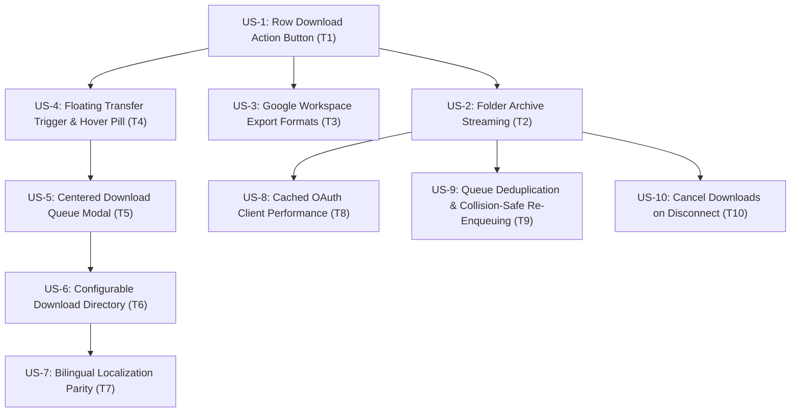

# Technical Plan: Spec 012 — Download Transfers Manager and Row Action Controls

## 1. Files and Responsibilities

### A. Shared Types, IPC Contracts, and Pure Helpers (`src/shared/`)
- `src/shared/types.ts`:
  - Declare `TransferStatus`: `'queued' | 'downloading' | 'completed' | 'failed' | 'cancelled'`.
  - Declare `DownloadTransferItem`: Structured model for transfer tasks (id, driveItemId, name, isDirectory, iconType, status, transferredBytes, totalBytes, progressPercent, destinationPath, error, warning, startedAt, completedAt, exportMimeType).
  - Declare `DownloadSettings`: Model for download preferences (`defaultDownloadPath`).
  - Declare `WorkspaceExportOption`: Format descriptor (extension, label, mimeType).
  - Declare IPC request/response types for starting, cancelling, retrying downloads, directory selection, and settings persistence.
- `src/shared/ipc-channels.ts`:
  - Register strongly typed constants: `DOWNLOAD_START`, `DOWNLOAD_CANCEL`, `DOWNLOAD_RETRY`, `DOWNLOAD_OPEN_FOLDER`, `DOWNLOAD_GET_SETTINGS`, `DOWNLOAD_SET_SETTINGS`, `DOWNLOAD_SELECT_DIRECTORY`, and `DOWNLOAD_PROGRESS_EVENT`.
- `src/shared/download-helpers.ts`:
  - Pure calculation and formatting functions strictly decoupled from Electron and React:
    - `calculateTransferPercent`: Deterministic progress percentage computation (0-100).
    - `resolveWorkspaceExportOptions`: Pure mapper from Google Docs, Sheets, Slides MIME types to available export formats.
    - `resolveNextAvailableFilename`: Pure collision resolution algorithm generating `name (1).ext`, `name (2).ext` if target exists.
    - `findExistingQueuedTransfer`: Pure lookup identifying whether a `(driveItemId, exportMimeType)` entry is already waiting in `queued` status (FR-14.1, FR-14.2).
    - `filterActiveTransfers`: Pure filter returning currently running or queued transfers.
    - `hasInFlightTransfers`: Pure predicate determining whether floating trigger should be visible.
- `src/shared/i18n/translations.ts`:
  - Define complete bilingual dictionary keys in English (`en`) and Spanish (`es`) for:
    - Tooltips: `download_tooltip`, `menu_settings`.
    - Floating trigger & pill: `transfer_floating_active`, `transfer_queue_count`.
    - Modal & list: `transfers_modal_title`, `transfers_active_tab`, `transfers_completed_tab`, `transfers_empty`, `transfers_cancel`, `transfers_retry`, `transfers_open_folder`, `transfers_clear_completed`.
    - Settings modal: `settings_modal_title`, `settings_download_path_label`, `settings_browse_button`, `settings_reset_button`, `settings_save_button`.
    - Export menu: `export_menu_title`, `export_format_pdf`, `export_format_docx`, `export_format_xlsx`, `export_format_pptx`.

### B. Main Process Infrastructure (`src/main/`)
- `src/main/core/download-settings-storage.ts`:
  - Manages atomic disk persistence for download settings (`userData/download-settings.json`). Defaults to operating system `app.getPath('downloads')`.
- `src/main/core/download-queue-manager.ts`:
  - Centralized singleton managing the sequential FIFO queue in the Node.js runtime.
  - Manages active streams, enforces 1-at-a-time execution, tracks bytes transferred, handles cancellation and partial file cleanup.
  - Deduplicates pending requests by `(driveItemId, exportMimeType)` when an entry is already `queued`, allows at most one queued re-download for an item currently `downloading`, and reserves in-flight filenames (`downloading` + `queued`) alongside disk files to prevent overwrites (FR-14).
  - Exposes `cancelAllAndClear()` to immediately abort any active transfer, remove partial files, cancel all queued entries, and reset the in-memory queue upon account sign-out (FR-15).
- `src/main/operations/download-stream.ts`:
  - Stream pipeline for binary files: pipes `drive.files.get({ fileId, alt: 'media' })` directly to `fs.createWriteStream`.
  - Stream pipeline for Google Workspace files: pipes `drive.files.export({ fileId, mimeType })` directly to `fs.createWriteStream`.
  - Stream pipeline for recursive folder zipping: uses `archiver('zip')` piped to `fs.createWriteStream`, recursively traversing directory tree via `drive.files.list` with partial error resilience (logging skipped files to `_descarga_advertencias.txt`).
- `src/main/ipc/download-ipc.ts`:
  - Exposes typed IPC handlers for starting, cancelling, retrying downloads, opening containing folders via `shell.showItemInFolder`, getting/saving settings, and selecting directories via `dialog.showOpenDialog`.
  - Emits real-time progress events to the Renderer window (`win.webContents.send(IPC_CHANNELS.DOWNLOAD_PROGRESS_EVENT, item)`).
- `src/main/core/google-client.ts`:
  - Caches and reuses a single in-memory authenticated `OAuth2Client` (`cachedAuthClient`) keyed by `cachedRefreshToken` across `getDriveClient`, `listDirectory`, `fetchStorageQuota`, and `fetchUserProfile` (FR-13).
  - Exposes `getAuthenticatedClient(refreshToken)` and `clearCachedClient()`, invalidating automatically when `refreshToken` changes, on `AUTH_DISCONNECT`, or on `401` / `invalid_grant` errors (EC-13, EC-14).
- `src/main/ipc/auth-ipc.ts`:
  - Clears the cached OAuth2Client via `googleClient.clearCachedClient()` and invokes the injected `onDisconnect` callback (`sharedDownloadQueue.cancelAllAndClear()`) during `AUTH_DISCONNECT` (FR-13, FR-15).
- `src/main/index.ts`:
  - Instantiates a single shared `GoogleAuthClient` instance inside `app.whenReady()` and injects it into `AuthIpcController`, `StorageIpcController`, and `DownloadQueueManager` (`DownloadIpcController`), wiring `onDisconnect: () => sharedDownloadQueue.cancelAllAndClear()`.

### C. Preload Security Bridge (`src/preload/`)
- `src/preload/index.ts` & `src/preload/index.d.ts`:
  - Exposes typed `window.api.download` under `contextIsolation: true`, providing methods:
    - `startDownload(params)`
    - `cancelDownload(transferId)`
    - `retryDownload(transferId)`
    - `openContainingFolder(filePath)`
    - `getSettings()`
    - `setSettings(settings)`
    - `selectDownloadDirectory()`
    - `onProgress(callback)`

### D. Renderer Components & State (`src/renderer/`)
- `src/renderer/src/context/DownloadContext.tsx`:
  - Global React context and provider managing `transfers: DownloadTransferItem[]`, `settings: DownloadSettings`, and modal open states.
  - Listens to IPC `onProgress` events and updates React state immutably.
- `src/renderer/src/components/explorer/FileTableRow.tsx`:
  - Renders the `26px × 26px` Download Action Button immediately preceding the Details button with `gap-1.5`.
  - Updates trailing container padding to `pr-16` (64px clearance from right edge) to prevent collision with lateral sidebar toggle chevron.
  - Stops event propagation on click and double-click (`stopPropagation`).
- `src/renderer/src/components/explorer/WorkspaceExportMenu.tsx`:
  - Anchored Swiss Archive popover menu displayed when clicking download on Google Docs, Sheets, or Slides.
- `src/renderer/src/components/transfer/FloatingTransferTrigger.tsx`:
  - Floating trigger widget anchored in `bottom-3 right-3` of `FileExplorer` canvas.
  - Resting state: `40px × 40px` card with Google Drive icon and download arrow badge.
  - Hover state: expands horizontally to `260px` showing active file name, progress bar, percentage, and queue counter.
  - Manages 4-second completion grace period, pausing timer when modal is open.
- `src/renderer/src/components/transfer/DownloadQueueModal.tsx`:
  - Centered Swiss Archive dialog with technical strip `[ESC]`.
  - Sectioned list of active, queued, completed, and failed downloads with individual actions (Cancel, Retry, Open in folder, Clear completed).
- `src/renderer/src/components/settings/DownloadSettingsModal.tsx`:
  - Centered Swiss Archive modal for viewing and changing default download path via native directory picker.
- `src/renderer/src/components/layout/MenuBar.tsx`:
  - Adds Settings button with `Settings` icon in top utility cluster between Theme and About.

### E. Automated Tests (`tests/`)
- `tests/unit/download-helpers.test.ts`:
  - Unit tests for pure calculation, filename collision resolution, and workspace export option mappers.
- `tests/unit/google-client.test.ts`:
  - Unit tests verifying in-memory `OAuth2Client` reuse per `refreshToken`, invalidation on different token or `clearCachedClient()`, and cache reset on `401` / `invalid_grant` errors.
- `tests/unit/translations.test.ts`:
  - Unit tests verifying 100% dictionary parity across English and Spanish for all download and settings keys.
- `tests/integration/download-flow.test.ts`:
  - Integration tests verifying button placement, `pr-16` clearance, event propagation prevention, floating trigger state machine, and IPC contracts.

---

## 2. Business Logic and Decoupled Functions

### A. Progress Percentage Calculator (`calculateTransferPercent`)
```typescript
/**
 * Computes deterministic progress percentage between 0 and 100 (FR-3.4, FR-6.2).
 */
export function calculateTransferPercent(
  transferredBytes: number,
  totalBytes: number | null
): number {
  if (totalBytes === null || totalBytes <= 0) {
    return transferredBytes > 0 ? 100 : 0;
  }
  const ratio = (transferredBytes / totalBytes) * 100;
  return Math.min(100, Math.max(0, Math.round(ratio)));
}
```

### B. Filename Collision Resolver (`resolveNextAvailableFilename`)
```typescript
/**
 * Automatically appends an incremental counter (e.g. 'file (1).txt') if target exists (EC-6).
 */
export function resolveNextAvailableFilename(
  existingFilenames: string[],
  desiredFilename: string
): string {
  if (!existingFilenames.includes(desiredFilename)) {
    return desiredFilename;
  }

  const lastDot = desiredFilename.lastIndexOf('.');
  const baseName = lastDot !== -1 ? desiredFilename.substring(0, lastDot) : desiredFilename;
  const ext = lastDot !== -1 ? desiredFilename.substring(lastDot) : '';

  let counter = 1;
  while (true) {
    const candidate = `${baseName} (${counter})${ext}`;
    if (!existingFilenames.includes(candidate)) {
      return candidate;
    }
    counter++;
  }
}
```

### C. Workspace Export Option Mapper (`resolveWorkspaceExportOptions`)
```typescript
export interface WorkspaceExportOption {
  format: 'pdf' | 'docx' | 'xlsx' | 'pptx';
  extension: string;
  mimeType: string;
  labelKey: string;
}

/**
 * Maps Google Docs, Sheets, and Slides MIME types to supported export options (FR-5).
 */
export function resolveWorkspaceExportOptions(
  mimeType: string
): WorkspaceExportOption[] {
  switch (mimeType) {
    case 'application/vnd.google-apps.document':
      return [
        {
          format: 'pdf',
          extension: '.pdf',
          mimeType: 'application/pdf',
          labelKey: 'export_format_pdf'
        },
        {
          format: 'docx',
          extension: '.docx',
          mimeType: 'application/vnd.openxmlformats-officedocument.wordprocessingml.document',
          labelKey: 'export_format_docx'
        }
      ];
    case 'application/vnd.google-apps.spreadsheet':
      return [
        {
          format: 'xlsx',
          extension: '.xlsx',
          mimeType: 'application/vnd.openxmlformats-officedocument.spreadsheetml.sheet',
          labelKey: 'export_format_xlsx'
        },
        {
          format: 'pdf',
          extension: '.pdf',
          mimeType: 'application/pdf',
          labelKey: 'export_format_pdf'
        }
      ];
    case 'application/vnd.google-apps.presentation':
      return [
        {
          format: 'pptx',
          extension: '.pptx',
          mimeType: 'application/vnd.openxmlformats-officedocument.presentationml.presentation',
          labelKey: 'export_format_pptx'
        },
        {
          format: 'pdf',
          extension: '.pdf',
          mimeType: 'application/pdf',
          labelKey: 'export_format_pdf'
        }
      ];
    default:
      return [];
  }
}
```

---

## 3. Algorithm in Pseudocode

### A. Sequential FIFO Queue Execution (`DownloadQueueManager`)
```text
CLASS DownloadQueueManager:
    STATE queue = []             // List of DownloadTransferItem
    STATE activeTransfer = null  // Current in-flight transfer
    STATE abortControllers = {}  // Map of transferId -> AbortController

    FUNCTION enqueue(itemParams):
        LET existingQueued = findExistingQueuedTransfer(queue, itemParams.driveItemId, itemParams.exportMimeType)
        IF existingQueued !== null THEN:
            RETURN existingQueued // Omit duplicate queued request (FR-14.1, FR-14.2)

        LET reservedNames = queue
            .filter(t => (t.status === 'downloading' || t.status === 'queued') && path.dirname(t.destinationPath) === destDir)
            .map(t => path.basename(t.destinationPath))
        LET finalFilename = resolveNextAvailableFilename([...diskFiles, ...reservedNames], desiredFilename)
        LET transfer = createTransferRecord(itemParams, finalFilename, status: 'queued')
        queue.push(transfer)
        emitProgress(transfer)
        processQueue()
        RETURN transfer

    FUNCTION processQueue():
        IF activeTransfer !== null THEN:
            RETURN // Strictly sequential: 1 download at a time

        LET nextItem = queue.find(item => item.status === 'queued')
        IF nextItem IS null THEN:
            RETURN // Queue empty or all transfers finished

        activeTransfer = nextItem
        activeItem.status = 'downloading'
        activeItem.startedAt = Date.now()
        emitProgress(activeItem)

        START async downloadExecution(activeItem):
            TRY:
                IF activeItem.isDirectory THEN:
                    streamFolderArchive(activeItem)
                ELSE IF activeItem.isWorkspace THEN:
                    streamWorkspaceExport(activeItem)
                ELSE:
                    streamBinaryFile(activeItem)

                activeItem.status = 'completed'
                activeItem.progressPercent = 100
                activeItem.completedAt = Date.now()
            CATCH error:
                IF error.name == 'AbortError' THEN:
                    activeItem.status = 'cancelled'
                ELSE:
                    activeItem.status = 'failed'
                    activeItem.error = error.message
            FINALLY:
                emitProgress(activeItem)
                activeTransfer = null
                processQueue() // Process next item in FIFO queue

    FUNCTION cancel(transferId):
        LET item = queue.find(i => i.id === transferId)
        IF item.status === 'downloading' THEN:
            abortControllers[transferId]?.abort()
            cleanupPartialFile(item.destinationPath)
        ELSE IF item.status === 'queued' THEN:
            item.status = 'cancelled'
            emitProgress(item)

    FUNCTION cancelAllAndClear():
        FOR EACH item IN queue:
            IF item.status === 'downloading' THEN:
                abortControllers[item.id]?.abort()
                cleanupPartialFile(item.destinationPath)
                item.status = 'cancelled'
            ELSE IF item.status === 'queued' THEN:
                item.status = 'cancelled'
        abortControllers.clear()
        queue = [] // Empties queue so processQueue finally does not start next item (FR-15)
```

### B. Floating Trigger Visibility & Grace Period State Machine
```text
STATE hasActiveOrQueued = transfers.some(t => t.status == 'downloading' || t.status == 'queued')
STATE isModalOpen = false
STATE isHovered = false
STATE isVisible = false
STATE graceTimeout = null

WHEN transfers update:
    IF hasActiveOrQueued THEN:
        isVisible = true
        IF graceTimeout !== null THEN:
            clearTimeout(graceTimeout)
            graceTimeout = null
    ELSE IF isVisible AND NOT hasActiveOrQueued THEN:
        IF NOT isModalOpen THEN:
            IF graceTimeout IS null THEN:
                graceTimeout = setTimeout(() => {
                    isVisible = false
                    graceTimeout = null
                }, 4000)

WHEN isModalOpen changes to true:
    IF graceTimeout !== null THEN:
        clearTimeout(graceTimeout) // Freeze auto-hide timer
        graceTimeout = null

WHEN isModalOpen changes to false:
    IF NOT hasActiveOrQueued AND isVisible THEN:
        graceTimeout = setTimeout(() => {
            isVisible = false
            graceTimeout = null
        }, 4000)
```

---

## 4. Interface Design and Visual Palette Contract

### A. Table Row Action Buttons & Clearance
```text
Row Height: 36px (h-9)
Row Trailing Action Container:
  - flex items-center gap-1.5 shrink-0 ml-2
  - Download Button: w-[26px] h-[26px] rounded-[4px] border border-[#C9C6BD] dark:border-[#2C323D] bg-[#FFFFFF] dark:bg-[#181C23] text-[#7C8087] dark:text-[#6B7280] hover:border-[#1B44E8] dark:hover:border-[#3B66FF] hover:text-[#1B44E8] dark:hover:text-[#3B66FF] hover:bg-[#ECEAE3] dark:hover:bg-[#1E232C] transition-all cursor-pointer flex items-center justify-center
  - Details Button (i): w-[26px] h-[26px] rounded-[4px] border border-[#C9C6BD] dark:border-[#2C323D] bg-[#FFFFFF] dark:bg-[#181C23] ...
  - Row & Header Trailing Clearance: pr-16 (64px clearance from right edge)
```

### B. Floating Transfer Trigger Specifications
- **Position:** `fixed` or `absolute` at `bottom-3 right-3` within `FileExplorer` canvas container (above status bar, moving with sidebar collapse/expand).
- **Resting Dimensions:** `w-10 h-10` (`40px × 40px`), `rounded-[6px]`, `border border-[#C9C6BD] dark:border-[#2C323D] bg-[#FFFFFF] dark:bg-[#181C23] shadow-md`.
  - Icon: Centered Google Drive SVG with a small blue download arrow badge (`w-3 h-3`) in the bottom-right corner.
- **Hover Expanded Dimensions:** Transitions horizontally to the left to `w-[260px] h-10`, `rounded-[6px]`, displaying:
  - Left icon badge: `w-7 h-7` Drive emblem with download arrow.
  - Center/Right content:
    - Upper row: Truncated active file name (`text-[11px] font-sans font-medium truncate`) + Queue counter (`font-mono text-[10px] text-[#7C8087] dark:text-[#6B7280]`).
    - Lower row: Progress bar (`h-1 bg-[#ECEAE3] dark:bg-[#2C323D] rounded-full overflow-hidden`) with filled bar (`bg-[#1B44E8] dark:bg-[#3B66FF] transition-all duration-200`).

### C. Download Queue Modal Specifications
- **Dimensions:** Width `480px`, max-height `540px`, centered overlay with backdrop `bg-black/40`.
- **Surfaces:** Elevated card (`bg-[#FFFFFF] dark:bg-[#181C23]`, `rounded-[6px]`, `border border-[#C9C6BD] dark:border-[#2C323D] shadow-xl`).
- **Upper Header Strip:** `h-8 px-3 bg-[#F2F0EA] dark:bg-[#15181E] border-b border-[#C9C6BD] dark:border-[#2C323D] flex items-center justify-between font-mono text-[11px] font-semibold`.
  - Left: `TRANSFERENCIAS // DESCARGAS` (`es`) / `TRANSFERS // DOWNLOADS` (`en`).
  - Right: `[ESC]` close button.
- **List Items Layout:**
  - Row: `h-14 px-3 flex items-center justify-between border-b border-[#ECEAE3] dark:border-[#222730]`.
  - Left: Item icon + Name + status/bytes indicator (`14.2 MB / 50.0 MB` or `Completado`).
  - Right: Contextual action icon button (Cancel `X`, Retry `RotateCw`, Open folder `FolderOpen`).
- **Footer Strip:** `h-9 px-3 bg-[#FAF9F6] dark:bg-[#101216] border-t border-[#C9C6BD] dark:border-[#2C323D] flex items-center justify-between font-mono text-xs`.
  - Left: Summary count (`3 completadas, 1 activa`).
  - Right: Button `Limpiar completados` (`Clear completed`).

### D. Download Settings Modal Specifications
- **Dimensions:** Width `440px`, centered dialog.
- **Content:**
  - Title: `AJUSTES // DESCARGAS` / `SETTINGS // DOWNLOADS`.
  - Current Path: Monospace read-only input showing `settings.defaultDownloadPath`.
  - Buttons: `Examinar...` (`Browse...`) invoking native directory picker, `Restablecer` (`Reset`) reverting to OS default `Downloads`, and `Cerrar` (`Close`).

---

## 5. Justified Technical Decisions

| Technical Decision | Alternative Considered | Justification & Constitution Alignment |
| :--- | :--- | :--- |
| **Strictly Sequential FIFO Queue (1 active download)** | Concurrent parallel downloads (3-5 simultaneous streams) | Avoids network congestion, eliminates complex progress collision in compact hover widgets, and protects against Google Drive API per-user quota spikes. |
| **Hover Pill Expansion to 260px** | Always-visible bottom transfer bar | Avoids consuming permanent vertical screen real estate when no downloads are active. The 260px width matches the user's explicit preference and keeps the canvas clean. |
| **Streaming Folder Compression via `archiver` in Main Process** | In-memory zip generation or downloading individual unzipped files | Principle 5 (Streaming Integrity) mandates zero in-memory buffering. `archiver` writes directly to a file stream without exhausting Node.js heap memory, supporting arbitrarily large folder trees. |
| **Compact Workspace Export Menu on Row Button** | Downloading default format without asking | Google Docs can be exported as Word or PDF; Sheets as Excel or PDF. Offering an immediate 2-item menu gives users exact control without polluting the main explorer table with extra controls. |
| **Freeze Auto-Hide Timer While Modal Is Open** | Hiding floating button strictly after 4 seconds regardless of modal state | If the user opens the modal to open downloaded files, hiding the trigger widget beneath their active interaction causes disorientation and broken UI state. |
| **Row Trailing Padding `pr-16` (64px)** | Retaining `pr-9` (36px) | Adding a second 26px button requires extra trailing clearance so that neither the download button nor the details button is occluded by the lateral sidebar toggle chevron button `<`. |
| **Shared In-Memory `OAuth2Client` Reuse per `refreshToken`** | Instantiating a new `OAuth2Client` on every Drive call | Eliminates redundant `oauth2.googleapis.com/token` round-trips on every folder click or download while keeping short-lived access tokens strictly in RAM (zero plaintext disk writes per Principle 5). |
| **Queued Item Deduplication + In-Flight Filename Reservation** | Blocking downloads even while actively streaming, or allowing unbounded duplicates | Omits accidental duplicate `queued` entries while allowing a single intentional re-queue of an actively streaming item, reserving in-flight filenames so disk overwrites never happen (FR-14, EC-15..EC-17). |
| **Disconnect Hook (`onDisconnect`) Cancelling & Clearing Queue** | Letting active streams continue silently or coupling `AuthIpcController` directly to `DownloadQueueManager` | An injected callback keeps `AuthIpcController` decoupled and testable while guaranteeing immediate stream abortion, partial-file deletion, and clean per-session queue isolation on disconnect (FR-15, EC-18..EC-20). |

---

## 6. Automated Testing Strategy

### A. Unit Tests (`tests/unit/download-helpers.test.ts` & `tests/unit/google-client.test.ts`)
1. `calculateTransferPercent`:
   - Validates ratio clamping between 0 and 100.
   - Handles `totalBytes === null` and `0` bytes safely.
2. `resolveNextAvailableFilename`:
   - Returns original filename if no collision.
   - Appends `(1)`, `(2)` respecting file extension (`photo (1).png`).
3. `resolveWorkspaceExportOptions`:
   - Returns PDF and DOCX for Google Docs.
   - Returns XLSX and PDF for Google Sheets.
   - Returns PPTX and PDF for Google Slides.
   - Returns empty array for regular binary files.
4. `GoogleAuthClient` (`tests/unit/google-client.test.ts`):
   - Returns the identical cached `OAuth2Client` instance on consecutive calls with the same `refreshToken`.
   - Replaces the cached `OAuth2Client` immediately when a different `refreshToken` is passed.
   - Invalidates the cached `OAuth2Client` when `clearCachedClient()` is invoked (on disconnect) or when a `401` / `invalid_grant` error occurs.
5. `findExistingQueuedTransfer` & `DownloadQueueManager` deduplication (`tests/unit/download-helpers.test.ts`, `tests/unit/download-stream.test.ts`):
   - Omits duplicate `enqueue()` calls when a `(driveItemId, exportMimeType)` entry is already `queued`.
   - Allows enqueuing at most one `queued` copy when an item is currently `downloading`, assigning a collision-safe incremented filename (`file (1).ext` / `folder (1).zip`) without overwriting the active download.
   - Treats distinct Google Workspace `exportMimeType` values as separate queue entries and permits re-enqueuing after a previous transfer finishes (`completed`, `failed`, or `cancelled`).
6. `DownloadQueueManager.cancelAllAndClear()` & Disconnect Wiring (`tests/unit/download-stream.test.ts`, `tests/integration/auth-flow.test.ts`):
   - Aborts active download stream immediately, deletes partial file from disk, cancels pending queued entries so none start afterward, and empties `getQueue()`.
   - Operates as a safe no-op when queue is empty.
   - Invokes `onDisconnect` callback inside `AuthIpcController`'s `AUTH_DISCONNECT` handler and verifies `src/main/index.ts` wires `sharedDownloadQueue.cancelAllAndClear()`.

### B. Bilingual Localization Parity Tests (`tests/unit/translations.test.ts`)
- Asserts that all newly added `download_*`, `transfers_*`, `settings_*`, and `export_*` keys maintain 100% parity across English and Spanish.

### C. Integration Flow Tests (`tests/integration/download-flow.test.ts`)
1. **Row Button Contract & Event Decoupling:**
   - Every file and folder row renders the `26px × 26px` download button with `Download` icon and `pr-16` row clearance.
   - Clicking download stops propagation (`stopPropagation`) and leaves selection unchanged.
   - Virtual `"..."` row renders no download button.
2. **Floating Trigger State Machine:**
   - Hidden when queue is empty.
   - Renders `40px × 40px` in resting state with Drive emblem and download arrow badge when items are active.
   - Expands to `260px` on hover showing active item and progress bar.
   - Automatically hides 4 seconds after queue completes, but freezes while modal is open.
3. **Queue Modal Presentation Contract:**
   - Displays technical strip `[ESC]`, item rows with progress bars, and individual action buttons.
4. **Settings Button & Modal:**
   - MenuBar renders Settings button between Theme and About.
   - Settings modal allows path inspection and reset.

---

## 7. Traceability Matrix & Story Dependencies

| User Story | Requirements Covered | Modules / Components | Verifying Tests |
| :--- | :--- | :--- | :--- |
| **US-1 (Row Download Action Button)** | FR-1, FR-2, FR-3.1, FR-11, EC-1 | `FileTableRow.tsx`, `FileExplorer.tsx` | `tests/integration/download-flow.test.ts` |
| **US-2 (Folder Archive Streaming Download)** | FR-4, NFR-2, EC-5, EC-10 | `download-stream.ts`, `download-queue-manager.ts` | `tests/unit/download-helpers.test.ts`, integration tests |
| **US-3 (Google Workspace Export Formats)** | FR-5, FR-12 | `WorkspaceExportMenu.tsx`, `download-helpers.ts` | `tests/unit/download-helpers.test.ts` |
| **US-4 (Floating Transfer Trigger & Hover Expansion)** | FR-6, NFR-1, EC-7 | `FloatingTransferTrigger.tsx`, `FileExplorer.tsx` | `tests/integration/download-flow.test.ts` |
| **US-5 (Centered Download Queue Modal)** | FR-7, FR-8, FR-9, EC-3, EC-4 | `DownloadQueueModal.tsx`, `DownloadContext.tsx` | `tests/integration/download-flow.test.ts` |
| **US-6 (Configurable Default Download Directory)** | FR-10, NFR-3, EC-11 | `DownloadSettingsModal.tsx`, `MenuBar.tsx`, `download-settings-storage.ts` | `tests/integration/download-flow.test.ts` |
| **US-7 (Bilingual Localization Parity)** | FR-12 | `translations.ts` | `tests/unit/translations.test.ts` |
| **US-8 (Cached OAuth Client & Folder Navigation Performance)** | FR-13, EC-13, EC-14 | `google-client.ts`, `auth-ipc.ts`, `index.ts` | `tests/unit/google-client.test.ts` |
| **US-9 (Queue Deduplication & Collision-Safe Re-Enqueuing)** | FR-14, EC-15, EC-16, EC-17 | `download-helpers.ts`, `download-queue-manager.ts` | `tests/unit/download-helpers.test.ts`, `tests/unit/download-stream.test.ts` |
| **US-10 (Cancel Active & Queued Downloads on Disconnect)** | FR-15, EC-18, EC-19, EC-20 | `download-queue-manager.ts`, `auth-ipc.ts`, `index.ts` | `tests/unit/download-stream.test.ts`, `tests/integration/auth-flow.test.ts` |

### Story Dependency Flow for `tasks.md`:

